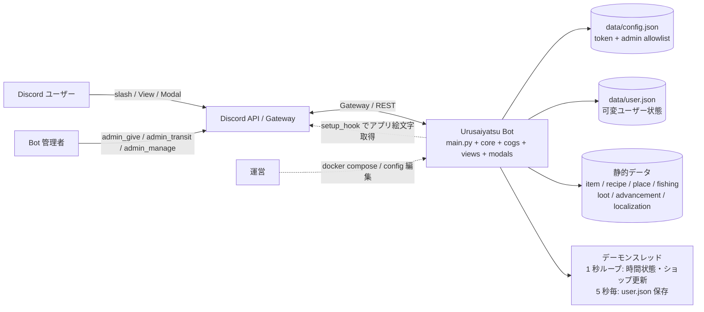

# Urusaiyatsu 機能カタログ（00-feature-catalog）

> **Phase1 成果物** — ソースコードを一次根拠として作成した、Phase2 仕様化への目次・トレーサビリティ台帳。
>
> - 本文書はソースコード解説ではなく、Phase2 で書く各仕様書のインデックスと追跡台帳である。
> - すべての「一次根拠」はリポジトリ内の相対パス + symbol で表記する。
> - 秘密実値（Discord token 実値、個人 ID、`data/config.json` の値）は記載しない。`config.json` の構造のみ `config.json.example` を根拠として記述する。
> - 対象コミット: `ca0dc10b78d252e4803e2a25a010290c39c339bb`（2026-08-06）。対象コミットの単一情報源は本文書と `CHANGELOG.md`。対象コミット時点の作業ツリーはクリーン（`git status` 確認済み）。本フェーズの書き込みは `docs/` 配下のみ。
> - 最終統合照合時点の状態：すべての機能 ID は「調査済 = 済」（ソース一次根拠を確認）・「詳細仕様化済 = 済」（詳細仕様書群 01〜11 + 12/13 で記述）・「静的照合 = 済」（コード・データとの静的な突合確認）・「実環境検証 = 未」（Discord ライブ・ビルドでの確認は未実施）。

---

## 1. 目的・境界・アクター・システムコンテキスト

### 1.1 目的

Urusaiyatsu は Discord 上で動作する採集・釣り・クラフト・経済を中心としたゲームボットである。
ユーザーはスラッシュコマンド / View（セレクト・ボタン）/ Modal で操作し、スタミナ・燃料・放射線・冷気などの時間ベース状態を持つ進行型ゲームを遊ぶ。
管理者（`ADMIN` 許可リスト）は `admin_*` コマンドでユーザーデータを直接操作できる。

### 1.2 境界

- **含む**: スラッシュコマンド 16 種、View 10 種、Modal 3 種、ゲーム契約（ユーザー初期化・インベントリ・統計・XP・weighted loot・派生価格）、起動ライフサイクル、1 秒/5 秒バックグラウンドジョブ、静的ゲームデータ 7 JSON、可変ユーザー状態 1 JSON、Docker 運用、Discord 統合。
- **含まない**: Web UI・REST サーバ・DB（永続化は JSON のみ）、認証基盤（Discord 本人認証のみ）、Prefix / Hybrid / Context / Group コマンド、メッセージコンテンツによるゲーム操作（`!` プレフィックスは設定のみで未使用）。

### 1.3 アクター

| アクター | 説明 | 主な操作 |
|---|---|---|
| Discord ユーザー | ゲームプレイヤー。未登録でもコマンド発火時に `new_user` で自動登録される | 全 `CMD-*`（admin 以外）、View 選択、Modal 入力 |
| Bot 管理者 | `config.json` の `admin[].id` で許可リスト化された Discord ユーザー | `admin_give` / `admin_transit` / `admin_manage` |
| Discord API | ゲートウェイ・アプリケーションコマンド・アプリ絵文字を提供する外部サービス | コマンド登録・実行・絵文字取得 |
| 運営（人間） | 設定・デプロイ・永続化ボリューム管理 | `data/config.json` 編集、docker compose 運用 |

### 1.4 システムコンテキスト図（Mermaid）

---

## 2. ID 規約と機能一覧

### 2.1 ID 規約

機能 ID は分類プレフィックス + 英数スネークケースで一意に付与する。Prefix は機能種別を表し、下記 9 分類・計 **59** 機能で構成する。

| プレフィックス | 分類 | 件数 |
|---|---|---|
| `CMD-` | スラッシュコマンド（グローバル） | 16 |
| `CTX-` | コマンド共通ゲーム契約 | 6 |
| `VIEW-` | `discord.ui.View` | 10 |
| `MODAL-` | `discord.ui.Modal` | 3 |
| `LIFE-` | ライフサイクル / Discord 起動処理 | 8 |
| `JOB-` | バックグラウンドジョブ | 2 |
| `DATA-` | データファイル | 9 |
| `OPS-` | config / 運用 / 権限 | 4 |
| `EXT-` | 外部統合 | 1 |

追跡表のステータス表記は `調査/詳細仕様化/静的照合/実環境検証` の四軸。最終統合照合時点では全機能 `調査済=済 / 詳細仕様化済=済 / 静的照合=済 / 実環境検証=未`（§6.2 の追跡表では省略形 `済/済/済/未` で表記する）。

> **DOM→CTX crosswalk（唯一の定義場所）**: Phase1 調査時に使った局所番号 `DOM-001`〜`DOM-006` は**別名**であり、canonical 機能 ID（計 59）には加えない。対応は `DOM-001=CTX-USER-INIT` / `DOM-002=CTX-INV-CRUD` / `DOM-003=CTX-STATS` / `DOM-004=CTX-XP` / `DOM-005=CTX-LOOT` / `DOM-006=CTX-VALUE`。仕様書群では canonical の CTX/CMD のみを使用し、DOM は本文書のこの crosswalk にのみ残す。

### 2.2 機能一覧（Commands / ゲーム契約）

| 機能ID | 概要 | トリガー | 担当コンポーネント | 一次根拠（相対パス+symbol） | Phase2 詳細仕様先 | 状態 |
|---|---|---|---|---|---|---|
| CMD-PING | bot のレイテンシを ms で応答 | `/ping` | `cogs/ping.py` | `cogs/ping.py:PingCog.pong_command` | `05-discord-interface/commands-information.md` | 済/済/済/未 |
| CMD-STATUS | 所持品・装備・レベル等のステータス表示（ページング） | `/status` | `cogs/status.py`, `views/status_view.py` | `cogs/status.py:StatusCog.view_command` | `05-discord-interface/commands-information.md` | 済/済/済/未 |
| CMD-EQUIP | アイテム装備 / 装備外し（View 経由） | `/equip` | `cogs/equip.py`, `views/equip_view.py` | `cogs/equip.py:EquipCog.equip_command`, `cogs/equip.py:equip` | `05-discord-interface/commands-gameplay.md`, `06-features/economy-and-equipment.md` | 済/済/済/未 |
| CMD-USE | 消費アイテム使用（スタミナ/燃料/放射線回復、loot 開封） | `/use` | `cogs/use.py` | `cogs/use.py:UseCog.use_command` | `05-discord-interface/commands-gameplay.md`, `06-features/progression-and-inventory.md` | 済/済/済/未 |
| CMD-GATHER | 採集（スタミナ・燃料消費、ツール耐久、放射線） | `/gather` | `cogs/gather.py` | `cogs/gather.py:GatherCog.gather_command` | `05-discord-interface/commands-gameplay.md`, `06-features/world-activities.md` | 済/済/済/未 |
| CMD-FISHING | 釣り（餌消費、釣りパワー、時間ボーナス） | `/fishing` | `cogs/fishing.py` | `cogs/fishing.py:FishingCog.fishing_command`, `cogs/fishing.py:get_fishing_loot_table` | `05-discord-interface/commands-gameplay.md`, `06-features/world-activities.md` | 済/済/済/未 |
| CMD-CRAFT | クラフト（View でレシピ選択 → Modal で個数） | `/craft` | `cogs/craft.py`, `views/craft_view.py`, `modals/craft_modal.py` | `cogs/craft.py:CraftCog.craft_command` | `05-discord-interface/commands-gameplay.md`, `06-features/world-activities.md` | 済/済/済/未 |
| CMD-SELL | アイテム売却（View で選択 → Modal で個数） | `/sell` | `cogs/sell.py`, `views/sell_view.py`, `modals/sell_modal.py` | `cogs/sell.py:SellCog.sell_command` | `05-discord-interface/commands-gameplay.md`, `06-features/economy-and-equipment.md` | 済/済/済/未 |
| CMD-BUY | ショップ購入（レベル 7 解放、View で商品選択） | `/buy` | `cogs/buy.py`, `views/shop_view.py` | `cogs/buy.py:BuyCog.shop_buy_command` | `05-discord-interface/commands-gameplay.md`, `06-features/economy-and-equipment.md` | 済/済/済/未 |
| CMD-REFUEL | 燃料補給（燃料 1 につき money 2 消費） | `/refuel` | `cogs/refuel.py` | `cogs/refuel.py:RefuelCog.refuel_command` | `05-discord-interface/commands-gameplay.md`, `06-features/economy-and-equipment.md` | 済/済/済/未 |
| CMD-ITEMDATA | アイテム詳細（基本情報/レシピ/入手情報、View で選択） | `/item_data` | `cogs/item_data.py`, `views/item_select_view.py` | `cogs/item_data.py:ItemDataCog.item_data_command`, `cogs/item_data.py:item_data` | `05-discord-interface/commands-information.md` | 済/済/済/未 |
| CMD-LEADERBOARD | 11 モードのランキング表示（トップ 10 + 自分の順位） | `/leaderboard` | `cogs/leaderboard.py` | `cogs/leaderboard.py:LeaderboardCog.leaderboard_command` | `05-discord-interface/commands-information.md` | 済/済/済/未 |
| CMD-SETTINGS | ユーザー設定変更（モーダル/トグル/View の 6 種） | `/settings` | `cogs/settings.py`, `views/settings_view.py`, `modals/settings_modal.py` | `cogs/settings.py:SettingsCog.settings_command` | `05-discord-interface/commands-information.md` | 済/済/済/未 |
| CMD-ADMGIVE | 管理者: ユーザーのアイテム増減（admin 権限必須） | `/admin_give` | `cogs/admin_give.py` | `cogs/admin_give.py:AdminGiveCog.admin_give_command` | `05-discord-interface/commands-administration.md`, `11-security-and-authorization.md` | 済/済/済/未 |
| CMD-ADMTRANSIT | 管理者: ユーザーデータを別ユーザーへ移行 | `/admin_transit` | `cogs/admin_transit.py` | `cogs/admin_transit.py:AdminTransitCog.admin_transit_command` | `05-discord-interface/commands-administration.md`, `11-security-and-authorization.md` | 済/済/済/未 |
| CMD-ADMMANAGE | 管理者: ユーザーデータを deepmerge で変更 | `/admin_manage` | `cogs/admin_manage.py` | `cogs/admin_manage.py:AdminManageCog.admin_manage_command` | `05-discord-interface/commands-administration.md`, `11-security-and-authorization.md` | 済/済/済/未 |

| 機能ID | 概要 | トリガー | 担当コンポーネント | 一次根拠（相対パス+symbol） | Phase2 詳細仕様先 | 状態 |
|---|---|---|---|---|---|---|
| CTX-USER-INIT | 新規ユーザーのデフォルト状態作成（未登録時の自動登録） | 各コマンド/View が冒頭で `await new_user(...)` を実行 | `core/utils.py` | `core/utils.py:new_user` | `06-features/progression-and-inventory.md` | 済/済/済/未 |
| CTX-INV-CRUD | インベントリ操作（追加/削除/変更/検索。スタック・メタ一致・インデックス指定を含む） | コマンド・View・Modal から呼び出し | `core/utils.py` | `core/utils.py:add_item`, `add_item_from_dict`, `modify_item`, `remove_item`, `remove_item_stacked`, `remove_item_from_dict`, `remove_item_from_index`, `remove_item_match_meta`, `get_item`, `get_item_stacked`, `get_item_index`, `get_item_match_meta` | `06-features/progression-and-inventory.md` | 済/済/済/未 |
| CTX-STATS | 装備・レベルから導出される数値ステータス計算（stamina_max / gathering_power / fishing_power 等 16 項目） | `get_stats()` を各機能が呼び出し | `core/utils.py` | `core/utils.py:get_stats` | `06-features/progression-and-inventory.md` | 済/済/済/未 |
| CTX-XP | 経験値付与・レベルアップ・進捗（advancement）達成判定 | `xp()` / `complete_advancement()` を採集・釣り・クラフト・使用で呼び出し | `core/utils.py` | `core/utils.py:xp`, `core/utils.py:complete_advancement` | `06-features/progression-and-inventory.md` | 済/済/済/未 |
| CTX-LOOT | 重み付きルートテーブル抽選（被り集計） | `table_roll()` を採集・釣り・loot 使用で呼び出し | `core/utils.py` | `core/utils.py:table_roll` | `06-features/world-activities.md` | 済/済/済/未 |
| CTX-VALUE | アイテム売値の再帰導出（レシピ素材合計）とショップ価格（`value*4` 既定） | 起動時 `set_item_value`、`buy`/`sell`/`item_data`/`leaderboard` で参照 | `core/state.py` | `core/state.py:set_item_value`, `core/state.py:Bot.setup_hook`（`price` setdefault） | `06-features/economy-and-equipment.md` | 済/済/済/未 |

### 2.3 機能一覧（View / Modal）

| 機能ID | 概要 | トリガー | 担当コンポーネント | 一次根拠（相対パス+symbol） | Phase2 詳細仕様先 | 状態 |
|---|---|---|---|---|---|---|
| VIEW-ITEMSELECT | 全アイテム 4 ページ分セレクトの選択 View（コールバック登録方式 + eval fallback） | `/item_data` 等が表示、ユーザーが選択 | `views/item_select_view.py` | `views/item_select_view.py:item_select`, `views/item_select_view.py:item_select_view`, `views/item_select_view.py:register_callback`, `views/item_select_view.py:_get_callback` | `05-discord-interface/interactions-views-and-modals.md` | 済/済/済/未 |
| VIEW-STATUSPAGING | ステータス表示の前後ページ送り View（custom_id でページ状態保持） | `/status`、ページボタン | `views/status_view.py` | `views/status_view.py:status_paging`, `views/status_view.py:view_status` | `05-discord-interface/interactions-views-and-modals.md` | 済/済/済/未 |
| VIEW-EQUIPSELECT | 装備可能アイテム選択 View（25/25/22 option/ページ・ページ送り） | `/equip` | `views/equip_view.py` | `views/equip_view.py:equip_select`, `views/equip_view.py:set_equip_func` | `05-discord-interface/interactions-views-and-modals.md` | 済/済/済/未 |
| VIEW-EQUIPREMOVE | 装備中アイテムの一覧から外す選択 View | `/equip` → `equip('remove_item')` | `views/equip_view.py` | `views/equip_view.py:remove_equip_choice` | `05-discord-interface/interactions-views-and-modals.md` | 済/済/済/未 |
| VIEW-CRAFTSELECT | 所持素材で作れるレシピの選択 View（25 件/ページ × 4 セレクト） | `/craft`、ページボタン | `views/craft_view.py` | `views/craft_view.py:craft_select`, `views/craft_view.py:craft_selecting` | `05-discord-interface/interactions-views-and-modals.md` | 済/済/済/未 |
| VIEW-SELLSELECT | 売却可能アイテムの選択 View（25 件/ページ × 4 セレクト） | `/sell`、ページボタン | `views/sell_view.py` | `views/sell_view.py:sell_select`, `views/sell_view.py:sell_selecting`, `views/sell_view.py:set_sell_func` | `05-discord-interface/interactions-views-and-modals.md` | 済/済/済/未 |
| VIEW-SHOP | ショップ商品（10 件）の購入選択 View | `/buy` | `views/shop_view.py` | `views/shop_view.py:shop_choice`, `views/shop_view.py:shop_buy` | `05-discord-interface/interactions-views-and-modals.md` | 済/済/済/未 |
| VIEW-SETTINGS-STATUS | ステータス短縮表示設定（自動/短縮/非短縮）選択 View | `/settings` config=2 | `views/settings_view.py` | `views/settings_view.py:status_setting_select`, `views/settings_view.py:status_setting_view` | `05-discord-interface/interactions-views-and-modals.md` | 済/済/済/未 |
| VIEW-SETTINGS-CRAFTREPL | クラフトツール破損時の交換設定（同種/使用可能/続行しない）選択 View | `/settings` config=3 | `views/settings_view.py` | `views/settings_view.py:crafting_tool_replacement_setting_select`, `views/settings_view.py:crafting_tool_replacement_setting_view` | `05-discord-interface/interactions-views-and-modals.md` | 済/済/済/未 |
| VIEW-SETTINGS-GATHERREPL | 採集ツール破損時の交換設定（同種/使用可能/続行しない）選択 View | `/settings` config=4 | `views/settings_view.py` | `views/settings_view.py:gathering_tool_replacement_setting_select`, `views/settings_view.py:gathering_tool_replacement_setting_view` | `05-discord-interface/interactions-views-and-modals.md` | 済/済/済/未 |

| 機能ID | 概要 | トリガー | 担当コンポーネント | 一次根拠（相対パス+symbol） | Phase2 詳細仕様先 | 状態 |
|---|---|---|---|---|---|---|
| MODAL-CRAFTQTY | クラフト個数入力 Modal（custom_id にレシピ index を格納） | クラフト View でレシピ選択 → `craft()` | `modals/craft_modal.py` | `modals/craft_modal.py:craft_amount`, `modals/craft_modal.py:craft`, `modals/craft_modal.py:craft_item` | `05-discord-interface/interactions-views-and-modals.md` | 済/済/済/未 |
| MODAL-SELLQTY | 売却個数入力 Modal（custom_id に index/page を格納） | 売却 View でアイテム選択 → `sell()` | `modals/sell_modal.py` | `modals/sell_modal.py:sell_amount`, `modals/sell_modal.py:sell`, `modals/sell_modal.py:sell_item` | `05-discord-interface/interactions-views-and-modals.md` | 済/済/済/未 |
| MODAL-NAME | ニックネーム変更 Modal（最大 32 文字） | `/settings` config=0 | `modals/settings_modal.py` | `modals/settings_modal.py:set_name` | `05-discord-interface/interactions-views-and-modals.md` | 済/済/済/未 |

### 2.4 機能一覧（ライフサイクル / Jobs / Data / Ops / Ext）

| 機能ID | 概要 | トリガー | 担当コンポーネント | 一次根拠（相対パス+symbol） | Phase2 詳細仕様先 | 状態 |
|---|---|---|---|---|---|---|
| LIFE-ENTRYPOINT | プロセスエントリポイント（`bot.run(TOKEN)`） | `python main.py` / Docker CMD | `main.py` | `main.py:6-7`（module guard `if __name__ == "__main__"`） | `07-event-processing/lifecycle.md`, `10-deployment-and-operations.md` | 済/済/済/未 |
| LIFE-IMPORT | import 時ブートストラップ（`os.chdir(DATA_DIR)`、静的 JSON 一括読込、user.json 自動作成、`config.json` 読込） | `core`（`core.state` / `core.config`）の import | `core/__init__.py`, `core/state.py`, `core/config.py` | `core/state.py:14`（chdir）, `core/state.py:27-49`（データ読込）, `core/config.py:12-15` | `07-event-processing/lifecycle.md`, `03-runtime-and-configuration.md` | 済/済/済/未 |
| LIFE-SETUP | `setup_hook`：起動前初期化全体のオーケストレーション | ゲートウェイ接続前 | `core/state.py` | `core/state.py:Bot.setup_hook` | `07-event-processing/lifecycle.md` | 済/済/済/未 |
| LIFE-EMOJI | アプリ絵文字を `fetch_application_emojis` で取得し ITEMS/EMOJIS へ反映 | setup_hook 内 | `core/state.py` | `core/state.py:97-102` | `08-external-integrations/discord.md` | 済/済/済/未 |
| LIFE-CHOICES | 起動時の Choice/選択リスト生成（item_choices, consumable_choices, equippable_choices, place_choices, fishing_choices, shop_list, equip_slot）とユーザー状態リフレッシュ（スタミナ全回復・advancement_now 再構築） | setup_hook 内 | `core/state.py` | `core/state.py:104-158`（選択リスト）, `core/state.py:160-176`（ユーザー初期化） | `07-event-processing/lifecycle.md` | 済/済/済/未 |
| LIFE-EXTLOAD | `cogs.EXTENSIONS` の動的拡張ロード（16 コグ） | setup_hook 内 | `cogs/__init__.py`, `core/state.py` | `cogs/__init__.py:EXTENSIONS`, `core/state.py:179-185` | `07-event-processing/lifecycle.md` | 済/済/済/未 |
| LIFE-TREESYNC | グローバルコマンドツリー同期（`self.tree.sync()`、guild 指定なし） | setup_hook 内 | `core/state.py` | `core/state.py:192` | `05-discord-interface/permissions-and-contexts.md` | 済/済/済/未 |
| LIFE-ONREADY | 起動完了時の存在感（Game status）設定 | ゲートウェイ接続完了 | `core/state.py` | `core/state.py:Bot.on_ready` | `07-event-processing/lifecycle.md` | 済/済/済/未 |

| 機能ID | 概要 | トリガー | 担当コンポーネント | 一次根拠（相対パス+symbol） | Phase2 詳細仕様先 | 状態 |
|---|---|---|---|---|---|---|
| JOB-TIMESTATE | 1 秒ループの時間状態更新（スタミナ回復・放射線減少・冷気減少・3600 tick 毎ショップ更新） | デーモンスレッド常駐ループ | `core/background.py` | `core/background.py:start_background_loop`, `core/background.py:TICK_RATE` | `07-event-processing/scheduled-and-background-jobs.md` | 済/済/済/未 |
| JOB-PERSIST | 5 秒毎の `user.json` 保存 | デーモンスレッド常駐ループ（5 tick 毎） | `core/background.py`, `core/utils.py` | `core/background.py:96-97`, `core/utils.py:save_users`, `core/background.py:SAVE_INTERVAL` | `07-event-processing/scheduled-and-background-jobs.md` | 済/済/済/未 |

| 機能ID | 概要 | トリガー | 担当コンポーネント | 一次根拠（相対パス+symbol） | Phase2 詳細仕様先 | 状態 |
|---|---|---|---|---|---|---|
| DATA-CONFIG | 設定テンプレート（`token` + `admin[].id` の最小構造） | 手動コピーで導入（`config.json.example` → `config.json`） | `data/config.json.example`, `core/config.py` | `data/config.json.example`, `core/config.py:12-20` | `04-data-model.md`, `03-runtime-and-configuration.md` | 済/済/済/未 |
| DATA-USER | 可変ユーザー状態（ユーザー単位のインベントリ・装備・レベル・設定・時刻タイムスタンプ） | 起動時読込・毎 5 秒保存・随時 save_users | `data/user.json`（git 管理外、Docker では `/app/runtime/user.json` の symlink） | `core/state.py:43-49`, `core/utils.py:save_users`, `Dockerfile:31-36`, `docker-entrypoint.sh:18-29` | `04-data-model.md` | 済/済/済/未 |
| DATA-ITEM | アイテム定義（229 件。tag / stats / value / price / shop_amount / max_damage / meta / stamina_restore / fuel_restore / radiation_remove / table / table_addition / equip_slot / equip_type） | 起動時 import | `data/item.json`, `core/state.py` | `data/item.json`, `core/state.py:29-30` | `04-data-model.md` | 済/済/済/未 |
| DATA-RECIPE | クラフトレシピ（179 件。result / type / tool_tag / stamina / xp / ingredient / default） | 起動時 import | `data/recipe.json`, `core/state.py` | `data/recipe.json`, `core/state.py:27-28` | `04-data-model.md` | 済/済/済/未 |
| DATA-PLACE | 採集場所（13 件。required_level / required_gathering_power / xp / table / radioactive） | 起動時 import | `data/place.json`, `core/state.py` | `data/place.json`, `core/state.py:31-32` | `04-data-model.md` | 済/済/済/未 |
| DATA-FISHING | 釣り場所（7 件。required_level / xp / table の power_min / power_max / weight） | 起動時 import | `data/fishing.json`, `core/state.py` | `data/fishing.json`, `core/state.py:33-34` | `04-data-model.md` | 済/済/済/未 |
| DATA-LOOT | loot テーブル（8 件。開封アイテム → 重み付き抽選） | 起動時 import | `data/loot.json`, `core/state.py` | `data/loot.json`, `core/state.py:35-36` | `04-data-model.md` | 済/済/済/未 |
| DATA-ADVANCEMENT | 進捗定義（116 件。title / description / complete_message / clear_condition / previous_advancement） | 起動時 import | `data/advancement.json`, `core/state.py` | `data/advancement.json`, `core/state.py:39-40` | `04-data-model.md` | 済/済/済/未 |
| DATA-LOCALIZATION | 表示名ローカライズ（41 キー。key → 日本語表示） | 起動時 import | `data/localization.json`, `core/state.py` | `data/localization.json`, `core/state.py:37-38` | `04-data-model.md` | 済/済/済/未 |

| 機能ID | 概要 | トリガー | 担当コンポーネント | 一次根拠（相対パス+symbol） | Phase2 詳細仕様先 | 状態 |
|---|---|---|---|---|---|---|
| OPS-CONFIG | config/運用（DATA_DIR 解決、config.json 読込、Docker secret 複製・権限降格、永続ボリューム） | 起動時・コンテナ起動 | `core/config.py`, `Dockerfile`, `docker-entrypoint.sh`, `compose.yaml` | `core/config.py:DATA_DIR`/`CONFIG`/`TOKEN`/`ADMIN`, `Dockerfile:31-37`, `docker-entrypoint.sh`, `compose.yaml` | `03-runtime-and-configuration.md` | 済/済/済/未 |
| OPS-ADMIN | アイデンティティ / 管理者許可リスト（`ADMIN` = `config.json` の `admin[].id`） | admin_* コマンド実行時の判定 | `core/config.py`, `cogs/admin_*.py` | `core/config.py:18-20`, `cogs/admin_give.py:22-24`, `cogs/admin_transit.py:23-25`, `cogs/admin_manage.py:24-26` | `11-security-and-authorization.md` | 済/済/済/未 |
| OPS-GLOBAL | グローバル公開（全サーバーに同期、guild 制限・`guild_only` なし、Discord のデフォルト権限に依存） | コマンドツリー同期 | `core/state.py` | `core/state.py:192`, `cogs/*.py`（guild 指定なし） | `05-discord-interface/permissions-and-contexts.md` | 済/済/済/未 |
| OPS-OWNERSHIP | コンポーネント所有（core = 状態/契約、cogs = コマンド、views = View、modals = Modal、data = データ、main = 起動） | 設計上の責務分割 | リポジトリ全体 | `core/__init__.py`, `cogs/__init__.py`, `views/__init__.py`, `modals/__init__.py` | `02-architecture.md` | 済/済/済/未 |

| 機能ID | 概要 | トリガー | 担当コンポーネント | 一次根拠（相対パス+symbol） | Phase2 詳細仕様先 | 状態 |
|---|---|---|---|---|---|---|
| EXT-DISCORD | Discord 外部統合（Gateway 接続、アプリコマンド、アプリ絵文字、Intents、存在感、グローバル同期） | 常時 | `core/state.py`, `main.py`, `cogs/*` | `core/state.py:Bot.__init__`（Intents）, `core/state.py:setup_hook`, `core/state.py:on_ready` | `08-external-integrations/discord.md` | 済/済/済/未 |

---

## 3. Commands / Interactions 完全カタログ

### 3.1 スラッシュコマンド一覧（全 16・グローバル）

`app_commands.command` によるスラッシュコマンドのみで構成される。`command_prefix="!"`（`core/state.py:90`）は設定されているが、プレフィックス（`@commands.command`）・Hybrid（`@commands.hybrid_command`）・Context Menu（`@commands.context_menu` / `@app_commands.context_menu`）・Group（`@app_commands.group` / `@commands.group`）は**一切存在しない**（grep で 0 件確認）。

| # | コマンド | 引数（型・必須性・default / choices） | 認可 | 応答公開性 | symbol（一次根拠） |
|---|---|---|---|---|---|
| 1 | `ping` | なし | 全ユーザー | ephemeral | `cogs/ping.py:PingCog.pong_command` |
| 2 | `status` | なし | 全ユーザー | 公開（`send_message`、非 ephemeral） | `cogs/status.py:StatusCog.view_command` |
| 3 | `equip` | なし（選択は View `VIEW-EQUIPSELECT` / `VIEW-EQUIPREMOVE`） | 全ユーザー | View は ephemeral、装備結果は公開 | `cogs/equip.py:EquipCog.equip_command` |
| 4 | `use` | `item_id: str`（必須・choices=`consumable_choices` ※起動時生成: 消費可能 17 件）／ `count: int`（任意・default=1） | 全ユーザー | 公開 | `cogs/use.py:UseCog.use_command` |
| 5 | `gather` | `place: str`（必須・choices=`place_choices` ※起動時生成: 採集場所 13 件）／ `count: int`（任意・default=1） | 全ユーザー | 公開 | `cogs/gather.py:GatherCog.gather_command` |
| 6 | `fishing` | `place: str`（必須・choices=`fishing_choices` ※起動時生成: 釣り場所 7 件）／ `count: int`（任意・default=1） | 全ユーザー | 公開 | `cogs/fishing.py:FishingCog.fishing_command` |
| 7 | `craft` | なし（選択は View `VIEW-CRAFTSELECT`、個数は Modal `MODAL-CRAFTQTY`） | 全ユーザー | View は ephemeral、クラフト結果は公開 | `cogs/craft.py:CraftCog.craft_command` |
| 8 | `sell` | なし（選択は View `VIEW-SELLSELECT`、個数は Modal `MODAL-SELLQTY`） | 全ユーザー | View は ephemeral、売却結果は公開 | `cogs/sell.py:SellCog.sell_command` |
| 9 | `buy` | なし（商品は View `VIEW-SHOP` で選択）※レベル 7 未満は実行不可 | 全ユーザー（ゲート: `level_global >= 7`） | View は ephemeral、購入結果は公開 | `cogs/buy.py:BuyCog.shop_buy_command` |
| 10 | `refuel` | `amount: int`（必須・正数） | 全ユーザー | 公開 | `cogs/refuel.py:RefuelCog.refuel_command` |
| 11 | `item_data` | なし（アイテム選択は View `VIEW-ITEMSELECT`） | 全ユーザー | ephemeral | `cogs/item_data.py:ItemDataCog.item_data_command` |
| 12 | `leaderboard` | `mode: int`（必須・choices 0–10） | 全ユーザー | 公開 | `cogs/leaderboard.py:LeaderboardCog.leaderboard_command` |
| 13 | `settings` | `config: int`（必須・choices 0–5） | 全ユーザー | トグル/View は ephemeral、名前変更結果は公開 | `cogs/settings.py:SettingsCog.settings_command` |
| 14 | `admin_give` | `user: discord.User`（必須）／ `item_id: str`（必須）／ `amount: int`（必須・0 以外） | `ADMIN` 許可リスト | ephemeral | `cogs/admin_give.py:AdminGiveCog.admin_give_command` |
| 15 | `admin_transit` | `user_datarom: discord.User`（必須・※パラメータ名のタイポそのまま）／ `user_to: discord.User`（必須） | `ADMIN` 許可リスト | ephemeral | `cogs/admin_transit.py:AdminTransitCog.admin_transit_command` |
| 16 | `admin_manage` | `user: discord.User`（必須）／ `data: str`（必須・`ast.literal_eval` で dict 変換） | `ADMIN` 許可リスト | ephemeral | `cogs/admin_manage.py:AdminManageCog.admin_manage_command` |

`leaderboard` の `mode` 選択肢（`cogs/leaderboard.py:19-31`）:
`0`=スコア、`1`=総合レベル、`2`=採集レベル、`3`=釣りレベル、`4`=目標達成数、`5`=総資産、`6`=コイン、`7`=スタミナ、`8`=燃料、`9`=アイテム数、`10`=放射線被爆量。

`settings` の `config` 選択肢（`cogs/settings.py:21-28`）:
`0`=ニックネーム変更（Modal `MODAL-NAME`）、`1`=ニュースと目標の表示トグル、`2`=ステータス短縮表示（View `VIEW-SETTINGS-STATUS`）、`3`=クラフトツール交換（View `VIEW-SETTINGS-CRAFTREPL`）、`4`=採集ツール交換（View `VIEW-SETTINGS-GATHERREPL`）、`5`=釣り餌切れ時続行トグル。

### 3.2 View 一覧（全 10）

全 View は `discord.ui.View` のサブクラスで、`__init__` で **`timeout=180` を明示宣言**している（各 `views/*.py` の `__init__(self, timeout=180)`）。

| # | 機能ID | クラス | 用途 | timeout（宣言） | symbol（一次根拠） |
|---|---|---|---|---|---|
| 1 | VIEW-ITEMSELECT | `item_select` | 全アイテムから選択（25 件/セレクト × 4、ページ送り）。コールバックは `register_callback` で登録し custom_id に格納 | 180 秒（明示） | `views/item_select_view.py:item_select` |
| 2 | VIEW-STATUSPAGING | `status_paging` | ステータス Embed の前後ページ送り（custom_id=`user_id/page/page_max/short` で状態保持） | 180 秒（明示） | `views/status_view.py:status_paging` |
| 3 | VIEW-EQUIPSELECT | `equip_select` | 装備可能アイテムの選択（equippable 69 件、25/25/22 option/ページ） | 180 秒（明示） | `views/equip_view.py:equip_select` |
| 4 | VIEW-EQUIPREMOVE | `remove_equip_choice` | 装備中アイテムの一覧から外す選択 | 180 秒（明示） | `views/equip_view.py:remove_equip_choice` |
| 5 | VIEW-CRAFTSELECT | `craft_select` | 所持素材で作れるレシピの選択（25 件/セレクト × 4） | 180 秒（明示） | `views/craft_view.py:craft_select` |
| 6 | VIEW-SELLSELECT | `sell_select` | 売却アイテムの選択（25 件/セレクト × 4、value 表示） | 180 秒（明示） | `views/sell_view.py:sell_select` |
| 7 | VIEW-SHOP | `shop_choice` | ショップ商品（10 件）の購入選択 | 180 秒（明示） | `views/shop_view.py:shop_choice` |
| 8 | VIEW-SETTINGS-STATUS | `status_setting_select` | ステータス短縮表示設定（auto/short/normal） | 180 秒（明示） | `views/settings_view.py:status_setting_select` |
| 9 | VIEW-SETTINGS-CRAFTREPL | `crafting_tool_replacement_setting_select` | クラフトツール交換設定（same/usable/never） | 180 秒（明示） | `views/settings_view.py:crafting_tool_replacement_setting_select` |
| 10 | VIEW-SETTINGS-GATHERREPL | `gathering_tool_replacement_setting_select` | 採集ツール交換設定（same/usable/never） | 180 秒（明示） | `views/settings_view.py:gathering_tool_replacement_setting_select` |

### 3.3 Modal 一覧（全 3）

Modal は **timeout を明示宣言していない**（`__init__` に `timeout=` 指定なし）。フレームワーク既定値に依存するため、本カタログでは確定できる宣言値を記さない。

| # | 機能ID | クラス | 入力項目 | timeout | symbol（一次根拠） |
|---|---|---|---|---|---|
| 1 | MODAL-CRAFTQTY | `craft_amount` | テキスト入力「クラフトする個数」（`max_length=8`）。custom_id = レシピ index | 未宣言（明示値なし） | `modals/craft_modal.py:craft_amount` |
| 2 | MODAL-SELLQTY | `sell_amount` | テキスト入力「売却する個数」（`max_length=8`）。custom_id = `index/page` | 未宣言（明示値なし） | `modals/sell_modal.py:sell_amount` |
| 3 | MODAL-NAME | `set_name` | テキスト入力「新しいニックネーム」（`max_length=32`） | 未宣言（明示値なし） | `modals/settings_modal.py:set_name` |

### 3.4 Prefix / Hybrid / Context / Group について

- **Prefix コマンド**: なし。`command_prefix="!"`（`core/state.py:90`）は設定のみで、`@commands.command` による登録は存在しない。
- **Hybrid コマンド**: なし。
- **Context Menu コマンド**: なし（`@app_commands.context_menu` / `@commands.context_menu` なし）。
- **Group コマンド**: なし（`@app_commands.group` / `@commands.group` なし）。
- 全 16 コマンドは `@app_commands.command(name=..., description=...)` のみで、guild 指定・`guild_only`・`default_permissions` 修飾なし。よってコマンドの認可は (a) 全ユーザー実行可 と (b) `ADMIN` 許可リスト内チェック（admin_* 3 コマンドのコマンド内判定）の 2 種のみ。

---

## 4. events / jobs / external integrations / datastores 一覧

### 4.1 イベント

| イベント | 発生タイミング | 処理内容 | 一次根拠 |
|---|---|---|---|
| `setup_hook` | ゲートウェイ接続前 | 絵文字取得・選択リスト生成・ユーザー状態リフレッシュ・拡張ロード・背景スレッド起動・ツリー同期 | `core/state.py:Bot.setup_hook` |
| `on_ready` | ゲートウェイ接続完了 | Game status（存在感）設定（失敗は握りつぶし） | `core/state.py:Bot.on_ready` |
| スラッシュコマンド実行 | ユーザーがコマンド発火 | 各 `CMD-*` のハンドラ | 各 `cogs/*.py` |
| View のボタン/セレクト | ユーザーが View を操作 | ページ送り・選択・購入・設定反映・装備・クラフト/売却の Modal 起動 | 各 `views/*.py` |
| Modal `on_submit` | ユーザーが Modal を送信 | クラフト・売却・ニックネーム変更の実処理 | `modals/craft_modal.py:craft_amount.on_submit`, `modals/sell_modal.py:sell_amount.on_submit`, `modals/settings_modal.py:set_name.on_submit` |
| バックグラウンドループ | デーモンスレッド常駐（約 1 秒周期） | 時間状態更新・ショップ更新・5 秒毎保存 | `core/background.py:start_background_loop` |

※ エラーハンドリングイベント（`on_command_error` / `tree.error` / `add_error_handler`）は**未登録**（grep 0 件）。例外時は Discord クライアント既定の「interaction failed」になる。

### 4.2 バックグラウンドジョブ

| ジョブ | 周期 | 内容 | 一次根拠 |
|---|---|---|---|
| JOB-TIMESTATE | 1 秒（`TICK_RATE=1`） | スタミナ回復（`stamina_regeneration_rate` 由来の所要時間経過判定）、放射線減少、冷気減少、3600 tick 毎にショップ再抽選（レベル 7 以上のユーザー対象） | `core/background.py:11`, `core/background.py:20-92` |
| JOB-PERSIST | 5 秒（`SAVE_INTERVAL=5`） | `save_users()` で `user.json` へ直接書込 | `core/background.py:12`, `core/background.py:95-97` |

### 4.3 外部統合

| 統合先 | 内容 | 一次根拠 |
|---|---|---|
| Discord Gateway / REST | ゲートウェイ接続、Intents（`message_content` / `messages` / `members` / `reactions` + default）、アプリケーションコマンド実行、存在感 | `core/state.py:84-90`, `core/state.py:195-201` |
| Discord アプリ絵文字 | `fetch_application_emojis()` で取得し ITEMS の `emoji` / EMOJIS に反映 | `core/state.py:97-102` |
| Docker secret / ボリューム | `config.json` を secret として tmpfs へ複製、`user.json` を永続ボリュームへ symlink | `compose.yaml:33-38`, `Dockerfile:31-37`, `docker-entrypoint.sh` |

※ その他の外部サービス（DB・Web API・HTTP サーバ等）は存在しない。永続化はファイルシステムのみ。

### 4.4 データストア

| ファイル | 種別 | 規模（Phase1 調査時点） | 役割 | 一次根拠 |
|---|---|---|---|---|
| `data/config.json` | 設定（git 管理外・Docker では secret） | `token` + `admin[].id` の最小構造 | 接続トークン・管理者リスト | `data/config.json.example`, `core/config.py` |
| `data/user.json` | 可変状態（git 管理外・起動時なければ自動作成） | ユーザー数分（デフォルト構造は `core/utils.py:new_user`） | 全プレイヤー状態の永続化（5 秒毎・随時保存） | `core/state.py:43-49`, `core/utils.py:save_users` |
| `data/item.json` | 静的ゲームデータ | 229 アイテム | アイテム定義・tag/stats/価格・消費・装備情報 | `core/state.py:29-30` |
| `data/recipe.json` | 静的ゲームデータ | 179 レシピ | クラフトレシピ（素材・スタミナ・XP・ツールタグ） | `core/state.py:27-28` |
| `data/place.json` | 静的ゲームデータ | 13 場所 | 採集場所（要求レベル/パワー・XP・重み付きテーブル・放射線） | `core/state.py:31-32` |
| `data/fishing.json` | 静的ゲームデータ | 7 場所 | 釣り場所（要求レベル・XP・power_min/power_max 付きテーブル） | `core/state.py:33-34` |
| `data/loot.json` | 静的ゲームデータ | 8 テーブル | 開封アイテムの重み付き抽選テーブル | `core/state.py:35-36` |
| `data/advancement.json` | 静的ゲームデータ | 116 進捗 | 進捗定義（タイトル・達成条件・前提進捗） | `core/state.py:39-40` |
| `data/localization.json` | 静的ゲームデータ | 41 キー | キー → 日本語表示の翻訳 | `core/state.py:37-38` |

---

## 5. 現行実装上の懸念と未検証事項

> **断定はコードで直接確定できる範囲に限定**する。実行時挙動の確認が必要な項目は §5.2「未検証/未確定」に分離した。

### 5.1 確認済みの現行実装上の懸念

| ID | 懸念 | 確定根拠（コード/データ） | 影響 |
|---|---|---|---|
| C-01 | **dependency lock の deepmerge 欠落** | `requirements.lock`（全 11 パッケージ）に `deepmerge` が**含まれない**。一方 `requirements.txt:8` に `deepmerge>=2.1.0`、`cogs/admin_manage.py:8` で `from deepmerge import always_merger`。`Dockerfile:19` は `pip install --no-deps --requirement requirements.lock` | Docker イメージに deepmerge が入らず、`setup_hook` の `load_extension`（`core/state.py:179-185`）で `admin_manage` のみロード失敗する可能性。ローカル（`requirements.txt` 使用）では入るため環境差が発生 |
| C-02 | **admin_give の負数剥奪が加算になる** | `cogs/admin_give.py:45` が負の `amount` を `remove_item` へ渡す。`core/utils.py:135` `count = min(count, inv_item['count'])` は負数を維持し、`core/utils.py:138` `inv_item['count'] -= count` で**加算**される | 負の `amount` 指定で剥奪どころかアイテムが増える |
| C-03 | **inventory pop bug（`list.pop` に辞書を渡す）** | `core/utils.py:212` `user_data['inventory'].pop(inv_item)` — `list.pop` は index を期待し、dict を渡すと `TypeError`。呼び出し元は `modals/craft_modal.py:126`（ツール破損時） | クラフトでツール耐久が `max_damage` に達したとき例外 → Interaction Failed。補足: `core/utils.py:147-171` の `remove_item_stacked(required=True)` はリスト浅コピー（dict は共有参照）のため、在庫不足時に実インベントリが**部分消費されたまま** `[]` を返す |
| C-04 | **accessory stats が反映されない** | `core/utils.py:352-362` のアクセサリー分岐は `user_stat = user_stats[item_stat['id']]` でローカルコピーして加算/乗算するが、`user_stats[...]` へ**書き戻していない**。非アクセサリー分岐（`core/utils.py:364-371`）は書き戻す | アクセサリー（27 種）の stats が一切のステータス計算に影響しない |
| C-05 | **settings / leaderboard がユーザー未登録（`new_user` 不在）** | `cogs/settings.py:31` で `USERS[str(user_id)]` を直接参照、`cogs/leaderboard.py:97` で `list(board.keys()).index(str(user_id))`。両ファイルとも `new_user` 呼び出し 0 件（grep 確認）。なお両 cog は `cogs/__init__.py:12-13` の `EXTENSIONS` に登録済み | 初回利用（USERS 未登録）ユーザーが `/settings` で `KeyError`、`/leaderboard` で `ValueError` |
| C-06 | **advancement 参照欠落** | `data/advancement.json` の `craft_drill_c1` / `craft_drill_i1` / `gather_ore_hallow` が**存在しない** `craft_drill_engine` を `previous_advancement` に参照（スクリプトで検出） | この 3 件は前提達成判定（`core/utils.py:386-394`）で常に false となり**永久に解放されない**。加えて `complete_advancement` は `prev_adv is None` を未達成扱いにする（`core/utils.py:389-391`）一方、`setup_hook` は達成扱い（`core/state.py:171-173`）と判定が食い違う（現状 null 前提は `gather_forest` のみで初期付与済みのため顕在化していない） |
| C-07 | **非 atomic・無 lock 永続化** | `core/utils.py:454-457` `save_users` は `user.json` へ直接 `json.dump`（一時ファイル + rename なし・lock なし）。`core/background.py:96-97` の 5 秒毎保存と、各コマンドハンドラの随時 `save_users` が並走 | クラッシュ時・同時書き込み時に破損リスク。`AGENTS.md` も単一レプリカ運用を明示 |
| C-08 | **user.json 読込の裸 `except`** | `core/state.py:43-49` の `except:`（例外型指定なし）が JSON 破損・I/O エラー等をすべて握りつぶし、`{}` で上書き | `user.json` が破損している場合に全ユーザーデータをリセットしてしまう |
| C-10 | **tick 基準ショップ** | `core/background.py:29` `if ticks % 3600 == 0` はプロセス起動からの秒数基準で、壁時計（1 時間ごと）ではない | 再起動でショップ更新周期がずれ、時刻とローテーションが非同期 |
| C-11 | **eval fallback** | `views/item_select_view.py:140-145` `_get_callback` が未登録名を `eval(name)` で解決 | コールバック名が不正なら任意コード実行に至り得る（現状は内部定数 `'item_data'` のみ渡される）。`AGENTS.md` も名前の内部保持を要請 |
| C-12 | **エラー/観測不足** | `logging` 不使用（print のみ、例: `core/state.py:94,148,193`）。エラーハンドラ未登録（`on_command_error` / `tree.error` / `add_error_handler` が grep 0 件）。拡張ロード失敗も `core/state.py:184-185` で print のみ | 例外は Discord 側で「interaction failed」となるだけで、原因・内部状態の観測手段がない。運用監視・障害解析が困難 |
| C-13 | **tests / CI 欠如** | テストファイル・pytest/unittest 設定・CI 設定（`.github` 等）が存在しない（ファイルシステム確認）。`AGENTS.md` も自動テストなしを明記 | 回帰検知手段なし。検証は `compileall` のみ |
| C-14 | **equip の空判定デッドコード** | `cogs/equip.py:34` `if len(equip_choices) < 0:` は常に false | 「アイテムを装備していません」は到達不能。未装備時に空セレクト付き View を送信する |
| C-16 | **`/use` 非正数 count の入力検証なし** | `cogs/use.py:21` の `count: int = 1` に正数ガードがない。負数を `remove_item_stacked`（`core/utils.py:172-185`）へ渡すと `remove_count = min(count - removed, ...)` が負数になり在庫が**増え**、効果（スタミナ/燃料回復・放射線除去）が**反転**する（`cogs/use.py:38-93`）。`con_loot` は `table_roll` の `random.choices(..., k=負数)` が空 list を返すため結果 `{}` になり、loot なしで処理が継続する | 負数指定で在庫増加・効果反転・`con_loot` は loot なしの応答になる。`count=0` は 0 効果の応答になる |
| C-17 | **background の `USERS.items()` 反復とトップレベル mutation の race** | `core/background.py:22` が `USERS.items()` を反復走査する最中に、イベントループ側の `new_user`（`core/utils.py:17` `USERS.setdefault`）や `admin_transit`（`cogs/admin_transit.py:33-36` `USERS.pop`/`USERS.setdefault`）が**トップレベルキーを追加/削除**すると `RuntimeError: dictionary changed size during iteration` になり得る。ループに try/except がない（`core/background.py:14-99`）ため、発生するとデーモンスレッドが終了し JOB-TIMESTATE / JOB-PERSIST が以後停止 | 時間状態更新・5 秒保存のサイレント停止。必発・頻度は未検証（U-13）。※C-07 のファイル書込 race とは別のメモリミューテーション race |
| C-18 | **`new_user` の `bot.fetch_user` が未捕捉** | `core/utils.py:18` `user = await bot.fetch_user(user_id)` に try/except がない。失敗時は例外が呼び出し元ハンドラへそのまま伝播する（未捕捉である事実のみ確定） | 新規登録経路（全ゲーム系コマンド冒頭）で Discord API 障害時に登録・処理が失敗する。例外型・ユーザーへの UI は未検証（U-14） |
| C-19 | **cooldown / max_concurrency / フレームワーク権限チェック / 共通 interaction_check 不在** | 全 16 コマンド・10 View・3 Modal に `@app_commands.checks` / `max_concurrency` / `@commands.has_permissions` / 共通 `interaction_check` が**一切存在しない**（grep 0 件） | 実行間隔・同時実行数・権限・View 所有者の制御がコード上にない（管理者判定は `ADMIN` リストのみ、C-05 / AUT-002）。導入要否・値は未検証（U-15） |
| C-20 | **use / gather / fishing の count 非正数ガード・上限不在** | `cogs/use.py:21` / `cogs/gather.py:21` / `cogs/fishing.py:23` の `count: int = 1` に非正数ガードと上限チェックがない（grep 確認）。負数の詳細は C-16、上限不在のため高 `count` 指定でループが長大化し得る | 入力境界の未定義。具体的な挙動は推測せず実機確認が必要（未検証） |
| C-21 | **stale shop choice の `index` ValueError** | `views/shop_view.py:27` `user_data['shop_content'].index(item_id)` は、View 表示後にショップ再抽選（`core/background.py:29-35`）で `shop_content` が更新されると stale な `item_id` に `ValueError` を起こし得る | 表示済み購入 View の選択が「interaction failed」になる可能性 |
| C-22 | **未使用の `set_craft_func` / `_craft_func` デッドコード** | `views/craft_view.py:12-19` の `_craft_func` / `set_craft_func` は定義のみで、登録元・呼び出し元ともに存在しない（クラフトは `modals/craft_modal.py:craft` を直接 import、`views/craft_view.py:9`） | 不要なグローバル注入フック。保守性の低下（grep で登録 0 件確認） |

### 5.2 未検証 / 未確定

| ID | 項目 | 内容 | 確定に必要な確認 |
|---|---|---|---|
| U-01 | deepmerge 欠落の実行時影響 | C-01 はコード・ロック比較で確定だが、Docker ビルドが実際に失敗するかはビルド/起動で未確認 | `docker compose build` で `admin_manage` ロード可否を確認 |
| U-02 | inventory pop bug の発火条件 | C-03 の `pop(dict)` はコードで確定だが、耐久 0 到達クラフトが実際に起こるか（＝実ユーザーに影響が出るか）は未検証 | 耐久が `max_damage` に達するクラフトの実行 |
| U-03 | Modal のタイムアウト値 | 3 Modal とも `timeout` を宣言していない。フレームワーク既定値に依存（**View の 180 秒と同じとは断定しない**） | discord.py 既定値の確認、または明示化の要否 |
| U-04 | View / Modal 破棄後操作・二重応答 | timeout 超過後や既応答 Interaction への再編集（例: `views/sell_view.py:114,146` の `edit_original_response`）の実挙動は未検証 | 実機での操作 |
| U-05 | sell_modal の応答済み Interaction 編集 | `modals/sell_modal.py:60` が `original_interaction`（モーダル表示済みの選択 Interaction）に対して `sell_selecting` を実行する際の挙動は未検証 | 実機での売却フロー |
| U-06 | ショップ抽出の再抽選重複 | `core/background.py:29-35` は現ショップ品を除外して `random.sample(shop_data, 10)` するが、shop_list 31 件に対し 10 枠の整合は未検証 | ローテーション実行の観察 |
| U-07 | leaderboard の順位算出コスト | `cogs/leaderboard.py:96-97` は全ユーザーをソートし `list(board.keys()).index(...)` で線形探索 | ユーザー数増加時の実測 |
| U-08 | アプリ絵文字と ITEMS の整合 | `core/state.py:97-102` で絵文字が見つからない場合のフォールバック表示（`:item_id:` 文字列）は実運用での見え方未確認 | 絵文字未設定での表示確認 |
| U-09 | 複数インスタンス同時実行 | `AGENTS.md` が単一レプリカを要請（同時書込による破損警告）。実際の多重起動挙動は未検証 | 多重起動テスト |
| U-10 | item_data の釣り確率近似 | `cogs/item_data.py:122-127` は `power_min` と `power_max` の中間値 `p` で確率を近似表示するが、実際の釣りロール（`cogs/fishing.py:get_fishing_loot_table`）の条件と完全一致するか未検証 | 確率表示と実ロールの突合 |
| U-11 | 釣りの時刻ボーナス | `cogs/fishing.py:170` `int((20 - abs(hour - 6)) / 3)` の時刻ボーナス式のバランス意図は文書化されておらず未確定 | Phase2 での数式仕様化 |
| U-12 | ゲームバランス数値 | スタミナ回復速度 20/h、`level_next = int((lv+1)**1.5)*5`、ショップ価格 `value*4` 等の数値はコード上の既定であり、意図されたバランスかは未確定 | Phase2 での仕様定義 |
| U-13 | C-17 の race の発生頻度 | `USERS.items()` 反復と `new_user` / `admin_transit` の top-level mutation が同時に起きる頻度（新規登録・データ移行の実行タイミングとループ走査の重なり）。**必発ではない** | 新規登録・`admin_transit` 実行下での長期観察 / 競合テスト |
| U-14 | `new_user` の `fetch_user` 失敗の例外型・UI | C-18 は「未捕捉であること」まで確定。実際の例外型（`discord.HTTPException` / `Forbidden` / `NotFound` 等）とユーザーへの表示は**断定しない** | Discord API 障害時の新規登録実行で観測 |
| U-15 | cooldown / max_concurrency / 権限チェック / interaction_check の導入要否・値 | C-19 は「不在」まで確定。導入するか、導入する場合の値（クールダウン秒数・同時実行数・適用範囲）は未確定 | 運用要件の決定・実機確認 |

---

## 6. Phase2 チェックリストと追跡表

### 6.1 現行ドキュメント構成

| ファイル | 主な対象（機能 ID） |
|---|---|
| [01-system-overview.md](01-system-overview.md) | 全体像・ゲームコンセプト・用語（全機能の上位要約） |
| [02-architecture.md](02-architecture.md) | アーキテクチャ・コンポーネント責務（OPS-OWNERSHIP） |
| [03-runtime-and-configuration.md](03-runtime-and-configuration.md) | 起動・設定・Docker（OPS-CONFIG, LIFE-IMPORT, DATA-CONFIG） |
| [04-data-model.md](04-data-model.md) | データモデル（DATA-* 全 9） |
| [05-discord-interface/README.md](05-discord-interface/README.md) | Discord インターフェース全体案内 |
| [05-discord-interface/commands-gameplay.md](05-discord-interface/commands-gameplay.md) | CMD-EQUIP, USE, GATHER, FISHING, CRAFT, SELL, BUY, REFUEL |
| [05-discord-interface/commands-information.md](05-discord-interface/commands-information.md) | CMD-PING, STATUS, ITEMDATA, LEADERBOARD, SETTINGS |
| [05-discord-interface/commands-administration.md](05-discord-interface/commands-administration.md) | CMD-ADMGIVE, ADMTRANSIT, ADMMANAGE |
| [05-discord-interface/interactions-views-and-modals.md](05-discord-interface/interactions-views-and-modals.md) | VIEW-* 全 10, MODAL-* 全 3 |
| [05-discord-interface/permissions-and-contexts.md](05-discord-interface/permissions-and-contexts.md) | OPS-GLOBAL, LIFE-TREESYNC, 認可・公開性 |
| [06-features/progression-and-inventory.md](06-features/progression-and-inventory.md) | CTX-USER-INIT, CTX-INV-CRUD, CTX-STATS, CTX-XP, CMD-USE |
| [06-features/economy-and-equipment.md](06-features/economy-and-equipment.md) | CTX-VALUE, CMD-EQUIP, CMD-SELL, CMD-BUY, CMD-REFUEL |
| [06-features/world-activities.md](06-features/world-activities.md) | CTX-LOOT, CMD-GATHER, CMD-FISHING, CMD-CRAFT |
| [07-event-processing/lifecycle.md](07-event-processing/lifecycle.md) | LIFE-* 全 8 |
| [07-event-processing/scheduled-and-background-jobs.md](07-event-processing/scheduled-and-background-jobs.md) | JOB-* 全 2 |
| [08-external-integrations/README.md](08-external-integrations/README.md) | 外部統合全体案内 |
| [08-external-integrations/discord.md](08-external-integrations/discord.md) | EXT-DISCORD, LIFE-EMOJI |
| [09-error-handling-and-observability.md](09-error-handling-and-observability.md) | C-12 等のエラー/観測契約 |
| [10-deployment-and-operations.md](10-deployment-and-operations.md) | LIFE-ENTRYPOINT, OPS-CONFIG（運用） |
| [11-security-and-authorization.md](11-security-and-authorization.md) | OPS-ADMIN, CMD-ADM*（権限） |
| [12-testable-acceptance-criteria.md](12-testable-acceptance-criteria.md) | 受入条件（C-13 への対応含む） |
| [13-open-questions-and-technical-debt.md](13-open-questions-and-technical-debt.md) | §5 の懸念・未検証事項の引き継ぎ |

※ 上記は**現行のドキュメント構成**であり、各パスはすべて実在する文書で、本文書（`docs/00-feature-catalog.md`）からの相対リンクとして参照できる（§6.2 追跡表の「詳細仕様先」も同じ割り当て）。対象コミットの単一情報源は本文書と `CHANGELOG.md` とする。

### 6.2 機能 ID 追跡表（全 59）

状態の四軸: **調査済**（ソース一次根拠確認）／ **詳細仕様化済み**／ **静的照合**（コード・データとの静的な突合確認）／ **実環境検証**。最終統合照合時点: 調査済 = 済、詳細仕様化済み = 済、静的照合 = 済、実環境検証 = 未（下記「根拠」は一次根拠の代表 1 件）。

#### Commands（16）

| 機能ID | 調査済 | 詳細仕様化済み | 静的照合 | 実環境検証 | 根拠 | 詳細仕様先 |
|---|---|---|---|---|---|
| CMD-PING | 済 | 済 | 済 | 未 | `cogs/ping.py:PingCog.pong_command` | `05-discord-interface/commands-information.md` |
| CMD-STATUS | 済 | 済 | 済 | 未 | `cogs/status.py:StatusCog.view_command` | `05-discord-interface/commands-information.md` |
| CMD-EQUIP | 済 | 済 | 済 | 未 | `cogs/equip.py:EquipCog.equip_command` | `05-discord-interface/commands-gameplay.md` |
| CMD-USE | 済 | 済 | 済 | 未 | `cogs/use.py:UseCog.use_command` | `05-discord-interface/commands-gameplay.md` |
| CMD-GATHER | 済 | 済 | 済 | 未 | `cogs/gather.py:GatherCog.gather_command` | `05-discord-interface/commands-gameplay.md` |
| CMD-FISHING | 済 | 済 | 済 | 未 | `cogs/fishing.py:FishingCog.fishing_command` | `05-discord-interface/commands-gameplay.md` |
| CMD-CRAFT | 済 | 済 | 済 | 未 | `cogs/craft.py:CraftCog.craft_command` | `05-discord-interface/commands-gameplay.md`, `06-features/world-activities.md` |
| CMD-SELL | 済 | 済 | 済 | 未 | `cogs/sell.py:SellCog.sell_command` | `05-discord-interface/commands-gameplay.md` |
| CMD-BUY | 済 | 済 | 済 | 未 | `cogs/buy.py:BuyCog.shop_buy_command` | `05-discord-interface/commands-gameplay.md` |
| CMD-REFUEL | 済 | 済 | 済 | 未 | `cogs/refuel.py:RefuelCog.refuel_command` | `05-discord-interface/commands-gameplay.md` |
| CMD-ITEMDATA | 済 | 済 | 済 | 未 | `cogs/item_data.py:ItemDataCog.item_data_command` | `05-discord-interface/commands-information.md` |
| CMD-LEADERBOARD | 済 | 済 | 済 | 未 | `cogs/leaderboard.py:LeaderboardCog.leaderboard_command` | `05-discord-interface/commands-information.md` |
| CMD-SETTINGS | 済 | 済 | 済 | 未 | `cogs/settings.py:SettingsCog.settings_command` | `05-discord-interface/commands-information.md` |
| CMD-ADMGIVE | 済 | 済 | 済 | 未 | `cogs/admin_give.py:AdminGiveCog.admin_give_command` | `05-discord-interface/commands-administration.md` |
| CMD-ADMTRANSIT | 済 | 済 | 済 | 未 | `cogs/admin_transit.py:AdminTransitCog.admin_transit_command` | `05-discord-interface/commands-administration.md` |
| CMD-ADMMANAGE | 済 | 済 | 済 | 未 | `cogs/admin_manage.py:AdminManageCog.admin_manage_command` | `05-discord-interface/commands-administration.md` |

#### コマンド共通ゲーム契約（6）

| 機能ID | 調査済 | 詳細仕様化済み | 静的照合 | 実環境検証 | 根拠 | 詳細仕様先 |
|---|---|---|---|---|---|
| CTX-USER-INIT | 済 | 済 | 済 | 未 | `core/utils.py:new_user` | `06-features/progression-and-inventory.md` |
| CTX-INV-CRUD | 済 | 済 | 済 | 未 | `core/utils.py:add_item`（他 CRUD 群） | `06-features/progression-and-inventory.md` |
| CTX-STATS | 済 | 済 | 済 | 未 | `core/utils.py:get_stats` | `06-features/progression-and-inventory.md` |
| CTX-XP | 済 | 済 | 済 | 未 | `core/utils.py:xp`, `complete_advancement` | `06-features/progression-and-inventory.md` |
| CTX-LOOT | 済 | 済 | 済 | 未 | `core/utils.py:table_roll` | `06-features/world-activities.md` |
| CTX-VALUE | 済 | 済 | 済 | 未 | `core/state.py:set_item_value` | `06-features/economy-and-equipment.md` |

#### View（10）

| 機能ID | 調査済 | 詳細仕様化済み | 静的照合 | 実環境検証 | 根拠 | 詳細仕様先 |
|---|---|---|---|---|---|
| VIEW-ITEMSELECT | 済 | 済 | 済 | 未 | `views/item_select_view.py:item_select` | `05-discord-interface/interactions-views-and-modals.md` |
| VIEW-STATUSPAGING | 済 | 済 | 済 | 未 | `views/status_view.py:status_paging` | `05-discord-interface/interactions-views-and-modals.md` |
| VIEW-EQUIPSELECT | 済 | 済 | 済 | 未 | `views/equip_view.py:equip_select` | `05-discord-interface/interactions-views-and-modals.md` |
| VIEW-EQUIPREMOVE | 済 | 済 | 済 | 未 | `views/equip_view.py:remove_equip_choice` | `05-discord-interface/interactions-views-and-modals.md` |
| VIEW-CRAFTSELECT | 済 | 済 | 済 | 未 | `views/craft_view.py:craft_select` | `05-discord-interface/interactions-views-and-modals.md` |
| VIEW-SELLSELECT | 済 | 済 | 済 | 未 | `views/sell_view.py:sell_select` | `05-discord-interface/interactions-views-and-modals.md` |
| VIEW-SHOP | 済 | 済 | 済 | 未 | `views/shop_view.py:shop_choice` | `05-discord-interface/interactions-views-and-modals.md` |
| VIEW-SETTINGS-STATUS | 済 | 済 | 済 | 未 | `views/settings_view.py:status_setting_select` | `05-discord-interface/interactions-views-and-modals.md` |
| VIEW-SETTINGS-CRAFTREPL | 済 | 済 | 済 | 未 | `views/settings_view.py:crafting_tool_replacement_setting_select` | `05-discord-interface/interactions-views-and-modals.md` |
| VIEW-SETTINGS-GATHERREPL | 済 | 済 | 済 | 未 | `views/settings_view.py:gathering_tool_replacement_setting_select` | `05-discord-interface/interactions-views-and-modals.md` |

#### Modal（3）

| 機能ID | 調査済 | 詳細仕様化済み | 静的照合 | 実環境検証 | 根拠 | 詳細仕様先 |
|---|---|---|---|---|---|
| MODAL-CRAFTQTY | 済 | 済 | 済 | 未 | `modals/craft_modal.py:craft_amount` | `05-discord-interface/interactions-views-and-modals.md` |
| MODAL-SELLQTY | 済 | 済 | 済 | 未 | `modals/sell_modal.py:sell_amount` | `05-discord-interface/interactions-views-and-modals.md` |
| MODAL-NAME | 済 | 済 | 済 | 未 | `modals/settings_modal.py:set_name` | `05-discord-interface/interactions-views-and-modals.md` |

#### ライフサイクル / Discord（8）

| 機能ID | 調査済 | 詳細仕様化済み | 静的照合 | 実環境検証 | 根拠 | 詳細仕様先 |
|---|---|---|---|---|---|
| LIFE-ENTRYPOINT | 済 | 済 | 済 | 未 | `main.py:6-7`（module guard `if __name__ == "__main__"`） | `07-event-processing/lifecycle.md` |
| LIFE-IMPORT | 済 | 済 | 済 | 未 | `core/state.py:14-49` | `07-event-processing/lifecycle.md` |
| LIFE-SETUP | 済 | 済 | 済 | 未 | `core/state.py:Bot.setup_hook` | `07-event-processing/lifecycle.md` |
| LIFE-EMOJI | 済 | 済 | 済 | 未 | `core/state.py:97-102` | `08-external-integrations/discord.md` |
| LIFE-CHOICES | 済 | 済 | 済 | 未 | `core/state.py:104-176` | `07-event-processing/lifecycle.md` |
| LIFE-EXTLOAD | 済 | 済 | 済 | 未 | `cogs/__init__.py:EXTENSIONS`, `core/state.py:179-185` | `07-event-processing/lifecycle.md` |
| LIFE-TREESYNC | 済 | 済 | 済 | 未 | `core/state.py:192` | `05-discord-interface/permissions-and-contexts.md` |
| LIFE-ONREADY | 済 | 済 | 済 | 未 | `core/state.py:Bot.on_ready` | `07-event-processing/lifecycle.md` |

#### Jobs（2）

| 機能ID | 調査済 | 詳細仕様化済み | 静的照合 | 実環境検証 | 根拠 | 詳細仕様先 |
|---|---|---|---|---|---|
| JOB-TIMESTATE | 済 | 済 | 済 | 未 | `core/background.py:start_background_loop` | `07-event-processing/scheduled-and-background-jobs.md` |
| JOB-PERSIST | 済 | 済 | 済 | 未 | `core/background.py:96-97`, `core/utils.py:save_users` | `07-event-processing/scheduled-and-background-jobs.md` |

#### Data（9）

| 機能ID | 調査済 | 詳細仕様化済み | 静的照合 | 実環境検証 | 根拠 | 詳細仕様先 |
|---|---|---|---|---|---|
| DATA-CONFIG | 済 | 済 | 済 | 未 | `data/config.json.example` | `04-data-model.md` |
| DATA-USER | 済 | 済 | 済 | 未 | `core/utils.py:new_user`（構造）, `core/utils.py:save_users` | `04-data-model.md` |
| DATA-ITEM | 済 | 済 | 済 | 未 | `data/item.json` | `04-data-model.md` |
| DATA-RECIPE | 済 | 済 | 済 | 未 | `data/recipe.json` | `04-data-model.md` |
| DATA-PLACE | 済 | 済 | 済 | 未 | `data/place.json` | `04-data-model.md` |
| DATA-FISHING | 済 | 済 | 済 | 未 | `data/fishing.json` | `04-data-model.md` |
| DATA-LOOT | 済 | 済 | 済 | 未 | `data/loot.json` | `04-data-model.md` |
| DATA-ADVANCEMENT | 済 | 済 | 済 | 未 | `data/advancement.json` | `04-data-model.md` |
| DATA-LOCALIZATION | 済 | 済 | 済 | 未 | `data/localization.json` | `04-data-model.md` |

#### config / operations / external（5）

| 機能ID | 調査済 | 詳細仕様化済み | 静的照合 | 実環境検証 | 根拠 | 詳細仕様先 |
|---|---|---|---|---|---|
| OPS-CONFIG | 済 | 済 | 済 | 未 | `core/config.py:DATA_DIR`/`CONFIG`, `Dockerfile`, `docker-entrypoint.sh` | `03-runtime-and-configuration.md` |
| OPS-ADMIN | 済 | 済 | 済 | 未 | `core/config.py:18-20`（`ADMIN`） | `11-security-and-authorization.md` |
| OPS-GLOBAL | 済 | 済 | 済 | 未 | `core/state.py:192`（`tree.sync()`） | `05-discord-interface/permissions-and-contexts.md` |
| OPS-OWNERSHIP | 済 | 済 | 済 | 未 | `core/__init__.py`, `cogs/__init__.py`, `views/__init__.py`, `modals/__init__.py` | `02-architecture.md` |
| EXT-DISCORD | 済 | 済 | 済 | 未 | `core/state.py:Bot.__init__`（Intents）, `setup_hook` | `08-external-integrations/discord.md` |

### 6.3 Phase2 着手チェックリスト（最終統合照合時点）

- [x] §2.2-2.4 の全 59 機能 ID を対象に、各「詳細仕様先」ファイルを作成・整備（`01-system-overview.md` → `13-open-questions-and-technical-debt.md` すべて実在）
- [x] 各仕様書にて §5.1 の懸念（C-01〜C-08, C-10〜C-14, C-16〜C-22）を「再実装時の契約 / 現行挙動」として記述・リンク
- [x] §5.2 の未検証事項（U-01〜U-15）を集約（`13-open-questions-and-technical-debt.md` に anchor 付きで一意管理）
- [x] 全 59 機能 ID の追跡状態を「調査済 = 済 / 詳細仕様化済 = 済 / 静的照合 = 済 / 実環境検証 = 未」へ更新
- [ ] 「実環境検証」への更新は、受入条件（`12-testable-acceptance-criteria.md`）を実機/ビルドで満たし、根拠を記録した時のみ行う
- [ ] 本カタログを最新の一次根拠（変更後コード）と突合して更新（コード変更時に随時）

---

## 付録: 一次根拠のスコープ（Phase1 調査範囲）

- 読み取り対象: 全 Python ソース（`main.py`, `core/*`, `cogs/*`, `views/*`, `modals/*`）、データ JSON 7 種 + 設定テンプレート、`requirements.txt` / `requirements.lock`, `Dockerfile`, `docker-entrypoint.sh`, `compose.yaml`, `AGENTS.md`, `.gitignore`, git ログ（直近 10 件）。
- 検証手段: ファイル一覧・行数確認、データ JSON の構造解析（件数・タグ・stats・参照整合性スクリプト）、パターン grep（`new_user` 未使用、エラーハンドラ、Prefix/Group/Hybrid/Context、テスト/CI、pop 使用箇所）。
- 非対象: 実稼働・実通信での動作確認（Discord 認証必要）、`data/config.json` の実値（秘密情報のため不記載・不参照）。

## 2026-10-15 追加機能台帳（既存59 + 追加7 = 66）

| 機能ID | 一次根拠 | 調査 | 仕様化 | 静的照合 | 隔離自動テスト | Discord実機 |
|---|---|---|---|---|---|---|
| CMD-AUCTION | `cogs/auction.py:AuctionCog` | 済 | 済 | 済 | 済 | 未 |
| CTX-AUCTION | `core/auction.py` | 済 | 済 | 済 | 済 | 未 |
| VIEW-AUCTION | `views/auction_view.py` | 済 | 済 | 済 | 済 | 未 |
| MODAL-AUCTION | `modals/auction_modal.py` | 済 | 済 | 済 | 済 | 未 |
| DATA-AUCTION | `core/storage.py:validate` | 済 | 済 | 済 | 済 | 未 |
| OPS-AUCTION-JOURNAL | `core/storage.py:commit / recover` | 済 | 済 | 済 | 済 | 未 |
| JOB-AUCTION-EXPIRY | `core/auction.py:expire_auctions` | 済 | 済 | 済 | 済 | 未 |

詳細仕様: [オークションハウス](06-features/auction-house.md)。2026-10-16にDocker内の全74テストと永続化・復旧検証が成功。Discord実機欄は未のままとし、Docker内のUI検証はフェイクInteractionによる自動テストとして区別する。
