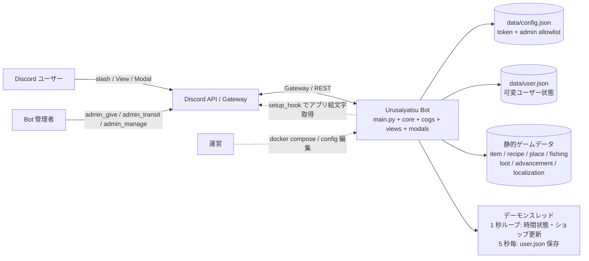

# システム概要（01-system-overview）

> **Phase2 成果物** — ソースコードを一次根拠として作成したシステム概要。仕様中心の記述であり、実装の詳細（バグ・内部関数）の説明は [02-architecture.md](02-architecture.md) に譲る。

## メタデータ

| 項目 | 値 |
|---|---|
| 対象機能 ID | 全 59 機能の上位要約（`CMD-*` 16 / `CTX-*` 6 / `VIEW-*` 10 / `MODAL-*` 3 / `LIFE-*` 8 / `JOB-*` 2 / `DATA-*` 9 / `OPS-*` 4 / `EXT-*` 1） |
| アクター | Discord ユーザー / Bot 管理者 / Discord API / 運営（人間） |
| 関連文書 | [00-feature-catalog.md](00-feature-catalog.md)（機能台帳・トレーサビリティ）、[02-architecture.md](02-architecture.md)（コンポーネント・起動・データフロー） |
| 根拠パス + symbol | `main.py:6-7`、`core/state.py:Bot`、`core/state.py:set_item_value`、`core/config.py:9-20`、`core/utils.py:new_user`/`get_stats`/`xp`/`table_roll`、`core/background.py:start_background_loop`、`cogs/__init__.py:EXTENSIONS`、`cogs/gather.py:GatherCog.gather_command`、`cogs/fishing.py:FishingCog.fishing_command`、`compose.yaml`、`Dockerfile`、`docker-entrypoint.sh` |
| 状態 | 詳細仕様化 = 本フェーズで実施、検証 = 未（本ドキュメントはコード一次根拠に基づく仕様であり、実機動作確認は含まない） |

> 相対リンクはすべて実在する文書（`docs/` 内）への相対リンクである。ドキュメント構成は [00-feature-catalog.md](00-feature-catalog.md) §6.1「現行ドキュメント構成」を参照。

---

## 1. 本ドキュメントの位置づけ

- 本文書は「Urusaiyatsu が何をするプロダクトか」を**仕様の観点**で定義する。
- 個別機能の仕様（コマンド引数・View 構成・データモデル・ライフサイクル等）は [00-feature-catalog.md](00-feature-catalog.md) §6.1 の各詳細仕様先ファイルへ展開される。
- すべての重要な主張には**相対パス + symbol** の一次根拠を付す。根拠がコードで確定できないものは「未確定」とその理由を明示する（§7）。

---

## 2. プロダクト目的

Urusaiyatsu は **Discord 上で動作する、採集・釣り・クラフト・経済を中心とした進行型ゲームボット**である。

- プレイヤーは Discord の**スラッシュコマンド**（全 16、グローバル登録）で採集・釣り・クラフト・売買・装備・設定を行い、操作の一部は **View**（`discord.ui.View`、全 10）と **Modal**（`discord.ui.Modal`、全 3）を介して行う。
  - 根拠: `cogs/__init__.py:EXTENSIONS`（16 コグ）、[00-feature-catalog.md](00-feature-catalog.md) §3.1-3.3
- プレイヤーは**スタミナ・燃料・放射線・冷気**などの時間ベース状態を持ち、時間経過（バックグラウンド 1 秒ループ）で回復・減少する。
  - 根拠: `core/background.py:start_background_loop`、`core/background.py:TICK_RATE`
- アイテム・レシピ・場所・進捗等のゲーム定義は **静的 JSON 7 種**に保持し、可変ユーザー状態は **`data/user.json`** に永続化する（DB は不使用）。
  - 根拠: `core/state.py:27-40`（静的 JSON 読込）、`core/utils.py:save_users`（保存）
- 実体は `python:3.12` の Docker コンテナで非 root 実行される単一プロセスであり、**外部ポート・DB・Web API を持たない**。
  - 根拠: `compose.yaml:6-41`、`Dockerfile:13-42`、`README.md:71`

### 2.1 ゲームの特徴（コードから確定する要素）

| 要素 | 内容 | 根拠 |
|---|---|---|
| 時間ベース資源 | スタミナは上限 `100 + level_global - 1`、回復速度は装備由来 `stamina_regeneration_rate`（既定 20.0/h）。放射線・冷気も時間で減少 | `core/utils.py:get_stats`、`core/utils.py:329-348`、`core/utils.py:373`、`core/background.py:40-92` |
| 二系統の経験値 | 採集系（`level_gathering`/`xp_gathering`）と釣り系（`level_fishing`/`xp_fishing`）を持ち、どちらのレベル上昇も `level_global` を押し上げる | `core/utils.py:xp`、`core/utils.py:405-418` |
| 進捗（advancement） | 前提進捗ツリーで解放される目標。達成でメッセージ表示と次目標の解放 | `core/utils.py:complete_advancement`、`core/state.py:160-176` |
| 経済 | 売却価値はレシピ素材の合計から再帰導出（`set_item_value`）。ショップ価格は既定 `value*4`、購入数制限は `shop_amount` | `core/state.py:set_item_value`、`core/state.py:131`、`data/item.json` |
| ショップ | レベル 7 で解放、10 商品・購入回数カウント付き、一定 tick 毎に再抽選 | `core/utils.py:427-429`、`cogs/buy.py:25-27`、`views/shop_view.py:shop_buy`、`core/background.py:29-35` |

---

## 3. 解決する課題

| # | 課題 | 解決手段 | 根拠 |
|---|---|---|---|
| 1 | Discord 上で手軽に遊べる進行型ゲーム基盤 | スラッシュコマンド 16 種 + View 10 + Modal 3 で全操作を完結 | `cogs/__init__.py:EXTENSIONS`、[00-feature-catalog.md](00-feature-catalog.md) §3 |
| 2 | ユーザー登録の手間 | 未登録でも全コマンド/View 冒頭の `await new_user(user_id)` で自動登録 | `core/utils.py:new_user`、`cogs/gather.py:25` 等 |
| 3 | 時間進行の自動管理 | デーモンスレッドの 1 秒ループでスタミナ回復・放射線/冷気減少・ショップ更新を自動化 | `core/background.py:20-92` |
| 4 | 進行状況の永続化 | 5 秒毎の `save_users()` とコマンド後の随時保存で `user.json` に永続化 | `core/utils.py:save_users`、`core/background.py:96-97` |
| 5 | 長期的な成長・目標 | レベル・XP・進捗（advancement）による段階的解放 | `core/utils.py:xp`、`core/utils.py:complete_advancement` |
| 6 | 経済循環 | 採集・釣り → 素材 → クラフト → 売却/ショップ → 燃料・消耗品購入 | `CTX-VALUE`（`core/state.py:set_item_value`）と `CMD-*` の連鎖 |
| 7 | 運営によるデータ管理 | `admin_*` 3 コマンドでユーザーデータの直接操作（付与/移行/merge） | `cogs/admin_give.py:AdminGiveCog.admin_give_command`、`cogs/admin_transit.py`、`cogs/admin_manage.py` |
| 8 | 運用の再現性 | Docker イメージ（pinned base + `requirements.lock`）と設定 secret 化で環境差を縮小 | `Dockerfile:3,18-19`、`compose.yaml:33-38` |

---

## 4. アクター

[00-feature-catalog.md](00-feature-catalog.md) §1.3 を一次根拠として確定する。認可モデルは「全ユーザー実行可」と「`ADMIN` 許可リスト内判定（admin_* 3 コマンドのみ）」の 2 種のみである。

| アクター | 説明 | 主な操作 | 根拠 |
|---|---|---|---|
| Discord ユーザー | ゲームプレイヤー。未登録でもコマンド発火時に `new_user` で自動登録される | 全 `CMD-*`（admin 以外）、View 選択、Modal 入力 | `core/utils.py:new_user`、`cogs/gather.py:25` |
| Bot 管理者 | `config.json` の `admin[].id` で許可リスト化された Discord ユーザー | `admin_give` / `admin_transit` / `admin_manage` | `core/config.py:18-20`、`cogs/admin_give.py:22-24` |
| Discord API | ゲートウェイ・アプリケーションコマンド・アプリ絵文字を提供する外部サービス | コマンド登録・実行・絵文字取得・存在感 | `core/state.py:Bot.__init__`、`core/state.py:setup_hook`、`core/state.py:on_ready` |
| 運営（人間） | 設定・デプロイ・永続化ボリューム管理 | `data/config.json` 編集、docker compose 運用、単一レプリカ維持 | `compose.yaml`、`docker-entrypoint.sh`、`README.md:75-83` |

> 未確定: Discord のデフォルト権限・チャンネル権限に応じた実行可否の実効値はサーバー側設定依存であり、コードでは確定できない（`OPS-GLOBAL`、[00-feature-catalog.md](00-feature-catalog.md) §2.4）。

---

## 5. 主要ユースケース

ユースケース ID は `SUC-*`（System Use Case）。トリガーと主フロー、一次根拠を記す。実装詳細（エラー処理・バグ）は [02-architecture.md](02-architecture.md) を参照。

| ID | ユースケース | トリガー | 主フロー（要約） | 一次根拠 |
|---|---|---|---|---|
| SUC-01 | 初回利用・自動登録 | 任意コマンド/View | `new_user` が `bot.fetch_user` で名前を取得し、既定状態を `USERS` に登録 | `core/utils.py:new_user` |
| SUC-02 | 採集 | `/gather` | ツール・レベル・採集パワー・燃料・スタミナの事前条件 → ループで消費と `table_roll` → ツール耐久/破損・放射線 → `add_item` → `xp`/進捗 → Embed 送信 → 保存 | `cogs/gather.py:GatherCog.gather_command` |
| SUC-03 | 釣り | `/fishing` | 釣り竿・レベル・スタミナの事前条件 → 餌消費・`get_fishing_loot_table`（時刻ボーナス・power フィルタ・餌テーブル加算）→ `table_roll` → `add_item` → `xp`/進捗 → 送信 → 保存 | `cogs/fishing.py:FishingCog.fishing_command`、`cogs/fishing.py:get_fishing_loot_table` |
| SUC-04 | クラフト | `/craft` → View → Modal | 所持素材のあるレシピ一覧 View → レシピ選択 → Modal で個数 → ツール・スタミナ・素材チェック → 素材消費・ツール耐久/破損 → 結果付与 → `xp`/進捗 → 送信 → 保存 | `cogs/craft.py:CraftCog.craft_command`、`views/craft_view.py:craft_selecting`、`modals/craft_modal.py:craft_item` |
| SUC-05 | アイテム使用 | `/use` | `remove_item_stacked` で消費 → tag 分岐（スタミナ回復 `con_stamina` / loot 開封 `con_loot` / 燃料回復 `con_fuel` / 除染 `con_radiation`）→ 効果適用 → 送信 → 保存 | `cogs/use.py:UseCog.use_command` |
| SUC-06 | 売却 | `/sell` → View → Modal | 売却可能アイテム一覧 View → アイテム選択 → Modal で個数 → `value*count` を `money` へ → 送信 → 保存 | `modals/sell_modal.py:sell_item`、`views/sell_view.py:sell_selecting` |
| SUC-07 | ショップ購入 | `/buy` → View | レベル 7 ゲート → 商品一覧 View → `shop_amount`（購入上限）と所持金チェック → `money` 消費・`add_item`・購入回数加算 → 送信 → 保存 | `cogs/buy.py:BuyCog.shop_buy_command`、`views/shop_view.py:shop_buy` |
| SUC-08 | 燃料補給 | `/refuel` | 正数チェック → 所持金チェック → `money -= amount*2`、`fuel += amount` → 送信 → 保存 | `cogs/refuel.py:RefuelCog.refuel_command` |
| SUC-09 | 装備・装備解除 | `/equip` → View | 装備可能一覧 View → スロット型判定（accessory は `equip_type` 衝突・空スロット確認）→ インベントリ ⇔ 装備スロット移動 → 送信 → 保存 | `cogs/equip.py:equip`、`views/equip_view.py:equip_select`/`remove_equip_choice` |
| SUC-10 | 情報閲覧 | `/ping` `/status` `/item_data` `/leaderboard` | ping 計測、ステータス（ページング・短縮切替・ニュース）、アイテム情報（3 Embed）、11 モードのランキング（トップ 10 + 自分の順位） | `cogs/ping.py:PingCog.pong_command`、`cogs/status.py:StatusCog.view_command`、`cogs/item_data.py:item_data`、`cogs/leaderboard.py:LeaderboardCog.leaderboard_command` |
| SUC-11 | ユーザー設定 | `/settings` | 6 種（Modal 1 / トグル 2 / View 3）で設定変更と保存 | `cogs/settings.py:SettingsCog.settings_command`、`views/settings_view.py`、`modals/settings_modal.py:set_name` |
| SUC-12 | 管理者データ操作 | `/admin_give` `/admin_transit` `/admin_manage` | `ADMIN` 判定 → アイテム増減 / ユーザーデータ移行 / `ast.literal_eval` + deepmerge | `cogs/admin_give.py:AdminGiveCog.admin_give_command`、`cogs/admin_transit.py`、`cogs/admin_manage.py` |
| SUC-13 | バックグラウンド時間進行 | 常駐スレッド（約 1 秒 tick） | スタミナ回復・放射線/冷気減少・3600 tick 毎のショップ再抽選・5 tick 毎の保存 | `core/background.py:start_background_loop` |
| SUC-14 | 起動・ライフサイクル | `python main.py` / Docker CMD | import 時ブートストラップ → `setup_hook`（絵文字・Choice 生成・ユーザー初期化・コグロード・スレッド起動・ツリー同期）→ `on_ready`（Game status） | `main.py:6-7`、`core/state.py:Bot.setup_hook`、`core/state.py:Bot.on_ready` |

---

## 6. システム境界

### 6.1 含む（スコープ内）

- スラッシュコマンド 16 種・View 10 種・Modal 3 種（グローバル登録）
- ゲーム契約（ユーザー初期化・インベントリ CRUD・数値統計・XP・進捗・重み付き loot・派生価格）
- 起動ライフサイクル（import ブートストラップ / `setup_hook` / `on_ready`）
- バックグラウンドジョブ 2 種（1 秒時間状態・5 秒保存）
- 静的ゲームデータ 7 JSON・可変ユーザー状態 1 JSON・設定 1 JSON（example 管理）
- Docker 運用（secret 複製・非 root 降格・永続ボリューム）
- Discord 統合（ゲートウェイ・アプリコマンド・アプリ絵文字・存在感）

根拠: `core/state.py:27-40`、`cogs/__init__.py:EXTENSIONS`、`compose.yaml`、[00-feature-catalog.md](00-feature-catalog.md) §1.2

### 6.2 含まない（スコープ外・コード根拠あり）

| 非対象 | コード根拠 |
|---|---|
| Web UI・REST サーバ・外部ポート | `compose.yaml` に `ports` 定義なし。`README.md:71`「外部ポート、DB、Redis は使用しません」 |
| DB / 永続化はファイルのみ | `core/state.py:43-49`（user.json）、`core/utils.py:save_users`。DB ドライバは依存に存在しない（`requirements.lock`） |
| 認証基盤（Bot の ID 基盤） | 本人認証は Discord に委譲（`core/state.py:85-90` の Intents のみ。ユーザーは `interaction.user` をそのままキーとする） |
| Prefix / Hybrid / Context / Group コマンド | `@commands.command` / `@commands.hybrid_command` / `@app_commands.context_menu` / `@app_commands.group` がソースに 0 件。`command_prefix="!"` は設定のみ（`core/state.py:90`） |
| メッセージコンテンツによるゲーム操作 | 上記に同じ。`intents.message_content = True`（`core/state.py:86`）は有効だが、メッセージトリガーのコマンドは未登録 |
| 自動テスト・CI・静的解析基盤 | テストファイル・`.github`（CI）・linter/type check 設定が存在しない。検証手段は `compileall` のみ（`AGENTS.md`） |
| エラーハンドラ・ロギング基盤 | `on_command_error` / `tree.error` / `add_error_handler` と `import logging` がソースに 0 件。ログは `print` のみ（例: `core/state.py:94,148,193`） |
| マルチレプリカ運用 | `README.md:79-81` が単一レプリカを明示（`user.json` 同時書込の破損回避のため） |

### 6.3 スコープ外で未確定のもの

- マルチサーバー運用での権限・レート制限の実効値（Discord プラットフォーム依存）
- 実ユーザー数・データ量におけるパフォーマンス特性（[00-feature-catalog.md](00-feature-catalog.md) §5.2 U-07）

---

## 7. 未確定事項（理由付き）

| ID | 項目 | 未確定の理由 |
|---|---|---|
| U-03 | Modal のタイムアウト値 | 3 Modal とも `timeout` を宣言していない（`modals/craft_modal.py:craft_amount` 等）。フレームワーク既定値に依存し、View の 180 秒と同じとは断定しない |
| U-09 | 複数インスタンス同時実行の挙動 | コード上は lock なしの共有ファイル書込のため、単一レプリカが必須（`README.md:79-81`）。多重起動時の破損挙動は未検証 |
| U-12 | ゲームバランス数値の意図 | `level_next = int((lv+1)**1.5)*5`（`core/utils.py:413`）、ショップ `value*4`（`core/state.py:131`）、回復速度 20.0/h（`core/utils.py:329`）等はコード上の既定値であり、意図されたバランスかは文書化されていない |
| — | コマンドの実際の権限反映 | コマンドに `guild_only` / `default_permissions` 修飾なし（[00-feature-catalog.md](00-feature-catalog.md) §3.4）。サーバー側権限設定依存のためコードだけでは確定しない |

---

## 8. システムコンテキスト図（Mermaid）

> 注: コンテキスト図はスコープ外の外部依存（DB・Web サーバ）を持たないことを明示するため、ボットと Discord API・ファイルストア・運営のみを描く。

---

## 9. 用語集

| 用語 | 定義 | 根拠 |
|---|---|---|
| USERS | `user.json` を読み込んだ、ユーザー ID 文字列をキーとする可変状態 dict | `core/state.py:43-49` |
| インベントリ | ユーザーごとの `{id, count, meta}` のリスト。同一 id + 同一 meta でスタック | `core/utils.py:add_item`、`core/utils.py:58-85` |
| 装備スロット | `accessory(リスト) / gathering_tool / gathering_equipment / fishing_rod / fishing_bait / weapon / armor / armor_secondary` | `core/utils.py:44-53` |
| 進捗（advancement） | 前提ツリーで解放される目標。`advancement_completed`（達成済み）と `advancement_now`（解放中）で管理 | `core/utils.py:377-397`、`core/state.py:160-176` |
| ルートテーブル | `{id, weight}`（必要に応じ `power_min`/`power_max`）のリスト。`table_roll` が重み付き抽選して件数集計 | `core/utils.py:table_roll`、`data/place.json`、`data/fishing.json`、`data/loot.json` |
| 数値統計（stats） | 装備とレベルから導出される 16 項目（`stamina_max` / `gathering_power` / `fishing_power` 等） | `core/utils.py:get_stats` |
| shop_list / shop_content | `shop_list` は `spawnable_in_shop` tag の全商品（31 件）、`shop_content` はユーザーごとの当選 10 商品 | `core/state.py:129-132`、`core/utils.py:427-429`、`core/background.py:29-35` |
