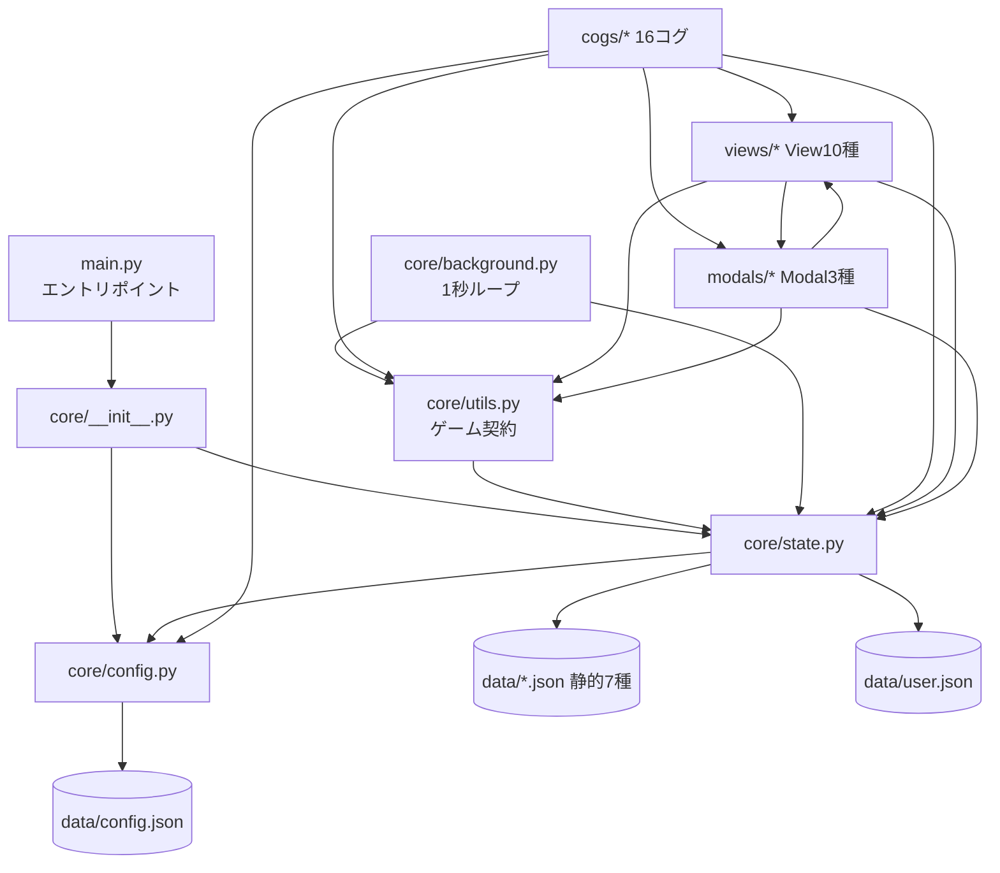
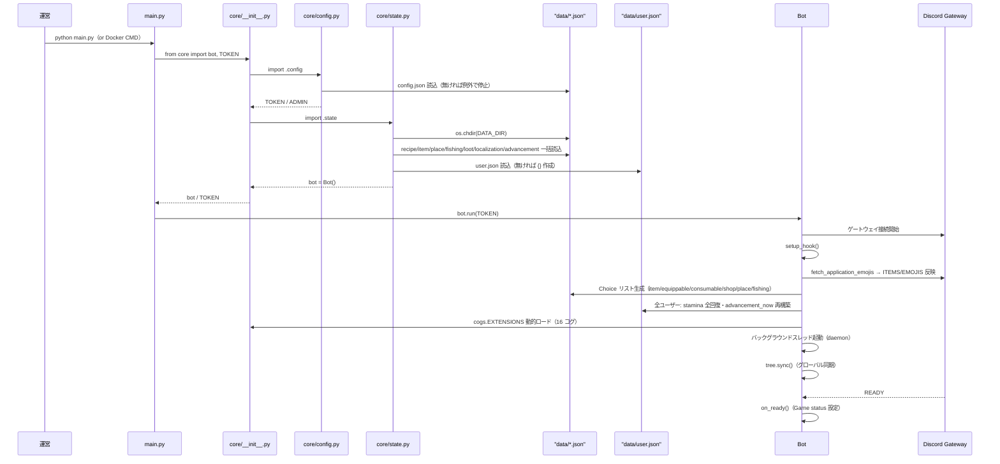
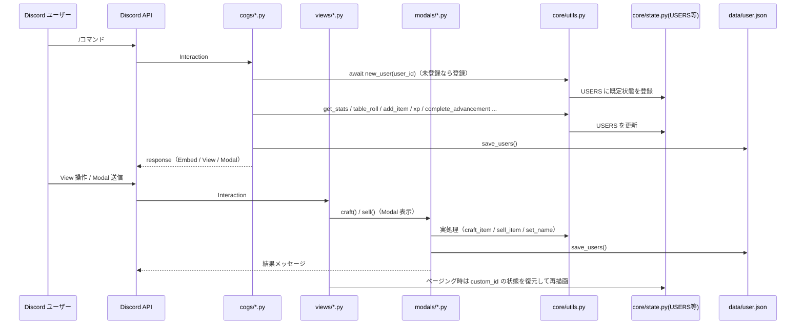

# アーキテクチャ（02-architecture）

> **Phase2 成果物** — ソースコードを一次根拠として作成したアーキテクチャ仕様。本文書は「現行実装がどのような構造を持ち、何が再実装で維持すべき契約か」を定義する。

## メタデータ

| 項目 | 値 |
|---|---|
| 対象機能 ID | `OPS-OWNERSHIP`（主要）に加え、`LIFE-*` 全 8、`JOB-*` 全 2、`CTX-*` 全 6、`EXT-DISCORD` |
| アクター | 開発者（再実装者）、運営（人間） |
| 関連文書 | [00-feature-catalog.md](00-feature-catalog.md)、[01-system-overview.md](01-system-overview.md)、[03-runtime-and-configuration.md](03-runtime-and-configuration.md)、[04-data-model.md](04-data-model.md)、[05-discord-interface/README.md](05-discord-interface/README.md)、[07-event-processing/lifecycle.md](07-event-processing/lifecycle.md)、[07-event-processing/scheduled-and-background-jobs.md](07-event-processing/scheduled-and-background-jobs.md)、[08-external-integrations/discord.md](08-external-integrations/discord.md)、[11-security-and-authorization.md](11-security-and-authorization.md)、[13-open-questions-and-technical-debt.md](13-open-questions-and-technical-debt.md) |
| 根拠パス + symbol | `main.py:6-7`、`core/__init__.py:4-5`、`core/config.py:9-20`、`core/state.py:14-205`（`os.chdir`/データ読込/`Bot`）、`core/state.py:Bot.setup_hook`、`core/state.py:Bot.on_ready`、`core/utils.py:new_user` ほか関数群、`core/background.py:start_background_loop`、`cogs/__init__.py:EXTENSIONS`、`views/__init__.py`、`modals/__init__.py`、`views/item_select_view.py:register_callback`/`_get_callback`、`views/equip_view.py:set_equip_func`、`views/sell_view.py:set_sell_func` |
| 状態 | 詳細仕様化 = 本フェーズで実施、検証 = 未 |

> 関連文書パス（`03-*` 以降）は [00-feature-catalog.md](00-feature-catalog.md) §6.1 の Phase2 文書構成に基づき、すべて実在文書への相対リンクである。

---

## 1. 本ドキュメントの位置づけ

- コンポーネント責務・依存方向・起動シーケンス・データフロー・非同期構造を**仕様として**記述する。
- §8 で「再実装で維持すべき必須契約」、§9 で「現行実装上の選択（置換・修正が可能なもの）」を区別して列挙する。
- バグ・未検証事項（`C-01`〜`C-22`、`U-01`〜`U-15`）は [00-feature-catalog.md](00-feature-catalog.md) §5 を継承し、本文書では契約判定の材料として引用する。

---

## 2. コンポーネント構成と責務

| コンポーネント | 責務 | 主な export / symbol | 一次根拠 |
|---|---|---|---|
| `main.py` | プロセスエントリポイント。`bot.run(TOKEN)` を実行 | module guard（`if __name__ == "__main__"`） | `main.py:4-7` |
| `core/__init__.py` | コア公開 API。`bot` と `TOKEN` を re-export | `bot` / `TOKEN` | `core/__init__.py:4-5` |
| `core/config.py` | 設定読込。`DATA_DIR` 解決、`config.json` 読込、`TOKEN`・`ADMIN`（管理者許可リスト）導出 | `DATA_DIR` / `CONFIG` / `TOKEN` / `ADMIN` | `core/config.py:9-20` |
| `core/state.py` | グローバル状態の所有者。`os.chdir(DATA_DIR)`、静的 JSON 7 種の import 時読込、`USERS`、`EMOJIS`、Choice リスト、`Bot` クラス、派生価格 `set_item_value` | `Bot`、`USERS`、`ITEMS`、`RECIPES`、`PLACES`、`FISHING_PLACES`、`LOOTS`、`LOCALIZATIONS`、`ADVANCEMENTS`、`EMOJIS`、`place_choices` ほか、`set_item_value` | `core/state.py:14-205` |
| `core/utils.py` | ゲーム契約の実装。ユーザー初期化・インベントリ CRUD・数値統計・XP/進捗・重み付き loot・保存 | `new_user` / `add_item` / `remove_item` / `get_stats` / `table_roll` / `xp` / `complete_advancement` / `save_users` ほか | `core/utils.py` |
| `core/background.py` | バックグラウンドジョブ。デーモンスレッドの 1 秒ループ（時間状態・ショップ回転）と 5 秒保存 | `start_background_loop` / `TICK_RATE` / `SAVE_INTERVAL` | `core/background.py:11-99` |
| `cogs/*.py`（16） | スラッシュコマンドのハンドラ。事前条件チェック・ゲーム契約呼び出し・応答送信 | 各 `*Cog` クラス（例: `GatherCog`） | `cogs/__init__.py:EXTENSIONS` |
| `views/*.py`（6 ファイル / View 10 種） | `discord.ui.View` の定義・ページング・選択・コールバック解決。`views/__init__.py` が re-export | `status_paging` / `equip_select` / `craft_select` / `sell_select` / `shop_choice` / `item_select` / 設定 3 View | `views/__init__.py` |
| `modals/*.py`（3） | `discord.ui.Modal` の定義と実処理（クラフト・売却・名前変更） | `craft_amount` / `sell_amount` / `set_name` | `modals/__init__.py` |
| `data/` | 静的ゲームデータ 7 JSON・設定・可変状態（`config.json` / `user.json` は git 管理外） | `data/item.json` 等 | `core/state.py:27-40`、`data/config.json.example` |
| Docker 一式 | 再現可能な実行環境（pinned base、`requirements.lock`、secret 複製、非 root 降格、永続ボリューム） | `Dockerfile` / `compose.yaml` / `docker-entrypoint.sh` | `Dockerfile:3-42`、`compose.yaml:6-41`、`docker-entrypoint.sh` |

---

## 3. 依存方向

依存は**「cogs / views / modals → core」の一方向が基本**で、`core` が cogs/views/modals を import しない（`core/state.py` 内の `from cogs import EXTENSIONS` と `from .background import start_background_loop` は `setup_hook` の関数スコープ内 import であり、モジュールレベル依存ではない）。

### 3.1 モジュール間 import（一次根拠）

| 依存 | 方向 | 根拠 |
|---|---|---|
| `main.py` → `core` | `from core import bot, TOKEN` | `main.py:4` |
| `core/__init__.py` → `core.state` / `core.config` | `from .state import bot` / `from .config import TOKEN` | `core/__init__.py:4-5` |
| `core.state` → `core.config` | `from .config import DATA_DIR` | `core/state.py:12` |
| `core.utils` → `core.state` | `from .state import USERS, ITEMS, ADVANCEMENTS, shop_list, bot` | `core/utils.py:9-12` |
| `core.background` → `core.state` / `core.utils` | `from .state import USERS, shop_list` / `from .utils import save_users, get_stats` | `core/background.py:8-9` |
| `cogs/*` → `core.state` / `core.utils` / `core.config` | 各コグの import 文 | `cogs/gather.py:9-10`、`cogs/admin_give.py:8-10` |
| `cogs/*` → `views/*` / `modals/*` | コマンドから View/Modal の表示・関数注入 | `cogs/craft.py:8`、`cogs/sell.py:8-9`、`cogs/settings.py:11-12` |
| `views/*` → `core.state` / `core.utils` | View から状態参照・契約呼び出し | `views/craft_view.py:7-8` 等 |
| `views/craft_view` → `modals/craft_modal` | `from modals.craft_modal import craft`（直接 import） | `views/craft_view.py:9` |
| `modals/sell_modal` → `views/sell_view` | `from views.sell_view import sell_selecting`（直接 import） | `modals/sell_modal.py:9` |

### 3.2 循環 import 回避パターン（コールバック注入）

View とコグ・Modal の相互参照を避けるため、2 つのパターンが使われる。

1. **モジュールグローバル関数注入**: コグの `__init__` が View モジュールのセッタへ実処理関数を登録する。
   - `cogs/equip.py:100-101` → `views/equip_view.py:set_equip_func`（`_equip_func`）
   - `cogs/sell.py:17` → `views/sell_view.py:set_sell_func`（`_sell_func`）
   - ※ `views/craft_view.py:set_craft_func`（`_craft_func`）は**定義のみで現在呼び出しなし**（**デッドコード C-22**。クラフトは `modals/craft_modal.craft` を直接 import している）。
2. **コールバック辞書登録**: コグの `__init__` が View 側の辞書に名前付きコールバックを登録する。選択時に custom_id 経由で名前を解決する。
   - `cogs/item_data.py:180` → `views/item_select_view.py:register_callback('item_data', item_data)`
   - 解決は `views/item_select_view.py:_get_callback`（未登録名の場合は `eval(name)` フォールバック。`C-11`）

### 3.3 コンポーネント図（Mermaid）



---

## 4. 初期化 / 起動シーケンス

### 4.1 シーケンス図（Mermaid）



### 4.2 ステップ別の仕様

| 段階 | 処理 | 一次根拠 |
|---|---|---|
| ① エントリ | `main.py` が `bot.run(TOKEN)` を実行 | `main.py:6-7` |
| ② import ブートストラップ（`LIFE-IMPORT`） | `core.config` が `config.json` を読込（`TOKEN` / `ADMIN`）。`core.state` が `os.chdir(DATA_DIR)` し、静的 JSON 7 種を import 時に読込。`user.json` が無ければ `{}` を作成。`bot = Bot()` を生成 | `core/config.py:12-20`、`core/state.py:15`、`core/state.py:27-49`、`core/state.py:205` |
| ③ Bot コンストラクタ | Intents（default + `message_content` / `messages` / `members` / `reactions`）と `command_prefix="!"` を設定 | `core/state.py:84-90` |
| ④ `setup_hook`（`LIFE-SETUP`） | (a) アプリ絵文字取得・反映（`LIFE-EMOJI`）→ (b) Choice リスト生成と `shop_list` / `equip_slot` 構築（`LIFE-CHOICES`）→ (c) 全ユーザーのスタミナ全回復・`advancement_now` 再構築（`LIFE-CHOICES`）→ (d) 16 コグの動的ロード（`LIFE-EXTLOAD`）→ (e) バックグラウンドスレッド起動 → (f) `tree.sync()`（`LIFE-TREESYNC`） | `core/state.py:92-193`、`core/state.py:97-102`、`core/state.py:104-158`、`core/state.py:160-176`、`core/state.py:178-189`、`core/state.py:192` |
| ⑤ `on_ready`（`LIFE-ONREADY`） | Game status（存在感）を設定。失敗は握りつぶし | `core/state.py:195-201` |
| ⑥ 常駐 | デーモンスレッドの `start_background_loop` が約 1 秒周期で動作（`JOB-TIMESTATE` / `JOB-PERSIST`） | `core/background.py:14-99` |

### 4.3 起動時に行われる重要副作用

- `setup_hook` は**全ユーザーの `stamina` を `stamina_max` に強制セット**する（再起動のたびにスタミナ満タン。`C-09`）。根拠: `core/state.py:163-164`
- Choice リスト（`place_choices` 等）はモジュールレベルで空リストとして宣言され、`setup_hook` で追記される。**再起動なしで変わるデータ（item.json 等）への追従はできない**。根拠: `core/state.py:17-24`、`core/state.py:104-158`
- `tree.sync()` は guild 指定なしのグローバル同期。根拠: `core/state.py:192`

---

## 5. データフロー

### 5.1 静的データ

`data/*.json`（recipe / item / place / fishing / loot / localization / advancement）は **`core.state` の import 時にモジュールグローバルとして一括読込**される。以降は変更されない（`setup_hook` は item への `emoji` / `name_e` / `price` の**実行時導出プロパティ**を追記する）。根拠: `core/state.py:27-40`、`core/state.py:104-148`

### 5.2 可変状態（USERS → user.json）

- `USERS` は「ユーザー ID 文字列 → ユーザー状態 dict」の共有 mutable 状態。
- 書き込み経路は (a) イベントループ上のコマンド/View/Modal ハンドラ、(b) バックグラウンドスレッドの 1 秒ループ、の 2 系統。**ロックなしの共有参照**。
- 保存は `save_users()` の `json.dump` 直接書込（非 atomic・無 lock。`C-07`）。5 秒毎（`JOB-PERSIST`）と各ハンドラ末尾の随時保存が並走する。根拠: `core/utils.py:454-457`、`core/background.py:96-97`
- 読込は import 時に 1 回のみ。破損時は裸 `except` で `{}` に置き換わる（`C-08`）。根拠: `core/state.py:43-49`

### 5.3 コマンド処理フロー（Mermaid）



### 5.4 バックグラウンドフロー

```
デーモンスレッド: 無限ループ（約1秒周期）
  1. ticks が 3600 の倍数かつ level_global >= 7 → ショップ再抽選（shop_content 10 件・shop_count リセット）
  2. 各ユーザーについて:
     - timestamp.stamina == -1 かつ stamina < stamina_max → 基準時刻記録
     - 経過時間 >= 3600 / stamina_regeneration_rate → stamina 加算（上限で停止・timestamp=-1）
     - 同様に radiation / cold を減少
  3. ticks % 5 == 0 → save_users()
```

根拠: `core/background.py:20-92`（時間状態）、`core/background.py:29-35`（ショップ）、`core/background.py:95-97`（保存）

---

## 6. Discord event / 非同期構造

### 6.1 実行モデル

| 面 | 現行の構造 | 一次根拠 |
|---|---|---|
| イベントループ | discord.py（asyncio）の単一イベントループ上で、`setup_hook` / `on_ready` / コマンド / View / Modal の全 async ハンドラが動作 | `core/state.py:92-201`、各 `cogs/*.py`、各 `views/*.py`、各 `modals/*.py` |
| バックグラウンド | **別スレッド（daemon `threading.Thread`）**で同期関数 `start_background_loop` が `time.sleep(1)` でループ | `core/state.py:187-189`、`core/background.py:99` |
| 共有状態 | `USERS`（と静的データの導出プロパティ）をイベントループとバックグラウンドスレッドが**ロックなしで**共有・変更 | `core/background.py:8-9,22`、`core/utils.py:9-12` |
| 共有状態の構造 race | バックグラウンドの `USERS.items()` 反復中に、イベントループ側の `new_user` / `admin_transit` がトップレベルキーを追加/削除すると `RuntimeError` になり得る（**C-17**、頻度は U-13） | `core/background.py:22`、`core/utils.py:17`、`cogs/admin_transit.py:33-36` |
| エラー処理 | 登録されたエラーハンドラなし（`on_command_error` / `tree.error` / `add_error_handler` がソースに 0 件）。例外は Discord 側の「interaction failed」になる | [00-feature-catalog.md](00-feature-catalog.md) §4.1、`C-12` |
| ログ | `print` のみ（`logging` モジュール不使用） | `core/state.py:94,148,193` 等、`C-12` |

### 6.2 イベント種別とハンドラ

| イベント | ハンドラ | 特徴 | 一次根拠 |
|---|---|---|---|
| `setup_hook` | `Bot.setup_hook` | ゲートウェイ接続前の全初期化。絵文字取得は Discord REST 呼び出し | `core/state.py:92-193` |
| `on_ready` | `Bot.on_ready` | Game status 設定のみ。例外は握りつぶし | `core/state.py:195-201` |
| スラッシュコマンド | 各 `*Cog` の `@app_commands.command` | async。事前条件チェック → 契約呼び出し → 応答 → 保存 | `cogs/*.py` |
| View 操作 | 各 View の `@discord.ui.select` / `@discord.ui.button` | async。`custom_id` に状態をエンコードして再描画。`timeout=180` 明示 | `views/*.py` |
| Modal `on_submit` | `craft_amount` / `sell_amount` / `set_name` | async。`timeout` は未宣言（`U-03`） | `modals/*.py` |
| バックグラウンド | `start_background_loop` | **同期・別スレッド**。async ではない | `core/background.py:14-99` |

### 6.3 非同期/スレッド設計上の注意点（再実装時の検討対象）

- バックグラウンド処理がイベントループ外（別スレッド）であることは**現行実装上の選択**であり、asyncio タスクへの置換は可能。ただし 1 秒 tick の時間契約と 5 秒保存契約は維持する必要がある（§9）。
- `USERS` の無ロック共有は**現行実装上の選択**であり、コマンド並走・スレッド並走時の一貫性保証は再実装で検討すべき事項（`C-07`）。
- View は破棄後・`timeout` 超過後の操作と、既応答 Interaction への再編集（`views/sell_view.py:114,146` の `edit_original_response`）に依存している（`U-04`）。

---

## 7. 主要ゲーム契約の呼び出し関係

| 契約（CTX-*） | 実装 symbol | 主な呼び出し元 | 一次根拠 |
|---|---|---|---|
| `CTX-USER-INIT` | `core/utils.py:new_user` | ほぼ全てのコマンド/View（`settings` / `leaderboard` は**未呼び出し**＝`C-05`） | `cogs/gather.py:25`、`views/craft_view.py:69`、`cogs/settings.py:29-31` |
| `CTX-INV-CRUD` | `add_item` 系 / `remove_item` 系 / `get_item` 系 / `modify_item` | 採集・釣り・クラフト・売却・装備・ショップ・使用 | `core/utils.py:58-298` |
| `CTX-STATS` | `core/utils.py:get_stats` | 採集・釣り・クラフト・ステータス表示・バックグラウンド | `core/utils.py:325-374`、`core/background.py:26` |
| `CTX-XP` | `core/utils.py:xp` / `complete_advancement` | 採集・釣り・クラフト・使用 | `core/utils.py:400-443` |
| `CTX-LOOT` | `core/utils.py:table_roll` | 採集・釣り・loot 使用 | `core/utils.py:301-322` |
| `CTX-VALUE` | `core/state.py:set_item_value` | 起動時 `setup_hook`、売却・購入・item_data・leaderboard が `ITEMS[*]['value'/'price']` を参照 | `core/state.py:64-78`、`core/state.py:119`、`core/state.py:131` |

---

## 8. 再実装で維持すべき必須契約

> 再実装（書き直し・別言語移行含む）でも**互換性と動作仕様を保証するため維持しなければならない**契約。根拠はすべて一次ソース。

### A. 実行環境・起動

| # | 契約 | 根拠 |
|---|---|---|
| A1 | Python 3.10+ の実行（`int | None` 等の union 構文が Python 3.9 で失敗）。Docker は Python 3.12 固定 | `core/utils.py:58,276`、`AGENTS.md`、`Dockerfile:3` |
| A2 | `import core` の時点で `data/config.json` が必要（存在しない場合は起動失敗） | `core/config.py:12-13` |
| A3 | 静的 JSON 7 種を起動時に一括読込し、実行中は静的なデータとして扱う | `core/state.py:27-40` |
| A4 | `user.json` が無ければ起動時に空で自動作成 | `core/state.py:43-49` |
| A5 | 単一プロセス・単一レプリカ運用（`user.json` を共有ファイルで永続化） | `README.md:79-81`、`compose.yaml:28-29` |
| A6 | 設定は git 管理外（`config.json` / `user.json`）、構造は `config.json.example` 準拠（`token` + `admin[].id`） | `.gitignore:225-227`、`data/config.json.example` |

### B. ゲーム契約

| # | 契約 | 根拠 |
|---|---|---|
| B1 | 各コマンド/View の入口で `new_user(user_id)` により未登録ユーザーを自動登録 | `core/utils.py:15-55`、`cogs/gather.py:25` 等 |
| B2 | インベントリ要素は `{id: str, count: int, meta: dict}` のリスト。同一 `id` + 同一 `meta` でスタック | `core/utils.py:58-85` |
| B3 | ユーザー既定状態（`new_user` の dict 形）をデータ互換として維持 | `core/utils.py:19-54` |
| B4 | 装備スロット形 `accessory(リスト) / gathering_tool / gathering_equipment / fishing_rod / fishing_bait / weapon / armor / armor_secondary` | `core/utils.py:44-53` |
| B5 | 数値統計 16 項目の名称と既定値（`stamina_regeneration_rate=20.0` 等） | `core/utils.py:328-348` |
| B6 | スタミナ上限 `100 + level_global - 1`、回復は `3600 / stamina_regeneration_rate` 秒毎に 1 点 | `core/utils.py:330,373`、`core/background.py:41` |
| B7 | XP 上昇時に `level_next = int((level+1)**1.5)*5` で判定し、`level_gathering` / `level_fishing` → `level_global` へ波及 | `core/utils.py:400-443` |
| B8 | 進捗は前提ツリー（`previous_advancement`）で解放し、達成は `advancement_completed` / `advancement_now` で管理 | `core/utils.py:377-397`、`core/state.py:160-176` |
| B9 | 重み付きルートテーブル（`{id, weight}`）による抽選と、被り集計した結果 dict を返す | `core/utils.py:301-322` |
| B10 | 売却価値はレシピ素材の再帰合計から導出。ショップ価格は既定 `value * 4`、購入上限は `shop_amount` | `core/state.py:64-78`、`core/state.py:131`、`views/shop_view.py:shop_buy` |
| B11 | ショップはレベル 7 で解放（10 商品・`shop_count` で購入回数管理） | `core/utils.py:427-429`、`cogs/buy.py:25-27` |
| B12 | 静的データ JSON のスキーマ（item / recipe / place / fishing / loot / advancement / localization） | [00-feature-catalog.md](00-feature-catalog.md) §4.4、`core/state.py:27-40` |

### C. インターフェース

| # | 契約 | 根拠 |
|---|---|---|
| C1 | コマンドはスラッシュコマンドのみ（Prefix / Hybrid / Context / Group は追加しない） | `cogs/__init__.py:EXTENSIONS`、[00-feature-catalog.md](00-feature-catalog.md) §3.4 |
| C2 | コマンドツリーは guild 指定なしでグローバル同期 | `core/state.py:192` |
| C3 | 管理者判定は `config.json` の `admin[].id`（`ADMIN` リスト）に一致することのみ | `core/config.py:18-20`、`cogs/admin_give.py:22-24` |
| C4 | View は `timeout=180` を明示し、状態は `custom_id` にエンコードする（user_id / page / page_max / func 等） | `views/status_view.py:18-19,227`、`views/item_select_view.py:15-16,127` |
| C5 | コールバック解決は**内部登録名**（`register_callback`）経由にし、ユーザー入力から関数名を導出しない | `views/item_select_view.py:135-145`、`AGENTS.md` |
| C6 | コグは `cogs.EXTENSIONS` に登録しないとロードされない | `cogs/__init__.py:6-22`、`core/state.py:178-185` |
| C7 | データ保存は 5 秒毎 + 主要操作後の随時保存の両方を満たす | `core/background.py:96-97`、`cogs/gather.py:175` 等 |

---

## 9. 現行実装上の選択と必須契約の区別

下表で「必須契約（維持）」「現行実装上の選択（置換・修正可）」を対比する。後者を変更しても仕様上の互換性は損なわれない（むしろ改善対象であり、[00-feature-catalog.md](00-feature-catalog.md) §5.1 の懸念に一致する）。

| 領域 | 必須契約（維持） | 現行実装上の選択（変更可） | 根拠 |
|---|---|---|---|
| 起動時の作業ディレクトリ | import 後に `data/` 配下の相対パスが解決できる | `os.chdir(DATA_DIR)` による CWD 変更（絶対パス化等で置換可） | `core/state.py:15` |
| バックグラウンド実行 | 1 秒 tick の時間状態更新と 5 秒保存 | `threading.Thread` + `time.sleep`（asyncio task 等に置換可） | `core/state.py:187-189`、`core/background.py` |
| ログ / 観測 | （契約なし）エラーハンドラ・ロギング基盤は未実装 | `print` のみ。`logging` 導入・`tree.error` 登録が推奨 | `C-12` |
| 永続化の安全性 | 5 秒周期で保存され、単一レプリカで運用 | `json.dump` 直接書込（非 atomic・無 lock） | `core/utils.py:454-457`、`C-07` |
| user.json 読込の例外処理 | 起動時に読込む | 裸 `except` で `{}` 上書き（例外種別の限定・リネーム保存等に改善可） | `core/state.py:43-49`、`C-08` |
| 起動時スタミナ | （ゲーム仕様としては未定義） | 起動時に全ユーザーのスタミナを満タンへ強制セット | `core/state.py:163-164`、`C-09` |
| ショップ回転の基準 | 一定間隔で再抽選される | プロセス起動からの tick 基準（壁時計 1 時間ではない） | `core/background.py:29`、`C-10` |
| コールバック解決 | 内部登録名のみを渡す | `_get_callback` の `eval(name)` フォールバック（除去・辞書解決のみに変更可） | `views/item_select_view.py:140-145`、`C-11` |
| アクセサリー stats | `CTX-STATS` が装備 stats を反映する | アクセサリー分岐がローカルコピーのまま書戻さない（バグ） | `core/utils.py:352-362`、`C-04` |
| インベントリ削除 | 指定 index のアイテムを削除する | `list.pop(dict)` による TypeError の可能性（`C-03`）と `remove_item_stacked(required=True)` の部分消費 | `core/utils.py:212`、`modals/craft_modal.py:126`、`C-03` |
| `admin_give` の剥奪 | 負数でアイテムを減らす（意図） | 負数が `remove_item` で加算になる（バグ） | `cogs/admin_give.py:45`、`core/utils.py:135-138`、`C-02` |
| 依存パッケージ | `deepmerge` を `admin_manage` が import | `requirements.lock` に `deepmerge` が未記載（Docker 環境差） | `cogs/admin_manage.py:8`、`requirements.lock`、`C-01` |
| ツール破損カウント | 破損ツールを結果に含める | gather は負値・craft は正値で符号が不一致 | `cogs/gather.py:112-115`、`modals/craft_modal.py:127-130`、`C-15` |
| コマンド接頭辞 | （ゲーム操作はスラッシュのみ） | `command_prefix="!"` は設定のみで未使用 | `core/state.py:90`、[00-feature-catalog.md](00-feature-catalog.md) §3.4 |
| 関数注入 | View はコグ実処理を呼べる | `set_equip_func` / `set_sell_func` によるグローバル注入（DI 等へ置換可）。`set_craft_func` は未使用デッドコード（`C-22`） | `views/equip_view.py:15-18`、`views/sell_view.py:14-17`、`views/craft_view.py:16-18` |
| 装備の空判定 | 未装備時に適切な応答 | `if len(equip_choices) < 0:` は常に false（到達不能デッドコード） | `cogs/equip.py:34`、`C-14` |
| ゲームバランス値 | （コード既定値として存在） | `level_next` / `value*4` / 回復速度等は意図確認が未了（`U-12`）。契約化するかは Phase2 の決定事項 | `core/utils.py:413`、`core/state.py:131`、`core/utils.py:329` |
| Modal タイムアウト | （フレームワーク既定値に依存） | 3 Modal とも `timeout` 未宣言（明示化の要否は `U-03`） | `modals/craft_modal.py:11-16` 等 |

---

## 10. 未確定事項（理由付き）

| ID | 項目 | 未確定の理由 | 関連 |
|---|---|---|---|
| U-01 | `deepmerge` 欠落の実行時影響 | コード・lock 比較では確定（`C-01`）だが、Docker ビルド/起動の実測は未実施 | `cogs/admin_manage.py:8`、`requirements.lock` |
| U-03 | Modal のタイムアウト値 | 3 Modal とも `timeout` 未宣言 | `modals/*.py` |
| U-04 | View/Modal 破棄後操作・二重応答 | 実機での挙動確認が必要 | `views/sell_view.py:114,146` |
| U-05 | sell_modal の応答済み Interaction 編集 | `original_interaction` への `sell_selecting` 実行の実挙動は未検証 | `modals/sell_modal.py:60` |
| U-09 | 複数インスタンス同時実行 | 単一レプリカ前提の設計で、多重起動挙動は未検証 | `README.md:79-81` |
| U-12 | ゲームバランス数値の意図 | コード既定値であり、仕様としての確定が未了 | `core/utils.py:413` 等 |

---

## 付録: 再実装時に参照すべき機能 ID マップ

| 本ドキュメントの章 | 主な機能 ID |
|---|---|
| §2 コンポーネント責務 | `OPS-OWNERSHIP`、`LIFE-ENTRYPOINT`、`LIFE-IMPORT` |
| §3 依存方向 | `OPS-OWNERSHIP` |
| §4 起動シーケンス | `LIFE-*` 全 8 |
| §5 データフロー | `DATA-*` 全 9、`JOB-PERSIST`、`CTX-*` |
| §6 Discord event / 非同期 | `EXT-DISCORD`、`JOB-TIMESTATE` |
| §7 ゲーム契約 | `CTX-*` 全 6 |
| §8 必須契約 | 上記すべて |
| §9 選択 vs 契約 | `C-01`〜`C-22`、`U-01`〜`U-15`（[00-feature-catalog.md](00-feature-catalog.md) §5 との対応） |
