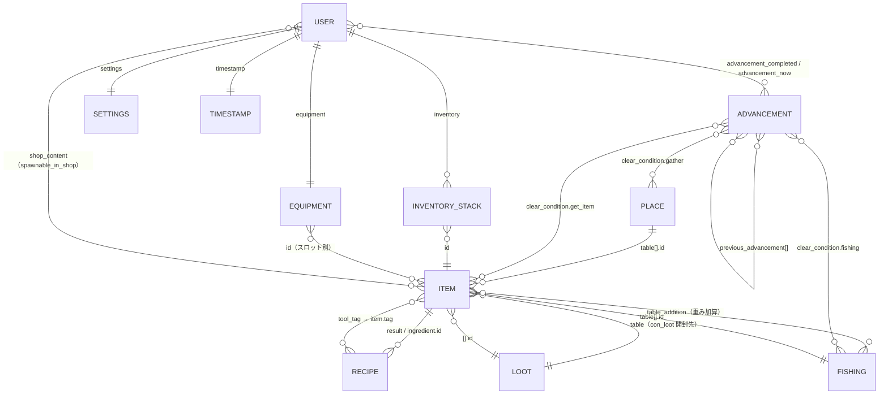
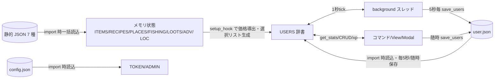

# Urusaiyatsu データモデル仕様（04-data-model）

> **Phase2 仕様書** — 一次根拠はリポジトリ内の現行ソースと非機密 JSON（`data/*.json`）のみ。秘密実値（Discord token 実値、個人 ID、`data/config.json`・`data/user.json` の実値）は一切記載しない。構造・型・必須性・制約のみを記述する。

---

## 1. 文書情報（メタデータ）

| 項目 | 値 |
|---|---|
| ドキュメントパス | `docs/04-data-model.md` |
| 対象機能 ID | `DATA-*` 全 9（`DATA-CONFIG`, `DATA-USER`, `DATA-ITEM`, `DATA-RECIPE`, `DATA-PLACE`, `DATA-FISHING`, `DATA-LOOT`, `DATA-ADVANCEMENT`, `DATA-LOCALIZATION`）。関連するゲーム契約 `CTX-*`（USER-INIT / INV-CRUD / STATS / XP / LOOT / VALUE）のデータ側 |
| 状態 | 調査 = 済 / **詳細仕様化済み = 済** / 検証済み = 未 |
| 対象コミット | `ca0dc10`（HEAD）。作業ツリーは `docs/` 追加のみでクリーン |
| 一次根拠 | `data/*.json`（7 種 + 設定テンプレート）、`core/state.py`, `core/utils.py`, `core/background.py`, `cogs/*.py`, `views/*.py`, `modals/*.py`, `Dockerfile`, `docker-entrypoint.sh` |
| 上位文書 | [`00-feature-catalog.md`](00-feature-catalog.md) |

---

## 2. 目的・スコープ

本仕様書は、Bot が扱う**全エンティティ**を、再実装時にそのまま再現・拡張できる粒度で定義する。データ整合・永続化・並行性の仕様も含む。

含む:

- 可変状態エンティティ（User Profile / Inventory Stack / Equipment / Settings / Timestamp）
- 静的ゲームデータエンティティ（Item / Recipe / Place / Fishing / Loot / Advancement / Localization）
- 各エンティティの属性・型・必須性・ID 規約・制約・参照先
- エンティティ間の関係図（Mermaid）
- 保存・更新・削除の契約
- メモリ内状態（memory）と永続化（persist）の区分
- データ整合の担保方法とスキーマなしの現状
- 同時更新・保持の仕様

含まない: コマンド/View/Modal の表示仕様、Discord との入出力（各文書へ委譲）。

---

## 3. データファイル総覧

| ファイル | 種別 | 規模（本調査時点） | 変更者 | 一次根拠 |
|---|---|---|---|---|
| `data/config.json` | 設定（git 管理外・Docker では secret） | `token` + `admin[].id` の最小構造 | 運営のみ（アプリは読込専用） | `data/config.json.example`, `core/config.py:12-20` |
| `data/user.json` | 可変状態（git 管理外） | ユーザー数分のプロファイル（既定構造は `core/utils.py:new_user`） | アプリ（5 秒毎 + 随時保存） | `core/state.py:43-49`, `core/utils.py:454-457` |
| `data/item.json` | 静的ゲームデータ | 229 アイテム | 開発のみ（実行時はメモリ上で拡張するが**ファイルには書き戻さない**） | `core/state.py:29-30` |
| `data/recipe.json` | 静的ゲームデータ | 179 レシピ | 開発のみ | `core/state.py:27-28` |
| `data/place.json` | 静的ゲームデータ | 13 場所 | 開発のみ | `core/state.py:31-32` |
| `data/fishing.json` | 静的ゲームデータ | 7 場所 | 開発のみ | `core/state.py:33-34` |
| `data/loot.json` | 静的ゲームデータ | 8 テーブル | 開発のみ | `core/state.py:35-36` |
| `data/advancement.json` | 静的ゲームデータ | 116 進捗 | 開発のみ | `core/state.py:39-40` |
| `data/localization.json` | 静的ゲームデータ | 41 キー | 開発のみ | `core/state.py:37-38` |

- 一括読込は `core/state.py:27-40`（import 時に同期的に実行）。
- アプリ実行中に**ファイルへ書かれるのは `user.json` のみ**（`save_users`）。静的 JSON は実行時変更されない（→ §7）。

---

## 4. エンティティ仕様

> 凡例: 型は JSON 表記。`?` は省略可能（欠落許容）。「必須」はコードがそのキーを前提にする（欠落時 `KeyError` になる）ことを示す。参照は「id 文字列が他エンティティのキーと対応する」ことを示し、外部キー制約（DB の FK）ではない（→ §8）。

### 4.1 User Profile（`data/user.json`）

**ID 規約**: トップレベルキー = `str(Discord ユーザー ID)`（文字列化した整数）。値 = 1 ユーザー分のプロファイルオブジェクト。

**既定構造**（`core/utils.py:new_user`、15-55 行）:

| キー | 型 | 必須性 | 意味・制約 | 参照 |
|---|---|---|---|---|
| `inventory` | array | 必須 | Inventory Stack のリスト。**既定は空** | §4.2, Item |
| `name` | string | 必須 | ニックネーム。`new_user` では `bot.fetch_user` の `user.name`。最大 32 文字（`set_name` Modal の制約） | — |
| `stamina` | int | 必須 | 現在スタミナ。`0 <= stamina <= stamina_max`。回復は §4.4 Timestamp | — |
| `money` | int | 必須 | 所持金。`>= 0`（実装上は非負が前提） | — |
| `level_global` | int | 必須 | 総合レベル。`>= 1`。レベル 7 でショップ解放、20 / 100 でアクセサリスロット増 | — |
| `news` | array | 必須 | **実質デッドフィールド**。`/status` 表示時に常に `[]` へリセット（`cogs/status.py:38`）。値は他コードで生成されない。**注意**: リセットは `view_status` の `save_users()`（`views/status_view.py:234`）**後**に実行されるため、後続の保存（5 秒毎 / 他コマンド末尾）までメモリ上のみ。**`settings.news`（bool、表示トグル）とは別物**（§4.4 参照） | — |
| `shop_content` | array | 必須 | 現在のショップ商品 `item_id` のリスト（**常に 10 件**の前提で抽選・参照される） | Item（`spawnable_in_shop`） |
| `advancement_completed` | array | 必須 | 達成済み進捗 id のリスト（順序 = 達成順） | Advancement |
| `advancement_now` | array | 必須 | 現在進行中（解放済み未達成）の進捗 id。**既定は `['gather_forest']`**。起動時に再構築（`core/state.py:160-176`） | Advancement |
| `shop_count` | array | 必須 | 長さ 10 の int 配列。`shop_content` と同じ index 位置の**購入済み回数**。ショップ再抽選時に 10×0 へリセット | §4.5 `shop_amount` |
| `fuel` | int | 必須 | 現在燃料。`>= 0` | — |
| `level_gathering` | int | 必須 | 採集レベル。`>= 1` | — |
| `xp_gathering` | int | 必須 | 採集 XP（レベル内残量）。`>= 0` | — |
| `level_fishing` | int | 必須 | 釣りレベル。`>= 1` | — |
| `xp_fishing` | int | 必須 | 釣り XP。`>= 0` | — |
| `level_combat` | int | 必須 | **デッドフィールド**（初期 1）。XP 付与・表示・導出のどこからも参照されない | — |
| `xp_combat` | int | 必須 | **デッドフィールド**（初期 0） | — |
| `radiation` | int | 必須 | 放射線被曝量。`>= 0`。`max_radiation`（既定 250）を上限の目安に利用 | — |
| `cold` | int | 必須 | 冷気値。`>= 0`。減衰のみ実装（増加経路は現状なし） | — |
| `timestamp` | object | 必須 | §4.4 参照 | — |
| `equipment` | object | 必須 | §4.3 参照 | Item |
| `settings` | object | 必須 | §4.4 参照 | — |

補足:

- レベルアップ曲線: `level_next = int((level+1) ** 1.5) * 5`（`core/utils.py:413`）。`xp()` で採集/釣り XP から累積し、`level_global` も同時に +1。
- `get_stats` の `stamina_max = 100 + level_global - 1`（`core/utils.py:373`）。
- **作成契機**: 未登録ユーザーがゲーム操作を行うと `new_user(user_id)` が自動登録（`core/utils.py:15-55`）。ただし `/settings`（`cogs/settings.py:31`）と `/leaderboard`（`cogs/leaderboard.py:97`）は `new_user` を呼ばず直接参照する（→ §10 懸念 C-05）。
- ユーザー削除のためのコードは**存在しない**。`admin_transit` はキーの移動のみ（`cogs/admin_transit.py:33-36`）。

### 4.2 Inventory Stack

`user.inventory` の要素オブジェクト。**リスト**（辞書ではない）で、要素の index がページ・Modal の custom_id に使われる。

| キー | 型 | 必須性 | 意味・制約 |
|---|---|---|---|
| `id` | string | 必須 | アイテム id。**`item.json` のキーと一致**すること（実行時 `KeyError` 前提） |
| `meta` | object | 必須 | メタデータ。`add_item` / `remove_item_match_meta` / `get_item_match_meta` は **`ITEMS[id]['meta'] | meta`** でアイテム既定とマージしてから比較する（`core/utils.py:63,223,293`）。ツールは `{'damage': int}` を持つ |
| `count` | int | 必須 | 個数。`add` で加算、`remove` で減算。**0 になるとリストから pop** される |

制約・操作契約（`core/utils.py`）:

- **スタック一意制約**: 同一 `(id, meta)` のスタックは 1 つにマージされる（`add_item` は既存一致スタックへ `count +=`。`core/utils.py:66-70`）。
- **取得系**: `get_item`（id+count 充足で最初の一致）、`get_item_stacked`（複数スタック合算）、`get_item_index`（index 返却）、`get_item_match_meta`（id+meta+count）。
- **変更系**: `add_item` / `add_item_from_dict` / `modify_item`（index 指定で meta・count 差替、`core/utils.py:102-113`）。
- **削除系**: `remove_item` / `remove_item_stacked` / `remove_item_from_dict` / `remove_item_from_index` / `remove_item_match_meta`。`required=True` は在庫不足時に何もせず空を返す（部分的消費なしを意図。ただし `remove_item_stacked(required=True)` は**実装不備**で部分消費のまま `[]` を返す → §10 懸念 C-03）。
- 実装上の不備: `remove_item_from_index` が `list.pop(辞書)` を呼ぶ（`core/utils.py:212`）。`list.pop` は index を要求するため `TypeError`（→ §10 懸念 C-03）。

### 4.3 Equipment（`user.equipment`）

| キー | 型 | 必須性 | 意味・制約 |
|---|---|---|---|
| `accessory` | array | 必須 | アクセサリー装備スロットのリスト。要素 = 装備オブジェクトまたは `{}`（空）。**既定 `[{}, {}]`**、レベル 20 / 100 で `{}` が 1 個追加（`core/utils.py:432-433`）→ 最大 4。**同 `equip_type` は同時装備不可**（`cogs/equip.py:60-63`） |
| `gathering_tool` | object | 必須 | 採集ツール。空 = `{}`。**耐久あり**（§4.5 `max_damage` / `meta.damage`） |
| `gathering_equipment` | object | 必須 | 採集装備（アーマー相当） |
| `fishing_rod` | object | 必須 | 釣り竿。`/fishing` 実行に必須（`cogs/fishing.py:34-37`） |
| `fishing_bait` | object | 必須 | 釣り餌。装備中の餌は釣りごとに 50% で 1 消費、0 になるとスロットが `{}` になる（`cogs/fishing.py:97-102`）。`count` を保持 |
| `weapon` | object | 必須 | **デッドスロット**。装備 UI ・表示・ゲーム効果に一切使われない |
| `armor` | object | 必須 | **デッドスロット** |
| `armor_secondary` | object | 必須 | **デッドスロット** |

装備オブジェクトの形（`remove_item` / `remove_item_from_dict` の返却値 = インベントリスタックのコピー）:

| キー | 型 | 必須性 | 意味 |
|---|---|---|---|
| `id` | string | 必須 | アイテム id（`item.json` キー） |
| `meta` | object | 必須 | アイテム meta（ツールは `damage` 経過値） |
| `count` | int | 必須 | 常に 1（装備時 1 個を移動） |

参照・制約:

- 装備可能アイテムは `equip_slot` を持つ 69 件。`equip_slot` の値域: `gathering_tool`(19) / `gathering_equipment`(6) / `fishing_rod`(13) / `fishing_bait`(4) / `accessory`(27)。
- `get_stats`（`core/utils.py:350-371`）は全スロットの装備アイテム `stats` を集計する。アクセサリー分岐は**ローカル変数に加算するだけで `user_stats` へ書き戻していない**（→ §10 懸念 C-04）。
- 装備・交換・取り外しの詳細は `cogs/equip.py:13-92`。取り外し（`remove_item`）と交換（旧装備をインベントリへ戻す）で移動する。

### 4.4 Settings / Timestamp

**`user.settings`**（既定は `core/utils.py:54`）:

| キー | 型 | 必須性 | 値域・意味 | 変更箇所 |
|---|---|---|---|---|
| `news` | bool | 必須 | `True`=ニュースと目標を表示 / `False`=非表示。既定 `True` | `/settings config=1` |
| `status` | int | 必須 | `0`=自動 / `1`=短縮 / `2`=非短縮。既定 `0` | `/settings config=2` |
| `gathering_tool_replacement` | int | 必須 | `0`=同種があれば交換 / `1`=使用可能なら交換 / `2`=続行しない。既定 `0` | `/settings config=4` |
| `crafting_tool_replacement` | int | 必須 | 同上。既定 `0` | `/settings config=3` |
| `continue_fishing` | bool | 必須 | `True`=餌切れ後も続行 / `False`=続行しない。既定 `True` | `/settings config=5` |

一次根拠: `views/settings_view.py`（値域の設定）、`cogs/settings.py`（トグル）、`cogs/gather.py:119-133`・`modals/craft_modal.py:133-147`（利用）。

**`user.timestamp`**（既定 `core/utils.py:39-43`）:

| キー | 型 | 必須性 | 意味・制約 |
|---|---|---|---|
| `stamina` | int/float | 必須 | スタミナ回復の基準時刻（**unix epoch 秒**）または `-1`（回復不要 = 満タン or 回復開始前）。`-1` のとき満タン未満なら現在時刻を設定、回復処理後に `-1` へ戻す |
| `radiation` | int/float | 必須 | 放射線減少の基準時刻または `-1`（0 到達で `-1`） |
| `cold` | int/float | 必須 | 冷気減少の基準時刻または `-1`（0 到達で `-1`） |

更新ロジック（`core/background.py:37-92`、1 秒 tick）:

- 回復間隔 `duration = 3600 / rate`（`stamina_regeneration_rate`=20 → 180 秒/1 回復、`radiation_decrease_rate`=3 → 1200 秒/1、`cold_decrease_rate`=3 → 1200 秒/1）。`rate` は装備 `stats` で変動。
- `unix_time >= timestamp + duration` なら `int(elapsed // duration)` 分だけ増減させ、`timestamp += duration`（繰り越し）。上限/下限に達したら `-1`。
- 補足: 起動時 `setup_hook` が全ユーザーの `stamina` を `stamina_max` へ**強制セット**する（**期待仕様**、`core/state.py:163-164`）。Timestamp の壁時計は保持されない。

### 4.5 Item（`data/item.json`）

**ID 規約**: トップレベルキー = アイテム id（スネークケース文字列）。値 = 定義オブジェクト。229 件。

| キー | 型 | 必須性 | 出現数 | 意味・制約 | 参照 |
|---|---|---|---|---|---|
| `name` | string | **必須** | 229/229 | 表示名（日本語） | — |
| `tag` | array[string] | 任意 | 120/229 | タグ一覧。値域: `spawnable_in_shop`(31) / `equippable`(69) / `consumable`(17) / `con_stamina`(5) / `con_fuel`(3) / `con_radiation`(1) / `con_loot`(8) / `unique_behavior`(2) / ツールタグ（`saw`・`furnace`・`hammer`・`anvil`・`charcoal_kiln`・`recycler`・`refiner`・`forge`・`fisherman_station`・`reaction_chamber`・`atomic_reactor`） | §4.6 `tool_tag` |
| `value` | int | 任意（実行時に保証） | 76/229 | 売値（money）。**未定義は起動時に `set_item_value` がレシピ素材合計から再帰導出**し `ITEMS` へ setdefault（`core/state.py:64-78,117-119`）。導出 0 の場合は警告 print のみ | §4.6 |
| `price` | int | 任意（実行時に保証） | 2/229 | ショップ買値。`spawnable_in_shop` で未定義なら `value * 4` を setdefault（`core/state.py:130-132`） | — |
| `shop_amount` | int | 任意 | 31/229 | 1 ローテーションあたりの購入上限数（`views/shop_view.py:32-34,48-49`） | `user.shop_count` |
| `equip_slot` | string | 任意（`equippable` と対） | 69/229 | 装備スロット。値域: `gathering_tool` / `gathering_equipment` / `fishing_rod` / `fishing_bait` / `accessory` | §4.3 |
| `equip_type` | string | 任意（アクセサリー用） | 27/229 | アクセサリー種別（同時装備不可判定）。値域: `gathering`(4) / `fishing`(4) / `rest`(3) / `money`(3) / `biting`(3) / `crafting`(3) / `radiation_unit`(3) / `radiation_shield`(2) / `robot_arm`(2) | §4.3 |
| `stats` | array[{id,amount,multiply?}] | 任意 | 69/229 | 装備時のステータス影響。`id` は `get_stats` の統計キー（`gathering_power` 等 15 種）、`amount` は数値、`multiply`（任意）が `true` なら乗算 | §4.3 |
| `max_damage` | int | 任意 | 8/229 | ツール耐久上限。`meta.damage >= max_damage` で破損 | §4.2 meta |
| `meta` | object | 任意 | 8/229 | アイテム既定メタ（静的には 8 件のみ定義）。実行時にスタックの `meta` とマージされる（ツールは `{'damage': 0}`）。**静的定義がないアイテムへは起動時 `setup_hook` が `{}` を setdefault する**（`core/state.py:114-115`） | §4.2 |
| `table` | string | 任意 | 8/229 | 開封先 loot テーブル id（`con_loot` 消費品） | §4.9 |
| `stamina_restore` | int | 任意 | 5/229 | 回復量（`con_stamina` 消費品） | — |
| `fuel_restore` | int | 任意 | 3/229 | 回復量（`con_fuel` 消費品） | — |
| `radiation_remove` | int | 任意 | 1/229 | 除去量（`con_radiation` 消費品） | — |
| `table_addition` | object | 任意 | 2/229 | 釣り場所 id → `{item_id: 重み加算}`。餌装備時に釣りテーブルの重みへ加算（`cogs/fishing.py:172-178`） | §4.8 |
| `stamina_reduce_chance` | int | 任意 | 1/229 | **デッドフィールド**（コード参照 0 件） | — |

**実行時（メモリ内）にのみ追加される導出キー**（`core/state.py:104-148`、ファイルへは書き戻さない）:

| キー | 型 | 導出 |
|---|---|---|
| `emoji` | string | アプリ絵文字（`<:name:id>`）または `:item_id:` フォールバック |
| `name_e` | string | `emoji + name`（表示用） |
| `value` / `price` | int | 上記の導出 |

> ※`meta` は上記 §4.5 のフィールド表に含めて記載している（静的任意 + 起動時 `{}` setdefault）ため、ここには重複記載しない。

### 4.6 Recipe（`data/recipe.json`）

**ID 規約**: ファイルは**リスト**（179 件）。配列 index（0 起点）がクラフト View の custom_id（`modals/craft_modal.py:28` で `int(custom_id)` として利用）。

| キー | 型 | 必須性 | 出現数 | 意味・制約 | 参照 |
|---|---|---|---|---|---|
| `result` | string | 必須 | 179/179 | 生成アイテム id | Item |
| `type` | string | 必須 | 179/179 | 経験値種別。値域: `gathering`(126) / `fishing`(53)。`xp()` の type へ直結（`core/utils.py:405-410`） | — |
| `tool_tag` | string \| null | 必須 | 179/179（null 23） | 必要ツールタグ。null = ツール不要。`tool_tag in ITEMS[item]['tag']` で判定 | Item.tag |
| `stamina` | int | 必須 | 179/179 | 1 回あたりスタミナ消費 | — |
| `xp` | int | 必須 | 179/179 | 1 回あたり XP | — |
| `ingredient` | object | 必須 | 179/179 | 素材 `{item_id: 個数}`（1 レシピ 1〜複数素材） | Item |
| `default` | bool | 任意 | 154/179 | **true のレシピのみ**売値導出（`set_item_value`）で素材合計に使われる（`core/state.py:67-74`） | §4.5 value |

制約・特徴:

- `result` は重複し得る（179 レシピ / 157 ユニーク結果。22 件は別ツール・別素材の代替レシピ）。
- クラフト処理は `modals/craft_modal.py:36-186`。ツール耐久 `max_damage` 到達で破損 → 交換設定（`settings.crafting_tool_replacement`）に従う。
- **読み込み encoding**: `recipe.json` のみ `open(..., 'r')` で encoding を指定していない（他 6 JSON は `encoding='UTF-8'`、`core/state.py:27-28`）。ASCII 範囲外の文字を含む場合に環境依存で読込エラーになり得るため、**低優先度の注記**とする（再実装時に統一推奨）。

### 4.7 Place（`data/place.json`）— 採集場所

**ID 規約**: トップレベルキー = 場所 id。13 件。`place_choices`（`/gather` の引数 choice）の value に使用。

| キー | 型 | 必須性 | 出現数 | 意味・制約 | 参照 |
|---|---|---|---|---|---|
| `name` | string | 必須 | 13/13 | 表示名 | — |
| `required_level` | int | 必須 | 13/13 | 要求採集レベル（`user.level_gathering`） | — |
| `required_gathering_power` | int | 必須 | 13/13 | 要求採集パワー。`0` はツール不要（`cogs/gather.py:31-36,46-49`）。`>0` の場所はツール破損ロジックが働く | §4.3, §4.5 stats |
| `xp` | int | 必須 | 13/13 | 1 回あたり採集 XP | — |
| `table` | array[{id,weight}] | 必須 | 13/13 | 重み付きルートテーブル（`table_roll` で抽選） | Item |
| `radioactive` | bool | 任意 | 1/13 | true の場所は採集ごとに放射線 +1 の判定がある（`cogs/gather.py:75-77`） | — |

### 4.8 Fishing（`data/fishing.json`）— 釣り場所

**ID 規約**: トップレベルキー = 場所 id。7 件。`fishing_choices` の value に使用。

| キー | 型 | 必須性 | 出現数 | 意味・制約 | 参照 |
|---|---|---|---|---|---|
| `name` | string | 必須 | 7/7 | 表示名 | — |
| `required_level` | int | 必須 | 7/7 | 要求釣りレベル（`user.level_fishing`） | — |
| `xp` | int | 必須 | 7/7 | 1 ロールあたり釣り XP | — |
| `table` | array[{id,weight,power_min,power_max}] | 必須 | 7/7 | 釣りルートテーブル。`power_min` / `power_max` で釣りパワーによる絞り込み（`cogs/fishing.py:180-186`）。**`power_max == -1` は「`power_min` 以上」の開区間**を意味する | Item |

補足: 釣りパワー = 装備 `stats['fishing_power']` + 時刻ボーナス `int((20 - abs(現在時 - 6)) / 3)`（`cogs/fishing.py:170`）。餌 `table_addition` がテーブル要素の重みを加算する（§4.5）。

### 4.9 Loot（`data/loot.json`）

**ID 規約**: トップレベルキー = テーブル id。8 件（`common_geode` / `rare_geode` / `lava_geode` / `radioactive_geode` / `crate` / `treasure_chest` / `golden_crate` / `abyssal_treasure_chest`）。値 = **リスト**（項目数 6〜13）。

| キー | 型 | 必須性 | 意味・制約 | 参照 |
|---|---|---|---|---|
| `id` | string | 必須（各要素） | 抽選されるアイテム id | Item |
| `weight` | int | 必須（各要素） | 重み。`table_roll` が `random.choices(population, weights, k=count)` で抽選し、被りを集計した `{id: 個数}` を返す（`core/utils.py:301-322`） | — |

### 4.10 Advancement（`data/advancement.json`）

**ID 規約**: トップレベルキー = 進捗 id。116 件。`gather_forest`（既定の最初の目標）は特別な位置づけ。

| キー | 型 | 必須性 | 出現数 | 意味・制約 | 参照 |
|---|---|---|---|---|---|
| `title` | string | 必須 | 116/116 | タイトル（表示用） | — |
| `description` | string | 必須 | 116/116 | 説明（表示用） | — |
| `complete_message` | string | 必須 | 116/116 | 達成メッセージ | — |
| `clear_condition` | object | 必須 | 116/116 | 達成条件。**キーは常に 1 種**（本データでは複合条件なし）: `gather: str`(13)=採集場所 id / `fishing: str`(7)=釣り場所 id / `get_item: str`(92)=アイテム id / `level: int`(4)=総合レベル以上 | Place, Fishing, Item |
| `previous_advancement` | array | 必須 | 116/116 | 前提進捗 id のリスト（**要素に null を含み得る**。全前提の達成が解放条件。**null は前提なし**を意図）。**現データで null を含むのは `gather_forest`（`[null]`）のみ** | Advancement（自己参照） |

判定ロジック（`core/utils.py:377-397`, `core/state.py:166-176`）:

- 解放: `complete_advancement` は `previous_advancement` の全要素が `advancement_completed` に含まれる場合のみ解放（`core/utils.py:386-394`）。`setup_hook` 側は `prev_adv is None` を**達成扱い**（`core/state.py:172`）とし、`complete_advancement` 側は `prev_adv not in completed` を**未達成扱い**にする（`core/utils.py:390-391`）→ **判定が食い違う**（→ §10 懸念 C-06）。
- 達成: 対象コマンド（gather / fishing / craft / use / レベルアップ）が `advancement_now` を走査し条件一致で `complete_advancement` を呼ぶ。

### 4.11 Localization（`data/localization.json`）

**構造**: トップレベルは **flat な dict**（41 件）で、各要素は `raw 文字列（タグ名 / stat id / フィールド名）→ 日本語表示文字列` の 1 対 1 対応（配列やネスト構造ではない）。

| キー | 型 | 必須性 | 意味・制約 |
|---|---|---|---|
| （raw 文字列キー） | string | 必須（41/41） | 表示ラベル化する raw 文字列（タグ名 / stat id / フィールド名） |
| （値） | string | 必須（41/41） | 日本語表示。`item_data` の `localize()` が引数に一致する場合のみ変換（`cogs/item_data.py:12-15`）。一致しない raw 文字列はそのまま表示される |

一次根拠: `data/localization.json`（41 キー）、`core/state.py:37-38`（import）、`cogs/item_data.py:12-15`（参照）。

---

## 5. 関係図

### 5.1 エンティティ関係（ER）

### 5.2 実行時データフロー

---

## 6. 保存・更新・削除の契約

### 6.1 読込

| データ | 契機 | 方法 | 一次根拠 |
|---|---|---|---|
| 静的 JSON 7 種 | `core` import 時 | `json.load` で dict/list 化（例外処理なし → 破損時クラッシュ） | `core/state.py:27-40` |
| `user.json` | `core` import 時 | `json.load`。**失敗時は裸 `except` で握りつぶし `{}` として上書き保存**（→ §10 懸念 C-08） | `core/state.py:43-49` |
| `config.json` | `core.config` import 時 | `json.load`。失敗時クラッシュ | `core/config.py:12-13` |

### 6.2 保存（`save_users`）

- `json.dump(USERS, f, indent=2, ensure_ascii=False)` で **`user.json` に全量を直接書込**（`core/utils.py:454-457`）。
- 一時ファイル + rename の原子化・ロックなし（→ §10 懸念 C-07）。
- 呼び出し契機:
  1. バックグラウンドループで 5 tick（約 5 秒）毎（`core/background.py:94-97`）
  2. 状態を変更した各コマンド / View / Modal の末尾（`cogs/*.py`、`views/*.py`、`modals/*.py` の各 `save_users()`）
  3. `/status` 表示の共通処理末尾（`views/status_view.py:233-234`。状態変更を伴わない保存もある）

### 6.3 更新

- 基本は **in-place ミューテーション**（`USERS[str(user_id)][...]` を直接変更、例: `stamina -=`、`money +=`、`advancement_completed.append`）。
- Inventory は契約関数を介する（§4.2）。`modify_item` はコピー → 削除 → 差替という**非原子的な操作**（`core/utils.py:102-113`）。
- 静的 JSON は実行時更新されない。`ITEMS` への導出キー付与（`emoji` / `name_e` / `value` / `price` / `meta`）は**メモリ内のみ**。

### 6.4 削除

| 対象 | 手段 | 一次根拠 |
|---|---|---|
| インベントリスタック | count 0 時に `list.pop(index)`（`remove_*` 群） | `core/utils.py:116-249` |
| 装備スロット | スロットへ `{}` 代入（破損・餌切れ時） | `cogs/gather.py:139`、`cogs/fishing.py:102` |
| ユーザープロファイル全体 | **コード上の削除手段なし**。`admin_transit` はキー移動のみ。実運用では手動編集 / `docker compose down -v` | `cogs/admin_transit.py:33-36`、`README.md:69` |
| ユーザーの `news` | `/status` 表示時に `[]` へリセット | `cogs/status.py:38` |

---

## 7. memory / persist 区分

| 区分 | 対象 | 備考 |
|---|---|---|
| **persist（永続化）** | `data/user.json`（アプリが書く唯一のファイル） | Docker では `/app/runtime/user.json`（volume）への symlink。5 秒毎 + 随時保存 |
| **persist（読込専用）** | `data/config.json`、静的 JSON 7 種 | アプリは実行時に書き込まない。静的 JSON の変更はデプロイ作業 |
| **memory（プロセス内のみ）** | `USERS`（実行中の全ユーザー状態。保存契機まではメモリのみ） | 停止すると未保存分（最大 5 秒）が失われる |
| **memory（生成物）** | `EMOJIS`、`place_choices` / `fishing_choices` / `consumable_choices` / `equippable_choices` / `item_choices` / `shop_list` / `equip_slot`、`ITEMS` の導出キー（`emoji` / `name_e` / `value` / `price` / `meta`） | setup_hook で毎起動時に再生成。`item.json` 等へは**書き戻さない** |

一次根拠: `core/state.py:52-61,104-158`、`core/utils.py:454-457`、`Dockerfile:28-37`、`README.md:65-73`。

---

## 8. データ整合・スキーマなし

- **JSON Schema・バリデータ・型チェックは存在しない**（`.github`、pytest、mypy 等なし。`AGENTS.md` も自動テストなしを明記）。
- 整合は**コード契約（前提）**でのみ担保される。実行時に壊れた参照は `KeyError` や誤動作として顕在化する。
- 参照整合の現状（本調査のスクリプトで検出）:
  - `recipe.result` / `recipe.ingredient.*` / `place.table[].id` / `fishing.table[].id` / `loot[].id` / `advancement.clear_condition.*` → `item.json`・`place.json`・`fishing.json` への参照は**すべて有効**。
  - `advancement.previous_advancement` に **3 件の欠落参照**あり: `craft_drill_c1` / `craft_drill_i1` / `gather_ore_hallow` → 存在しない `craft_drill_engine`（→ §10 懸念 C-06）。
- 実行時整合の担保（実装依存）: インベントリの `(id, meta)` 一意性は `add_item` の走査、装備スロットの種別衝突は `cogs/equip.py:60-63` で部分担保。完全な不変条件の検査はない。

---

## 9. 同時更新・保持の仕様

### 9.1 実行モデル

- プロセスは **単一**。asyncio イベントループ（コマンド・View・Modal 処理）+ **デーモンスレッド**（`core/background.py` の 1 秒ループ）の 2 系統が `USERS`（メモリ上の辞書）を共有する。
- **ロック・アトミック操作なし**。イベントループとデーモンスレッドが同時に同一ユーザーの値を読書きし得る（例: コマンド実行中にタイム状態更新が走る）。
- **トップレベル構造の race（C-17）**: デーモンスレッドが `USERS.items()` を反復走査する（`core/background.py:22`）間、イベントループ側の `new_user`（`core/utils.py:17` の `USERS.setdefault`）や `admin_transit`（`cogs/admin_transit.py:33-36` の `USERS.pop` / `setdefault`）が**トップレベルキーを追加/削除**すると `RuntimeError: dictionary changed size during iteration` になり得る。ループに try/except がないため、発生時はデーモンスレッドが終了し JOB-TIMESTATE / JOB-PERSIST が停止する（頻度は **U-13**）。C-07 のファイル書込 race とは**別のメモリミューテーション race**。

### 9.2 永続化の並行性

- `save_users` は `user.json` へ**全量を直接書込**（一時ファイル+rename なし・lock なし・fsync なし）。
- 5 秒毎保存と各コマンド末尾の随時保存が並走し得る → クラッシュ時破損・同時書込破損のリスク（→ §10 懸念 C-07）。
- **複数レプリカは禁止**（`AGENTS.md` / `README.md:79-81` が単一レプリカ運用を明示）。複数プロセスで同一 `user.json` を書くと破損する。

### 9.3 保持・停止

- `user.json` は再起動・再デプロイを跨いで保持される（Docker は `bot_runtime` volume。`docker compose down -v` でのみ消える）。
- 停止時: `SIGINT`（`compose.yaml:13`、graceful）だが、定期保存仕様のため**最後の保存から最大 5 秒分の未保存進行が失われる**（`README.md:82-83`）。
- 再起動時の整合: `setup_hook` が全ユーザーの `stamina` を満タン（`stamina_max`）へ強制し（**期待仕様**）、`advancement_now` を再構築する。`timestamp` はそのまま保持される（`stamina` のみ強制回復）。

---

## 10. 仕様と既知懸念の分離

### 10.1 仕様（コードで確定できる事項）

- §4〜§9 は現行コード・非機密 JSON を一次根拠とする**現行仕様**である。
- 再実装時の契約として特に重要なもの:
  - インベントリは `{id, meta, count}` の**リスト**、`(id, meta)` 一意・count 0 で除去（§4.2）。
  - 装備スロットは「空 = `{}`」、アクセサリーは**リスト**（§4.3）。
  - `user.json` のトップレベルキーは文字列化ユーザー ID（§4.1）。
  - 静的データは実行時変更なし・`ITEMS` 導出はメモリ内のみ（§7）。
  - 永続化は `user.json` 全量書込の 1 方式のみ（§6.2, §9）。

### 10.2 既知の懸念（機能カタログ §5 より引き継ぎ・データ関連分）

| ID | 懸念 | 確定根拠 | 影響 |
|---|---|---|---|
| C-02 | `admin_give` の負数剥奪が**加算**になる | `cogs/admin_give.py:45` → `core/utils.py:135,138`（`count = min(count, ...)` が負数を維持し `count -= 負数` で加算） | 負の `amount` でアイテムが増える |
| C-03 | `list.pop(辞書)` TypeError と `remove_item_stacked(required=True)` の部分消費 | `core/utils.py:212`、`core/utils.py:147-171` | クラフトでツール破損時に Interaction Failed。在庫不足時に実インベントリが部分消費されたまま空を返す |
| C-04 | アクセサリー stats が反映されない | `core/utils.py:352-362`（ローカル変数に加算するのみ） | アクセサリー 27 種の効果が無効 |
| C-05 | `/settings`・`/leaderboard` が未登録ユーザーで失敗 | `cogs/settings.py:31`、`cogs/leaderboard.py:97`（`new_user` 呼び出しなし） | 初回利用で `KeyError` / `ValueError` |
| C-06 | advancement の欠落参照 | 3 件が存在しない `craft_drill_engine` を `previous_advancement` に参照（§8）。`complete_advancement` と `setup_hook` の null 前提の扱いが食い違う | 3 進捗が永久解放不可。前提判定の曖昧さ |
| C-07 | 非 atomic・無 lock 永続化 | `core/utils.py:454-457` | クラッシュ・同時書込で破損リスク（§9） |
| C-08 | `user.json` 読込の裸 `except` | `core/state.py:43-49` | 破損時に全ユーザーデータを `{}` で上書き |
| C-16 | `/use` の `count` 非正数ガードなし | `cogs/use.py:21`、`core/utils.py:172-185` | 負数で在庫増加・効果反転、`con_loot` は loot なし（空結果）で処理継続 |
| C-17 | 背景ループの `USERS.items()` 反復と top-level mutation race | `core/background.py:22`、`core/utils.py:17`、`cogs/admin_transit.py:33-36` | `RuntimeError` でデーモンスレッド終了（C-07 のファイル書込 race とは別。頻度は U-13） |
| C-18 | `new_user` の `fetch_user` 未捕捉 | `core/utils.py:18` | Discord API 障害時に新規登録経路が失敗する（例外が未捕捉のまま伝播。例外型・UI は U-14） |
| C-20 | use / gather / fishing の `count` 非正数ガード・上限不在 | `cogs/use.py:21`, `cogs/gather.py:21`, `cogs/fishing.py:23` | 入力境界の未定義（挙動は推測しない） |
| C-21 | stale shop choice の `shop_content.index` `ValueError` | `views/shop_view.py:27`、`core/background.py:29-35` | 表示済み購入 View の選択が interaction failed |
| C-22 | `craft_view` の `set_craft_func` / `_craft_func` デッドコード | `views/craft_view.py:12-19` | 未使用のグローバル注入フック |
| C-D01 | **デッドフィールド群**（本稿で整理） | `level_combat` / `xp_combat`（`core/utils.py:35-36`）、`news`（`cogs/status.py:38`）、装備スロット `weapon` / `armor` / `armor_secondary`（`core/utils.py:50-52`）、item の `stamina_reduce_chance`、`unique_behavior` タグ（2 件） | データモデル上存在するが未使用。誤解を招く・拡張時に事故りやすい |

### 10.3 未確定（検証が必要な事項）

| ID | 項目 | 内容 | 確定に必要な確認 |
|---|---|---|---|
| U-02 | inventory pop bug の発火条件 | C-03 が実ユーザーに影響するか（耐久 0 到達クラフトが実際に起こるか） | 実機でのクラフト実行 |
| U-06 | ショップ再抽選の重複 | `random.sample(shop_data, 10)`（`core/background.py:34`）は `shop_list` 31 件から 10 枠の整合 | ローテーション観察 |
| U-09 | 複数インスタンス同時実行 | §9 の単一レプリカ要請に対する実挙動 | 多重起動テスト |
| U-12 | ゲームバランス数値 | 回復速度・XP 曲線・`value*4` 等はコード既定であり意図は未確定 | Phase2 での定義 |
| U-13 | C-17 の race 発生頻度 | `USERS.items()` 反復と `new_user` / `admin_transit` の top-level mutation が重なる頻度 | 新規登録・`admin_transit` 実行下での観察 |
| U-14 | C-18 の `fetch_user` 失敗の例外型・UI | `new_user` の `bot.fetch_user` 失敗時の例外型・ユーザー表示は未検証（断定しない） | Discord API 障害時の新規登録実行 |
| U-D01 | `get_items` 条件分岐のデッドコード | gather / fishing / craft / use は `get_items`（複数アイテム条件）分岐を持つが、advancement データには `get_items` が 0 件 | 仕様として複合条件を許容するか確認 |

---

## 11. 関連文書（相対リンク）

| 文書 | 関係 |
|---|---|
| [`00-feature-catalog.md`](00-feature-catalog.md) | 機能 ID 台帳・懸念一覧（§5）・データ規模のベースライン |
| [`03-runtime-and-configuration.md`](03-runtime-and-configuration.md) | 起動・設定・永続化の実行時側仕様（本稿の §6/§7/§9 と対） |
| [`06-features/progression-and-inventory.md`](06-features/progression-and-inventory.md) | ゲーム契約（CTX-USER-INIT / CTX-INV-CRUD / CTX-STATS / CTX-XP）の詳細 |
| [`06-features/economy-and-equipment.md`](06-features/economy-and-equipment.md) | CTX-VALUE（売値導出）と装備・経済の詳細 |
| [`06-features/world-activities.md`](06-features/world-activities.md) | CTX-LOOT・採集・釣り・クラフトの詳細 |
| [`07-event-processing/scheduled-and-background-jobs.md`](07-event-processing/scheduled-and-background-jobs.md) | 時間状態更新・保存ジョブの詳細 |
| [`13-open-questions-and-technical-debt.md`](13-open-questions-and-technical-debt.md) | C-02〜C-08・C-10〜C-14・C-16〜C-22・C-D01・U-13〜U-15 等の引き継ぎ |
