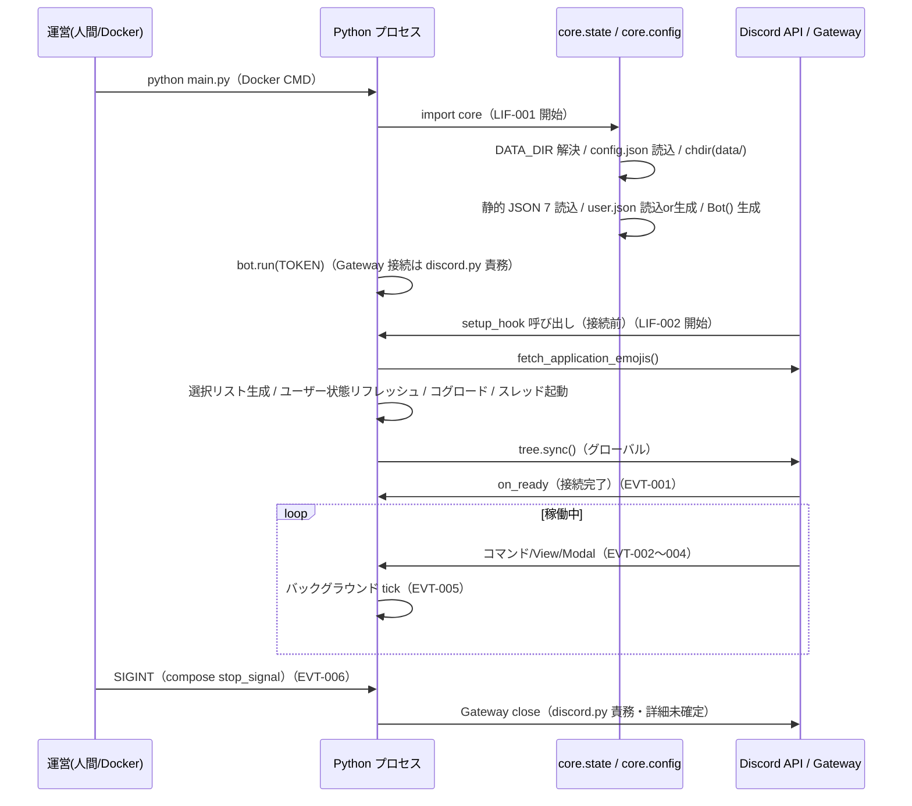

# ライフサイクル仕様（07-event-processing/lifecycle）

> **対象機能ID（本仕様）**: LIF-001 / LIF-002 / EVT-001〜006
> **対応カタログID**: LIFE-ENTRYPOINT / LIFE-IMPORT / LIFE-SETUP / LIFE-EMOJI / LIFE-CHOICES / LIFE-EXTLOAD / LIFE-TREESYNC / LIFE-ONREADY（機能カタログ §2.4）
> **アクター**: 運営（人間・プロセス/Docker 起動）、Discord API、Discord ユーザー、Bot プロセス
> **関連文書**: `00-feature-catalog.md`（§1.4 / §4.1 / §5 / §6.2）、`07-event-processing/scheduled-and-background-jobs.md`、`08-external-integrations/README.md`、`08-external-integrations/discord.md`
> **一次根拠（現行実装）**: `main.py`（:1-7）、`core/__init__.py`（:1-8）、`core/state.py`（:12-205）、`core/config.py`（:1-20）、`core/utils.py`（:15-55, :325-374, :454-457）、`cogs/__init__.py`（:6-23）、`Dockerfile`（:1-43）、`docker-entrypoint.sh`（:1-32）、`compose.yaml`（:1-41）

本仕様では「現行実装の挙動（as-is）」「失敗時の挙動」「再実装契約（to-be の受け入れ条件）」を分けて記述する。現行コードから直接確定できない事項は「未確定」として区別する（機能カタログ §5.2 の U-* と対応）。

---

## 1. ID マッピングと全体の時間順フロー

| 本仕様 ID | 対応カタログ ID | 概要 |
|---|---|---|
| LIF-001 | LIFE-ENTRYPOINT, LIFE-IMPORT | プロセス起動・import 時ブートストラップ |
| LIF-002 | LIFE-SETUP, LIFE-EMOJI, LIFE-CHOICES, LIFE-EXTLOAD, LIFE-TREESYNC | `setup_hook` 初期化オーケストレーション |
| EVT-001 | LIFE-ONREADY | 起動完了（Gateway 接続後）イベント |
| EVT-002 | —（CMD-* と連動） | スラッシュコマンド実行 |
| EVT-003 | —（VIEW-* と連動） | View インタラクション（ボタン/セレクト） |
| EVT-004 | —（MODAL-* と連動） | Modal 送信（`on_submit`） |
| EVT-005 | JOB-TIMESTATE, JOB-PERSIST | バックグラウンドループ 1 tick |
| EVT-006 | —（OPS-CONFIG と連動） | シャットダウン／プロセス終了 |

時間順の全体フロー:

---

## 2. LIF-001: プロセス起動・import 時ブートストラップ

対応: LIFE-ENTRYPOINT / LIFE-IMPORT。`core`（`core.state` / `core.config`）の import が起点となる。

### 2.1 時間順の処理

1. 運営が `python main.py` を実行（Docker では `CMD ["python", "main.py"]`、`Dockerfile:43`）。エントリポイントが設定複製・権限降格後に app ユーザー（UID/GID 10001）で実行する（`docker-entrypoint.sh:5-32`）。
2. `main.py` がモジュール先頭で `from core import bot, TOKEN`（`main.py:4`）を実行。**import 時点で起動の前提処理が走る**（LIFE-IMPORT の性質）。
3. `core/__init__.py` が `from .state import bot`（`core/__init__.py:4`）→ `core.state` の import 開始。
4. `core.state` が `from .config import DATA_DIR`（`core/state.py:12`）→ `core.config` の import 開始。
5. `core.config` が `DATA_DIR` を `Path(os.path.dirname(os.path.dirname(__file__))) / 'data'` で計算（`core/config.py:9`。実行時 cwd に依存しないリポジトリルート基準の絶対パス）し、`data/config.json` を読み込む（`core/config.py:12-13`）。`TOKEN = CONFIG['token']`（`:15`）、`ADMIN = [a['id'] for a in CONFIG['admin']]`（`:18-20`）。
6. `core.state` が `os.chdir(DATA_DIR)`（`core/state.py:15`）でプロセス cwd を `data/` へ変更。以降、相対パスのデータ読込が `data/` 基準になる（`AGENTS.md` 記載の実行時挙動と一致）。
7. 静的 JSON を 7 ファイル読み込み（`core/state.py:26-40`）: `recipe.json`（:27-28, encoding 指定なし）→ `item.json`（:29-30, UTF-8）→ `place.json`（:31-32）→ `fishing.json`（:33-34）→ `loot.json`（:35-36）→ `localization.json`（:37-38）→ `advancement.json`（:39-40）。
8. `user.json` を読み込み、存在しない場合は `{}` を生成して書き出す（`core/state.py:42-49`）。読込失敗は**裸の `except:`** で捕捉（:46）。
9. `EMOJIS` を 8 キー（stamina / money / fuel / level / level_gathering / level_fishing / empty / radiation）で初期化（`core/state.py:51-61`）。※ `recipe.json` のみ encoding 指定なし（他は UTF-8）である点は現行実装の不統一。
10. モジュール末尾で `bot = Bot()` を生成（`core/state.py:204-205`）。`Bot.__init__` は Intents = default + `message_content` / `messages` / `members` / `reactions`、`command_prefix="!"`（`core/state.py:84-90`）。
11. `core/__init__.py` が `from .config import TOKEN`（`core/__init__.py:5`）を続行し、`bot` / `TOKEN` を re-export。
12. `main.py` が `if __name__ == "__main__":` で `bot.run(TOKEN)`（`main.py:6-7`）を実行。Login・Gateway 接続・自動再接続は discord.py ライブラリの責務に委譲（詳細は `08-external-integrations/discord.md`）。

### 2.2 失敗時（現行実装）

| 失敗シナリオ | 現行の挙動 | 根拠 |
|---|---|---|
| `data/config.json` 未作成 | `FileNotFoundError` が import 時に送出され、`main.py` の import 自体が失敗してトレースバック表示でプロセス終了。親切な案内なし | `core/config.py:12` |
| 静的 JSON の欠落 | `FileNotFoundError` で import 失敗 → プロセス終了 | `core/state.py:27-40` |
| 静的 JSON の破損 | `JSONDecodeError` で import 失敗 → プロセス終了 | `core/state.py:27-40` |
| `user.json` の破損 | 裸の `except:` が例外を握りつぶし、**`{}` で上書き**して起動続行（既存ユーザーデータ消失の恐れ） | `core/state.py:43-49`（カタログ C-08） |
| `data/` ディレクトリ不在 | 最初の `open()` で `FileNotFoundError` | `core/state.py:27` |

### 2.3 再実装契約（to-be）

- **config.json 欠落時**: 起動を即中断し、対処手順（例: `cp data/config.json.example data/config.json`）を含む明確なログを出力して失敗させる。
- **静的 JSON の欠落/破損**: 起動時に全 7 ファイルの存在とパースをバリデーションし、欠落・破損は起動失敗として扱う。対象ファイル名をログに含める。
- **user.json の破損**: 裸の `except:` を廃止し、捕捉する例外型（`json.JSONDecodeError` / `OSError`）を限定する。破損検知時は破損ファイルを `user.json.<日時>.corrupt` 等へ退避したうえで復旧し、復旧経緯をログに残す（C-08 解決）。
- **import 副作用の除去**: chdir・データ読込・Bot インスタンス生成といった import 時副作用を「明示的な起動関数（例: `run_bot()`）」へ移し、import を副作用なしにする。起動手順をユニットテスト可能にする（OPS-OWNERSHIP / C-13 と整合）。
- **観測性**: import 中の処理を `print` ではなく `logging` で記録する（C-12 解決）。

---

## 3. LIF-002: setup_hook 初期化オーケストレーション

対応: LIFE-SETUP / LIFE-EMOJI / LIFE-CHOICES / LIFE-EXTLOAD / LIFE-TREESYNC。discord.py が Gateway 接続**前**に `setup_hook` を呼び出す（`core/state.py:92`）。

### 3.1 時間順の処理

1. `print("setup_hookを実行中")`（`core/state.py:94`）。
2. **アプリ絵文字取得**（`core/state.py:97-102`）: `await self.fetch_application_emojis()` を実行し、絵文字名が `ITEMS` に一致 → `ITEMS[name]['emoji']` を設定、`EMOJIS` のキーに一致 → `EMOJIS[name]` を設定。**失敗時の try/except はない**。詳細は `08-external-integrations/discord.md` の EXT-001-D。
3. **アイテムループ**（`core/state.py:104-148`）: 各 ITEMS エントリについて
   - emoji 未設定なら `:item_id:` を既定設定（:109-110）、`name_e = emoji + name`（:111）。
   - meta 未設定なら `{}`（:114-115）。
   - value 未設定なら `set_item_value(item_id)` でレシピから再帰導出（:117-119、`core/state.py:64-78`）。
   - `item_choices` を 25 件/ページで構築（:121-126）。
   - `tag` が存在する場合: `spawnable_in_shop` → `price` を既定 `value * 4` に設定し `shop_list` に追加（:129-132）/ `consumable` → `consumable_choices` に追加（:133-134）/ `equippable` → ページ先頭に `'remove_item'` センチネルを置いた `equippable_choices` と `equip_slot`（重複排除）を構築（:135-143）。
4. **fishing_choices 生成**（`core/state.py:150-153`）: FISHING_PLACES の全エントリを Choice 化。
5. **place_choices 生成**（`core/state.py:155-158`）: PLACES の全エントリを Choice 化。
6. **ユーザー状態リフレッシュ**（`core/state.py:160-176`）: 全 USERS について
   - `stamina = stamina_max`（= `100 + level_global - 1`）に**強制セット**（:163-164、**期待仕様**）。
   - `advancement_now` を再構築（:166-176）: `advancement_completed` に未登録の進捗のうち、`previous_advancement` がすべて完了済み **または None** のものを解放。※ `core/utils.py:389-391` の `complete_advancement`（None を未達成扱い）と判定が食い違う（カタログ C-06）。
7. **コグロード**（`core/state.py:178-185`）: `from cogs import EXTENSIONS`（`cogs/__init__.py:6-23` の 16 コグ）を順に `await self.load_extension(ext)`。失敗は `print` のみで続行（:184-185）。※ Docker では `requirements.lock` に `deepmerge` が無いため `admin_manage` のロード失敗が想定される（カタログ C-01 / U-01）。
8. **バックグラウンドループ開始**（`core/state.py:187-189`）: `Thread(target=start_background_loop, daemon=True).start()` でデーモンスレッドを起動。詳細は `07-event-processing/scheduled-and-background-jobs.md`。
9. **コマンドツリー同期**（`core/state.py:192`）: `await self.tree.sync()` を guild 指定なしで実行（グローバル同期）。詳細は `08-external-integrations/discord.md` の EXT-001-E。

### 3.2 失敗時（現行実装）

| 失敗シナリオ | 現行の挙動 | 根拠 |
|---|---|---|
| 絵文字取得失敗（ネットワーク / レート制限 / API エラー） | try/except なし。例外が setup_hook から伝播し、**起動が失敗**（Gateway 未接続）。再試行なし | `core/state.py:97` |
| 価格導出（`set_item_value`）で売却価格 0 | `print` 警告のみで value=0 のまま続行 | `core/state.py:76-77` |
| ユーザーデータに `level_global` 等が欠損 | `KeyError` → setup_hook 失敗 → 起動失敗 | `core/state.py:163-164` |
| 特定コグのロード失敗 | `print` のみでスキップし起動続行。失敗コグのコマンドは未登録のまま | `core/state.py:184-185` |
| `tree.sync()` 失敗 | 例外が伝播し起動失敗。再試行なし | `core/state.py:192` |

### 3.3 再実装契約（to-be）

- **絵文字取得**: 取得失敗で起動を落とさない。失敗時はログに記録し、ITEMS の emoji 未設定分は `:item_id:` フォールバック（現行 :109-110 と同様）で起動を継続する。リトライ・タイムアウトのポリシーを明示（実測で確定すべきものは U-08 参照）。
- **選択リスト/価格導出**: レシピ循環参照を検出し、価格 0 の扱い（警告で続行 or 起動失敗）を明示する。
- **ユーザー状態リフレッシュ**: 起動時にデータスキーマを検証し、欠損ユーザーを隔離（起動継続）する。
- **advancement_now 再構築**: `core/state.py:172`（None を解放扱い）と `core/utils.py:389-391`（None を未達成扱い）の判定不一致を解消し、解放ロジックを単一化する（C-06 解決。現状は `gather_forest` の初期付与で顕在化していないが、データ追加時に食い違う）。
- **コグロード**: 依存関係を `requirements.lock` に含めて全コグのロードを保証する（C-01 解決）。ロード失敗はログで明確にし、方針（起動継続 or 起動失敗）を明示する。
- **ツリー同期**: 失敗時のリトライ（例: 指数バックオフ）を定義し、失敗時は起動を続行して再同期の契機（on_ready 後等）を定める。
- **観測性**: 全 step を `logging` で記録（C-12 解決）。

---

## 4. EVT-001: 起動完了（on_ready）

対応: LIFE-ONREADY。Gateway 接続完了後に discord.py が呼び出す。

### 4.1 時間順の処理

1. `print('Botが起動しました')`（`core/state.py:197`）。
2. `await self.change_presence(activity=discord.Game(name="うおおおお～～～～～～～～～～～～～～～"))`（`core/state.py:199`）。
3. 失敗は `except: pass`（:200-201）で握りつぶし。

### 4.2 失敗時（現行実装）

presence 設定失敗（レート制限 / ゲートウェイ状態）は**静かに無視**される（ログなし、C-12）。on_ready は discord.py の仕様上、再接続時にも呼ばれ得る（ライブラリ責務、詳細未確定）。

### 4.3 再実装契約（to-be）

- presence 設定の失敗をログに記録し、無視の判断を可視化する。
- on_ready が複数回呼ばれるケース（再接続）を想定し、冪等にする。

---

## 5. EVT-002: スラッシュコマンド実行

対応: CMD-* 全 16 コマンド（`cogs/*.py`）。機能カタログ §3.1 と連動。

### 5.1 時間順の処理

1. ユーザーがコマンドを発火 → discord.py がアプリコマンドツリーを照合。
2. 各 `cogs/*.py` のハンドラを実行。未登録ユーザーは各コマンド冒頭の `await new_user(...)`（`core/utils.py:15-55`、`bot.fetch_user` 使用）で自動登録（CTX-USER-INIT）。
3. ゲーム状態（USERS）を参照・変更し、必要に応じて随時 `save_users()` を実行。
4. `interaction.response.send_message` 等で応答（`defer` 使用は 0 件、`followup` も 0 件 — grep 確認）。

### 5.2 失敗時（現行実装）

- エラーハンドラが**未登録**（`on_command_error` / `tree.error` / `add_error_handler` が grep 0 件、カタログ C-12）。ハンドラ内の未捕捉例外は discord.py 既定の「This interaction failed」応答になり、**ログが残らない**。
- Discord の応答期限（3 秒ルール）を超える処理への延長手段（`defer`）は使われていない。重い処理で期限超過した場合の挙動は未確定（U-04 系）。
- `new_user` 内の `fetch_user` 失敗（ネットワーク / レート制限）は例外として伝播し、コマンドが失敗する。

### 5.3 再実装契約（to-be）

- グローバルエラーハンドラ（`tree.error` 等）を登録し、例外をログに記録したうえでユーザー向け応答を返す（C-12 解決）。
- 応答期限を超え得る処理には `defer`（延長応答）を導入する。
- 重複実行・二重応答を防ぐ冪等性を検証条件に含める（実測で確定、U-04 参照）。

---

## 6. EVT-003: View インタラクション

対応: VIEW-* 全 10（`views/*.py`）。機能カタログ §3.2 と連動。

### 6.1 時間順の処理

1. ユーザーが View のボタン/セレクトを操作 → discord.py が custom_id でコールバックを解決。
2. 各 `views/*.py` のコールバック実行（ページ送り・選択・購入・設定反映・Modal 起動等）。`item_select_view.py` はコールバック名を custom_id に格納し、未登録名は `eval()` で解決するフォールバックを持つ（カタログ C-11、`AGENTS.md` の内部保持要請あり）。
3. 状態変更時は随時 `save_users()` を実行。

### 6.2 失敗時（現行実装）

- コールバック内の未捕捉例外は EVT-002 と同様に「This interaction failed」になりログなし（C-12）。
- timeout は 180 秒を明示宣言（カタログ §3.2）。timeout 超過後の操作・応答済み Interaction への再編集（`views/sell_view.py:114,146` の `edit_original_response` 等）の実挙動は未検証（U-04）。

### 6.3 再実装契約（to-be）

- コールバック例外の捕捉・ログを共通化する。
- View 破棄後（timeout 超過）の操作への応答方針を明示する。
- コールバック名はユーザー入力から導出せず内部定数のみを使用し、`eval()` フォールバックを撤廃する（C-11 解決）。

---

## 7. EVT-004: Modal 送信

対応: MODAL-* 全 3（`modals/*.py`）。機能カタログ §3.3 と連動。

### 7.1 時間順の処理

1. ユーザーが Modal を送信 → discord.py が `on_submit` を呼び出す。
2. `modals/craft_modal.py` / `modals/sell_modal.py` / `modals/settings_modal.py` の `on_submit` で実処理（クラフト / 売却 / ニックネーム変更）を実行。
3. 状態変更時は随時 `save_users()` を実行。

### 7.2 失敗時（現行実装）

- 未捕捉例外は「This interaction failed」になりログなし（C-12）。例: クラフトのツール破損時 `remove_item_from_index` が `list.pop(dict)` を呼び `TypeError` を起こす（カタログ C-03）。
- timeout は**未宣言**（`__init__` に `timeout=` 指定なし）。既定値に依存する（U-03、View の 180 秒と同じとは断定しない）。

### 7.3 再実装契約（to-be）

- `on_submit` の例外捕捉・ログを共通化する。
- timeout を明示宣言し、宣言値を機能カタログに反映する（U-03 解決）。
- 既応答 Interaction の編集（U-05）は実機検証後に契約として確定する。

---

## 8. EVT-005: バックグラウンドループ 1 tick

対応: JOB-TIMESTATE / JOB-PERSIST。デーモンスレッドが約 1 秒毎に 1 回実行する（`core/state.py:187-189` で起動）。

### 8.1 時間順の処理

1. `unix_time = time.time()` を取得。
2. 全 USERS を走査し、時間状態（スタミナ回復・放射線減少・冷気減少・ショップ更新）を更新。
3. 5 tick 毎に `save_users()`。
4. `time.sleep(TICK_RATE)`（=1 秒）で待機。

詳細なアルゴリズム・同期・停止/例外/競合は `07-event-processing/scheduled-and-background-jobs.md` に譲る。

### 8.2 失敗時・再実装契約

`07-event-processing/scheduled-and-background-jobs.md` §5 に記載。スレッドは未捕捉例外で黙って停止し監視手段がないため、生存監視とログを再実装契約とする。

---

## 9. EVT-006: シャットダウン／プロセス終了

対応: OPS-CONFIG の運用面。明示的なシャットダウン処理はコード上存在しない。

### 9.1 時間順の処理（現行実装）

1. 運営が `docker compose stop` / コンテナ停止 → `stop_signal: SIGINT`（`compose.yaml:13`）、`stop_grace_period: 15s`（:14）、`init: true`（:11）が適用される。
2. SIGINT を受けた discord.py の `bot.run(TOKEN)` がクリーン終了を試みる（Gateway close）。これはライブラリ責務であり、内部詳細は本リポジトリの一次根拠外（**未確定**）。
3. バックグラウンドスレッドはデーモン（`daemon=True`、`core/state.py:189`）のため、プロセス終了と同時に強制終了される。最終保存が 5 秒間隔に間に合わない場合、**最大約 5 秒分の状態変化が失われ得る**。
4. 保存は `user.json` への直接 `json.dump`（`core/utils.py:454-457`）であり atomic ではない（カタログ C-07）。

### 9.2 再実装契約（to-be）

- SIGTERM/SIGINT ハンドラで最終 `save_users()` を実行し、Graceful シャットダウンを保証する。
- 保存を atomic 化（一時ファイル + `os.replace`）する（C-07 解決。詳細は scheduled-and-background-jobs.md と共通）。
- `stop_grace_period` 内に保存が完了するよう、保存時間を検証条件に含める。

---

## 10. 現行の失敗時の共通挙動（まとめ）

- エラーハンドラ（`on_command_error` / `tree.error` / `add_error_handler`）は**未登録**。例外は Discord 側の「This interaction failed」表示になり、Bot 側にログが残らない（C-12）。
- `logging` / `logger` / `traceback` は 0 件（grep 確認）。観測手段は `print` のみ。
- setup_hook 中の未捕捉例外は起動失敗につながる（絵文字取得・ツリー同期・ユーザー状態リフレッシュ）。
- バックグラウンドスレッドの未捕捉例外はプロセスに影響せず黙って停止する。

---

## 11. 未確定事項

| ID | 項目 | 内容 | 確定に必要な確認 |
|---|---|---|---|
| U-01 | deepmerge 欠落の実行時影響 | `admin_manage` のロード失敗が Docker で実際に起きるかは未確認（C-01） | `docker compose build` + 起動ログ確認 |
| U-03 | Modal timeout 値 | 3 Modal とも未宣言。既定値はライブラリ依存 | discord.py 既定値確認 / 明示化 |
| U-04 | View/Modal 破棄後操作・二重応答 | timeout 超過後や既応答 Interaction への再編集の実挙動 | 実機操作 |
| U-05 | sell_modal の応答済み Interaction 編集 | `modals/sell_modal.py:60` の `sell_selecting` 実行挙動 | 実機の売却フロー |
| U-06 | ショップ再抽選の件数整合 | `random.sample(shop_data, 10)` が `len(shop_data) < 10` で失敗しないか | ローテーション実行の観察 |
| U-09 | 複数インスタンス同時実行 | 同時書込による破損（単一レプリカ要請の根拠） | 多重起動テスト |
| U-12 | ゲームバランス数値 | スタミナ回復 20/h 等の数値が意図されたバランスか | Phase2 の仕様定義 |

---

## 12. 再実装契約サマリ（C-* 対応一覧）

| カタログ懸念 | 本仕様での契約 | 適用箇所 |
|---|---|---|
| C-01 | 依存を `requirements.lock` に含め全コグのロードを保証。ロード失敗は明示ログ | LIF-002 コグロード |
| C-06 | advancement 解放判定（None の扱い）を単一化 | LIF-002 ユーザー状態リフレッシュ |
| C-07 | 保存の atomic 化（一時ファイル + rename）+ シャットダウン時最終保存 | EVT-006 / jobs 文書 |
| C-08 | `user.json` の裸 except 廃止、例外型限定、破損時バックアップ退避 | LIF-001 |
| C-10 | ショップ更新を tick 基準でなく壁時計基準へ | jobs 文書 JOB-001 |
| C-11 | `eval()` フォールバック撤廃、コールバック名は内部定数のみ | EVT-003 |
| C-12 | `logging` 導入、エラーハンドラ登録、全フェーズの観測性 | 全 LIF/EVT |
