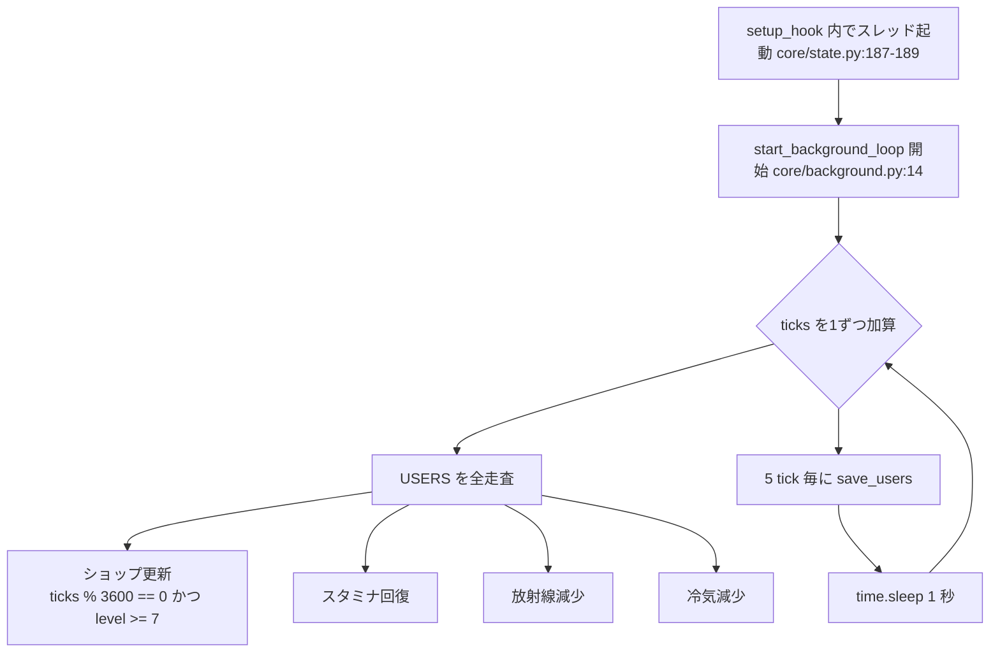

# バックグラウンドジョブ仕様（07-event-processing/scheduled-and-background-jobs）

> **対象機能ID（本仕様）**: JOB-001 / JOB-002
> **対応カタログID**: JOB-TIMESTATE / JOB-PERSIST（機能カタログ §2.4 / §4.2）
> **アクター**: Bot プロセス（デーモンスレッド）、Discord ユーザー（状態変化の受け手）、運営（人間・データ保全の責任者）
> **関連文書**: `00-feature-catalog.md`（§4.2 / §5.1 C-07・C-10・C-17・C-21 / §5.2 U-06・U-09・U-13）、`07-event-processing/lifecycle.md`（EVT-005 / EVT-006）、`08-external-integrations/README.md`
> **一次根拠（現行実装）**: `core/background.py`（:1-99）、`core/utils.py`（:325-374 の `get_stats`, :454-457 の `save_users`）、`core/state.py`（:187-189 のスレッド起動, :26-49 のデータ読込）、`AGENTS.md`（単一レプリカ要請）

本仕様では現行実装の挙動（as-is）と再実装契約（to-be）を分けて記述する。実行時挙動が未確認の項目は「未確定」として区別する。

---

## 1. 概要と起動契機

- バックグラウンド処理は単一のデーモンスレッドで実行される。起動は `setup_hook` 内の `Thread(target=start_background_loop, daemon=True).start()`（`core/state.py:187-189`）で、**ゲートウェイ接続前に開始**される（LIF-002 の step 8）。
- ループ本体は `core/background.py:start_background_loop`（:14-99）。`while True` の無限ループで、末尾の `time.sleep(TICK_RATE)`（:99）により周期を調整する。
- 定数: `TICK_RATE = 1`（:11）、`SAVE_INTERVAL = 5`（:12）。
- 全処理は `asyncio` イベントループ（コマンド/View/Modal ハンドラ）とは**別スレッド**で、`USERS` 辞書を共有参照する。

---

## 2. JOB-001: 時間状態更新（約 1 秒周期）

対応: JOB-TIMESTATE。ループ 1 周ごとに全ユーザーの時間ベース状態を更新する。

### 2.1 周期

- `TICK_RATE = 1`（`core/background.py:11`）で `time.sleep(1)`（:99）。ループ本体の実行時間が加算されるため、**「約 1 秒」**であり厳密な 1 秒周期ではない。
- 1 周で全 USERS を走査する（:22）。ユーザー数が増えると 1 周の実時間が伸び、全ユーザーの更新間隔が伸びる（O(n) 走査）。

### 2.2 状態変化の詳細

共通の枠組み: 各ユーザーの `timestamp`（`stamina` / `radiation` / `cold`）を「回復/減少の進行中か」のフラグ兼スケジュールとして使い、**壁時計（`time.time()`）と比較**して経過分を一括適用する。`-1` は「進行なし」のセンチネル。

#### 2.2.1 ショップ更新（level 7 以上・3600 tick 毎）

- 条件: `ticks % 3600 == 0` かつ `user_data['level_global'] >= 7`（`core/background.py:29`）。`ticks` は 0 から始まるため、**起動直後（ticks=0）に 1 回実行**され、以降はプロセス起動から約 1 時間毎（C-10: 壁時計の 1 時間と同期しない）。
- 処理: `shop_list`（`spawnable_in_shop` タグのアイテム、LIF-002 で構築）のコピーから現在の `shop_content` に含まれるアイテムを除外し、`random.sample(shop_data, 10)` で 10 件を再抽選。`shop_count` を `[0] * 10` に初期化（`core/background.py:30-35`）。
- 前提: `shop_data` の要素数が 10 以上であること。要素が 10 未満だと `random.sample` が `ValueError` を起こし得る（U-06 で未検証）。
- 補足: この再抽選により、**表示済みの購入 View（`shop_choice`）の選択肢が stale 化**し、選択時の `shop_content.index` が `ValueError` になり得る（**C-21**、`views/shop_view.py:27`）。
- 補足: レベル 7 到達時の初回生成はコマンド経由（`core/utils.py:427-429` の `xp()`）で行われる。

#### 2.2.2 スタミナ回復

- `duration = 3600 / stats['stamina_regeneration_rate']`（`core/background.py:41`）。既定値は `stamina_regeneration_rate = 20.0`（`core/utils.py:329`）→ **180 秒 / 1 スタミナ**。
- `timestamp['stamina'] == -1` かつ `stamina < stamina_max` のとき、`timestamp['stamina'] = unix_time` で回復開始を記録（:42-44）。
- `unix_time >= timestamp['stamina'] + duration` のとき、`elapsed = unix_time - timestamp['stamina']`、`stamina += int(elapsed // duration)`（:45-49）。
- オーバーフロー処理: `stamina >= stamina_max` なら `stamina = stamina_max` に丸めて `timestamp = -1`（進行なしに戻す）。未満なら `timestamp['stamina'] += duration`（:51-56）。`timestamp += duration` により端数が次回以降に繰り越される。
- 補足: `stamina_max` は `get_stats` が `100 + level_global - 1` で導出（`core/utils.py:373`）。

#### 2.2.3 放射線減少

- `duration = 3600 / stats['radiation_decrease_rate']`（`core/background.py:59`）。既定値 `radiation_decrease_rate = 3.0`（`core/utils.py:340`）→ **1200 秒 / 1 減少**。
- `timestamp['radiation'] == -1` かつ `radiation > 0` のとき進行を開始（:60-62）。`radiation -= elapsed // duration`（:67）、`radiation <= 0` なら 0 に丸めて `-1`（:70-72）。

#### 2.2.4 冷気減少

- `duration = 3600 / stats['cold_decrease_rate']`（`core/background.py:77`）。既定値 `cold_decrease_rate = 3.0`（`core/utils.py:347`）→ **1200 秒 / 1 減少**。放射線減少と同型（:78-92）。

### 2.3 同期（現行実装）

- バックグラウンドスレッドは `USERS` を直接参照・変更し、`get_stats` / `save_users` も同じ `USERS` を操作する（`core/background.py:8-9`、`core/utils.py:325-457`）。
- コマンド/View/Modal ハンドラ（asyncio イベントループ側）も同じ `USERS` を変更するため、**2 スレッドからの非同期並走**になる。**ロック・シリアライズは存在しない**（カタログ C-07 / U-09）。
- 単一レプリカ運用は `AGENTS.md` が要請済み（同時書込による破損防止）。

### 2.4 停止 / 例外 / 競合（現行実装）

- ループ内に try/except は**ない**。`get_stats` 等で未捕捉例外が起きるとデーモンスレッドが**黙って終了**する（ログなし・監視なし・再起動なし。C-12）。
  - 例: 欠損フィールドを持つユーザーが USERS に混入した場合の `KeyError`、`random.sample` の `ValueError`。
  - **C-17 / U-13**: `USERS.items()` 反復（:22）中に、イベントループ側の `new_user`（`core/utils.py:17` の `USERS.setdefault`）や `admin_transit`（`cogs/admin_transit.py:33-36` の `USERS.pop` / `setdefault`）が**トップレベルキーを追加/削除**すると `RuntimeError: dictionary changed size during iteration` になり、try/except がないためスレッドが終了する。※C-07（`save_users` のファイル書込 race）とは別の**メモリミューテーション race**。発生頻度は未検証（U-13）。
- スレッド停止後も Discord イベントは動き続けるため、**時間状態の更新だけが止まった**状態になる。また JOB-002 の 5 秒毎保存も停止する（コマンド起因の `save_users` のみが残る）。
- プロセス終了時（EVT-006）はデーモンのため強制終了。最終保存が保証されない。

### 2.5 再実装契約（to-be）

- **周期**: 「約 1 秒」を許容するか、タイムスタンプベースの固定周期（次の実行時刻 = 前回 + 1 秒）にするかを明示する。ユーザー数が多く 1 周が 1 秒を超える場合の挙動（スキップ / 遅延許容）を定義する。
- **状態変化**:
  - ショップ更新は tick 基準（C-10）を廃止し、壁時計基準（例: 前回更新時刻 + 3600 秒）にする。再起動で周期がずれないようにする。
  - スタミナ/放射線/冷気の更新式（`duration = 3600 / rate`、`elapsed // duration`、端数は `timestamp += duration` で繰り越し）を維持するか再定義する。数値のバランス意図（U-12）を仕様化する。
  - 更新を 1 ユーザー単位で atomic に（途中で例外が起きても他ユーザーへの影響を分離）。
- **例外**: ループ内の例外を捕捉し `logging` で記録する。1 ユーザー分の処理失敗でループ全体が落ちないようにする（ユーザー単位 try/except）。スレッド異常終了の監視（ハートビート / 死活監視）を導入する（C-12 解決）。
- **競合**: `USERS` への書き込みをロック（またはイベントループへの委譲）で直列化し、ハンドラとの並走を安全にする（C-07 / U-09 解決）。
- **起動時**: ticks=0 での即時ショップ更新を廃止するか、仕様として明記する。

---

## 3. JOB-002: ユーザーデータ永続化（約 5 秒周期）

対応: JOB-PERSIST。`save_users()` で `user.json` へ書き出す。

### 3.1 周期

- `SAVE_INTERVAL = 5`（`core/background.py:12`）。`ticks += 1` 後に `ticks % SAVE_INTERVAL == 0` で判定（:95-96）するため、**5 tick 毎（約 5 秒毎）**に実行される。初回は ticks=5（起動から約 5 秒後）。

### 3.2 書き込み方式（現行実装）

- `save_users()`（`core/utils.py:454-457`）は `user.json` へ**直接** `json.dump(USERS, f, indent=2, ensure_ascii=False)` を実行する。
- **一時ファイル + rename はなく、ロックもない**（カタログ C-07）。書き込み中のクラッシュ・同時書き込みでファイルが破損するリスクがある。
- Docker では `data/user.json` は `/app/runtime/user.json` への相対シンボリックリンク（`Dockerfile:36`、`docker-entrypoint.sh:18-29` で初期化・権限保証）であり、永続化先は `bot_runtime` ボリューム（`compose.yaml:29`）。

### 3.3 並走する保存（現行実装）

JOB-002 だけでなく、コマンド/View/Modal ハンドラも随時 `save_users()` を呼ぶ（grep 確認済みの呼び出し元）:

- コグ: `cogs/equip.py:92`、`cogs/settings.py:43,61`、`cogs/refuel.py:41`、`cogs/use.py:96`、`cogs/gather.py:175`、`cogs/fishing.py:162`、`cogs/admin_give.py:51`、`cogs/admin_transit.py:42`、`cogs/admin_manage.py:51`
- View: `views/settings_view.py:31,67,103`、`views/equip_view.py:95`、`views/shop_view.py:57`、`views/status_view.py:234`
- Modal: `modals/craft_modal.py:186`、`modals/sell_modal.py:64`、`modals/settings_modal.py:24`

これらと JOB-002 が**同じファイルに並行書き込み**し得る（競合の要因、C-07）。

### 3.4 停止 / 例外 / 競合（現行実装）

- ディスクフル・権限エラー・シンボリックリンク破損等の保存失敗は未捕捉（ループ外では try/except なし）で、スレッド停止 or ハンドラの例外になる。
- 5 秒間隔のため、クラッシュ / kill 時は**最大約 5 秒分の状態が失われ得る**。シャットダウン時の最終保存はない（EVT-006）。
- 2 プロセス同時起動は `AGENTS.md` が禁止（単一レプリカ）。破損実挙動は未検証（U-09）。

### 3.5 再実装契約（to-be）

- **atomic 化**: 一時ファイル（例: `user.json.tmp`）に書き込み、`os.replace` で置換する。書き込み中クラッシュでも旧ファイルを保持する（C-07 解決）。
- **直列化**: 保存の排他（ロック or 保存キュー）を導入し、JOB-002 とハンドラ起因の保存が同時に走らないようにする（C-07 / U-09 解決）。
- **保存タイミング**: シャットダウン時（SIGTERM/SIGINT）の最終保存を契約化（EVT-006 と共通）。保存間隔（5 秒）は失われる状態量の上限として明示する。
- **失敗時**: 保存失敗を `logging` で記録し、退避（破損防止）方針を定義する。
- **運用**: 単一レプリカ運用を継続し、多重起動は起動前ガード（ロックファイル等）で防ぐ（U-09 解決）。

---

## 4. スレッドモデルと同期の現状まとめ

| 項目 | 現行実装 | 根拠 | 再実装契約の方向 |
|---|---|---|---|
| 実行形態 | 単一デーモンスレッド（asyncio とは別） | `core/state.py:187-189` | 監視可能なワーカー（死活監視付き） |
| 周期 | `time.sleep(1)` による約 1 秒 | `core/background.py:11,99` | 固定周期 or 遅延許容の明示 |
| USERS へのアクセス | ロックなしの並走 | `core/background.py:22`, `core/utils.py:325-457` | 直列化（ロック or 委譲） |
| 例外 | 未捕捉でスレッド終了（黙殺） | `core/background.py:14-99`（try なし） | ユーザー単位 try + logging + 監視 |
| 保存 | 直接 `json.dump`（atomic なし） | `core/utils.py:454-457` | 一時ファイル + `os.replace` |
| 保存の多重性 | ジョブとハンドラが並行書き込み | §3.3 の呼び出し元一覧 | 排他制御 |
| 多重起動 | 禁止要請のみ（実装上のガードなし） | `AGENTS.md` | 起動前ガード |

---

## 5. 未確定事項

| ID | 項目 | 内容 | 確定に必要な確認 |
|---|---|---|---|
| U-06 | ショップ再抽選の件数整合 | `random.sample(shop_data, 10)` が要素 10 未満で `ValueError` を起こさないか（現状 `shop_list` 31 件で安全圏の見込み） | ローテーション実行の観察 |
| U-09 | 複数インスタンス同時実行 | 並行書き込みの破損実挙動（現状は単一レプリカ要請のみ） | 多重起動テスト |
| U-12 | ゲームバランス数値 | 回復レート（20.0 / 3.0 / 3.0）や 3600 tick が意図されたバランスか | Phase2 での仕様定義 |
| U-13 | C-17 の race 発生頻度 | `USERS.items()` 反復と `new_user` / `admin_transit` の top-level mutation の重なり頻度（必発ではない） | 新規登録・`admin_transit` 実行下での観察 / 競合テスト |
| — | 1 周の実時間 | ユーザー数増加による 1 周の実測時間と、それによる実質更新間隔の伸び | 負荷計測 |
