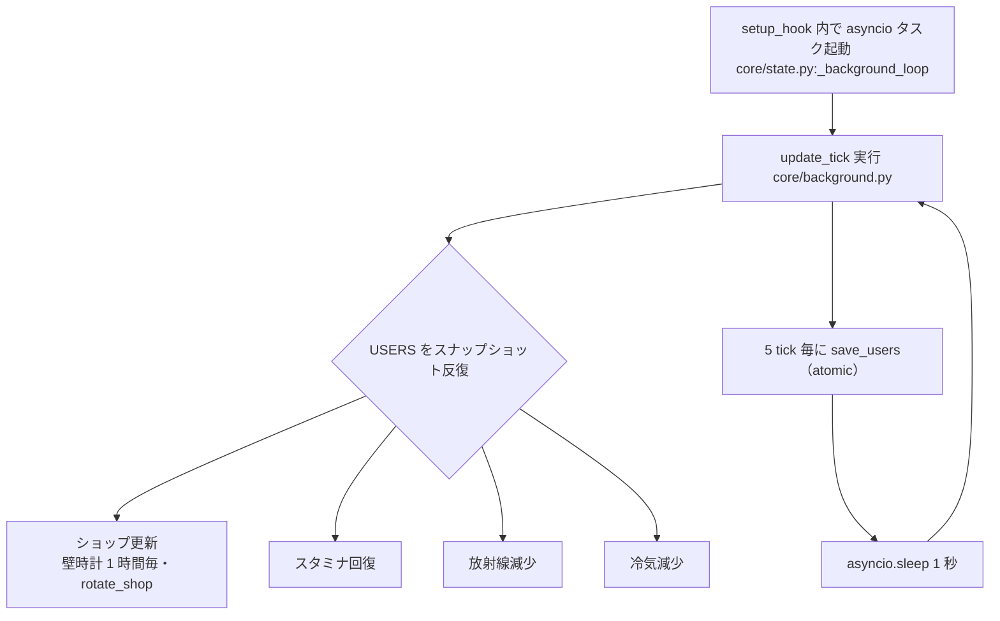

# バックグラウンドジョブ仕様（07-event-processing/scheduled-and-background-jobs）

> **対象機能ID（本仕様）**: JOB-001 / JOB-002
> **対応カタログID**: JOB-TIMESTATE / JOB-PERSIST（機能カタログ §2.4 / §4.2）
> **アクター**: Bot プロセス（デーモンスレッド）、Discord ユーザー（状態変化の受け手）、運営（人間・データ保全の責任者）
> **関連文書**: `00-feature-catalog.md`（§4.2 / §5.1 C-07・C-10・C-17・C-21 / §5.2 U-06・U-09・U-13）、`07-event-processing/lifecycle.md`（EVT-005 / EVT-006）、`08-external-integrations/README.md`
> **一次根拠（現行実装）**: `core/background.py`（:1-99）、`core/utils.py`（:325-374 の `get_stats`, :454-457 の `save_users`）、`core/state.py`（:187-189 のスレッド起動, :26-49 のデータ読込）、`AGENTS.md`（単一レプリカ要請）

本仕様では現行実装の挙動（as-is）と再実装契約（to-be）を分けて記述する。実行時挙動が未確認の項目は「未確定」として区別する。

---

## 1. 概要と起動契機

- バックグラウンド処理は **Bot イベントループ上の asyncio タスク**（`core/state.py:_background_loop`、`self.loop.create_task`）で実行される（旧実装はデーモンスレッド。**2026-08-07 変更**）。起動は `setup_hook` 内で行われる。
- ループ本体は `core/background.py:update_tick`（1 ティック分の更新関数）。`Bot._background_loop` が `while True` で `update_tick()` を呼び、`asyncio.sleep(TICK_RATE)` で周期を調整する。
- 定数: `TICK_RATE = 1`（`core/background.py`）、`SAVE_INTERVAL = 5`（`core/background.py`）。
- **2026-08-07 修正**: `update_tick` は `list(USERS.keys())` のスナップショットで反復し、ユーザー単位の例外は捕捉して `logger.exception` で記録しループを継続（**C-17 解決**）。`Bot._background_loop` もティック・保存の例外を捕捉してループを停止させない（**C-12 解決**）。

---

## 2. JOB-001: 時間状態更新（約 1 秒周期）

対応: JOB-TIMESTATE。ループ 1 周ごとに全ユーザーの時間ベース状態を更新する。

### 2.1 周期

- `TICK_RATE = 1`（`core/background.py:11`）で `time.sleep(1)`（:99）。ループ本体の実行時間が加算されるため、**「約 1 秒」**であり厳密な 1 秒周期ではない。
- 1 周で全 USERS を走査する（:22）。ユーザー数が増えると 1 周の実時間が伸び、全ユーザーの更新間隔が伸びる（O(n) 走査）。

### 2.2 状態変化の詳細

共通の枠組み: 各ユーザーの `timestamp`（`stamina` / `radiation` / `cold`）を「回復/減少の進行中か」のフラグ兼スケジュールとして使い、**壁時計（`time.time()`）と比較**して経過分を一括適用する。`-1` は「進行なし」のセンチネル。

#### 2.2.1 ショップ更新（level 7 以上・壁時計 1 時間毎）

- **2026-08-07 決定**: ショップ更新は **壁時計の 1 時間毎**（ユーザー決定・C-10 解決）。`core/utils.py:rotate_shop` が `int(now // 3600)` の壁時計時間を基準に、ユーザーごとの `last_rotation_hour` で同一時間内の再抽選を防ぐ（べき等）。
- 処理: `rotate_shop(user_data, now)` が、前回内容と重複しない候補（`candidates >= 10` 時）から `random.sample(candidates, 10)` で再抽選。候補不足時は全 `shop_list` から `min(10, len(shop_list))` で安全に処理（**U-06 解決**）。`shop_count` を `[0] * len(new_content)` に初期化。
- 未初期化（`shop_content` が空）のレベル 7+ ユーザーは初期化する。
- 補足: 表示済みの購入 View（`shop_choice`）の選択肢が stale 化した場合、`views/shop_view.py:shop_buy` が `item_id not in shop_content` を先に判定し安全に応答する（**C-21 解決**）。
- 補足: レベル 7 到達時の初回生成も `rotate_shop` を呼ぶ（`core/utils.py:xp`）。

#### 2.2.2 スタミナ回復

- `duration = 3600 / stats['stamina_regeneration_rate']`（`core/background.py:41`）。既定値は `stamina_regeneration_rate = 20.0`（`core/utils.py:329`）→ **180 秒 / 1 スタミナ**。
- `timestamp['stamina'] == -1` かつ `stamina < stamina_max` のとき、`timestamp['stamina'] = unix_time` で回復開始を記録（:42-44）。
- `unix_time >= timestamp['stamina'] + duration` のとき、`elapsed = unix_time - timestamp['stamina']`、`stamina += int(elapsed // duration)`（:45-49）。
- オーバーフロー処理: `stamina >= stamina_max` なら `stamina = stamina_max` に丸めて `timestamp = -1`（進行なしに戻す）。未満なら `timestamp['stamina'] += duration`（:51-56）。`timestamp += duration` により端数が次回以降に繰り越される。
- 補足: `stamina_max` は `get_stats` が `100 + level_global - 1` で導出（`core/utils.py:373`）。

#### 2.2.3 放射線減少

- `duration = 3600 / stats['radiation_decrease_rate']`（`core/background.py:59`）。既定値 `radiation_decrease_rate = 3.0`（`core/utils.py:340`）→ **1200 秒 / 1 減少**。
- `timestamp['radiation'] == -1` かつ `radiation > 0` のとき進行を開始（:60-62）。`radiation -= elapsed // duration`（:67）、`radiation <= 0` なら 0 に丸めて `-1`（:70-72）。

#### 2.2.4 冷気減少

- `duration = 3600 / stats['cold_decrease_rate']`（`core/background.py:77`）。既定値 `cold_decrease_rate = 3.0`（`core/utils.py:347`）→ **1200 秒 / 1 減少**。放射線減少と同型（:78-92）。

### 2.3 同期（現行実装）

- バックグラウンドタスクは `USERS` を直接参照・変更し、`get_stats` / `save_users` も同じ `USERS` を操作する（`core/background.py`、`core/utils.py`）。
- コマンド/View/Modal ハンドラ（asyncio イベントループ側）も同じ `USERS` を変更する。**2026-08-07 修正**: トップレベル `USERS` の構造ミューテーション（追加/削除）は `core/utils.py:_users_lock` で直列化し、`save_users` は `_save_lock` で直列化（**C-07 解決**）。
- 単一レプリカ運用は `AGENTS.md` が要請済み。加えて `core/state.py:acquire_state_lock` が起動時に多重起動を拒否（**U-09 解決**）。

### 2.4 停止 / 例外 / 競合（現行実装）

- **2026-08-07 修正**: `update_tick` は `list(USERS.keys())` のスナップショットで反復し、ユーザー単位の例外は捕捉して `logger.exception` で記録しループを継続（**C-17 解決**）。`Bot._background_loop` もティック・保存の例外を捕捉してループを停止させない（**C-12 解決**）。
- 旧実装（デーモンスレッド・`USERS.items()` 反復・try/except なし）は、`new_user` / `admin_transit` によるトップレベルキー追加/削除で `RuntimeError` になりスレッドが黙って終了する問題があった（**C-17**）。これはスナップショット反復 + `_users_lock` で解消済み。発生頻度の実機観察は U-13 として延期。
- プロセス終了時（EVT-006）は `Bot.close` がバックグラウンドタスクをキャンセルしてから閉じる。

### 2.5 再実装契約（to-be）

> **2026-08-07 更新**: 下記のうち多くは実装済み（解決）。残る未確定は §5 参照。

- **周期**: 「約 1 秒」を許容するか、タイムスタンプベースの固定周期にするかを明示する。ユーザー数が多く 1 周が 1 秒を超える場合の挙動（スキップ / 遅延許容）を定義する。
- **状態変化**:
  - ショップ更新は tick 基準（C-10）を廃止し、壁時計基準にする。**実装済み**（`rotate_shop`、壁時計 1 時間毎・`last_rotation_hour` でべき等）。
  - スタミナ/放射線/冷気の更新式（`duration = 3600 / rate`、`elapsed // duration`、端数は `timestamp += duration` で繰り越し）を維持する。数値のバランス意図（U-12）は**文書化された契約として維持**（2026-08-07 決定）。
  - 更新を 1 ユーザー単位で atomic に（途中で例外が起きても他ユーザーへの影響を分離）。**実装済み**（ユーザー単位 try/except）。
- **例外**: ループ内の例外を捕捉し `logging` で記録する。1 ユーザー分の処理失敗でループ全体が落ちないようにする。**実装済み**（`update_tick` のユーザー単位 try/except + `logger.exception`、`Bot._background_loop` のティック/保存 try/except）。
- **競合**: `USERS` への書き込みをロックで直列化する。**実装済み**（`_users_lock` / `_save_lock`）。
- **起動時**: ticks=0 での即時ショップ更新を廃止するか、仕様として明記する。**実装済み**（壁時計基準のため起動直後の即時更新は発生しない）。

---

## 3. JOB-002: ユーザーデータ永続化（約 5 秒周期）

対応: JOB-PERSIST。`save_users()` で `user.json` へ書き出す。

### 3.1 周期

- `SAVE_INTERVAL = 5`（`core/background.py:12`）。`ticks += 1` 後に `ticks % SAVE_INTERVAL == 0` で判定（:95-96）するため、**5 tick 毎（約 5 秒毎）**に実行される。初回は ticks=5（起動から約 5 秒後）。

### 3.2 書き込み方式（現行実装）

- **2026-08-07 修正**: `save_users()`（`core/utils.py`）は `_save_lock` 下で `USERS` の**深いスナップショット**を取得し、一時ファイル（`user.json.tmp`）へ `json.dump` → `flush` → `fsync` → `os.replace` で**原子的に置換**する（**C-07 解決**）。対象パスは状態ファイルの実体ディレクトリ（Docker では `/app/runtime/user.json` への symlink 先）に解決される。
- Docker では `data/user.json` は `/app/runtime/user.json` への相対シンボリックリンク（`Dockerfile:36`、`docker-entrypoint.sh:18-29` で初期化・権限保証）であり、永続化先は `bot_runtime` ボリューム（`compose.yaml:29`）。

### 3.3 並走する保存（現行実装）

JOB-002 だけでなく、コマンド/View/Modal ハンドラも随時 `save_users()` を呼ぶ（grep 確認済みの呼び出し元）:

- コグ: `cogs/equip.py`、`cogs/settings.py`、`cogs/refuel.py`、`cogs/use.py`、`cogs/gather.py`、`cogs/fishing.py`、`cogs/admin_give.py`、`cogs/admin_transit.py`、`cogs/admin_manage.py`
- View: `views/settings_view.py`、`views/equip_view.py`、`views/shop_view.py`、`views/status_view.py`
- Modal: `modals/craft_modal.py`、`modals/sell_modal.py`、`modals/settings_modal.py`

これらと JOB-002 は `_save_lock` で**直列化**される（**C-07 解決**）。

### 3.4 停止 / 例外 / 競合（現行実装）

- **2026-08-07 修正**: 保存失敗は `Bot._background_loop` の try/except で捕捉し `logger.exception` で記録（ループは継続）。コマンド起因の保存失敗は各ハンドラの `on_error` / `BotTree.on_error` で記録される（**C-12 解決**）。
- 5 秒間隔のため、クラッシュ / kill 時は**最大約 5 秒分の状態が失われ得る**。シャットダウン時の最終保存はない（EVT-006）。
- 2 プロセス同時起動は `AGENTS.md` が禁止（単一レプリカ）。加えて `acquire_state_lock` が起動時に多重起動を拒否（**U-09 解決**）。

### 3.5 再実装契約（to-be）

> **2026-08-07 更新**: 下記のうち多くは実装済み（解決）。残る未確定は §5 参照。

- **atomic 化**: 一時ファイル（例: `user.json.tmp`）に書き込み、`os.replace` で置換する。**実装済み**（`save_users`）。
- **直列化**: 保存の排他（ロック）を導入し、JOB-002 とハンドラ起因の保存が同時に走らないようにする。**実装済み**（`_save_lock`）。
- **保存タイミング**: シャットダウン時（SIGTERM/SIGINT）の最終保存を契約化（EVT-006 と共通）。保存間隔（5 秒）は失われる状態量の上限として明示する。**未実装**（`Bot.close` はタスクをキャンセルするが最終保存はしない）。
- **失敗時**: 保存失敗を `logging` で記録する。**実装済み**（`logger.exception`）。
- **運用**: 単一レプリカ運用を継続し、多重起動は起動前ガード（ロックファイル等）で防ぐ。**実装済み**（`acquire_state_lock`）。

---

## 4. スレッドモデルと同期の現状まとめ

| 項目 | 現行実装 | 根拠 | 再実装契約の方向 |
|---|---|---|---|
| 実行形態 | **asyncio タスク**（`Bot._background_loop`、旧デーモンスレッド） | `core/state.py:_background_loop` | 監視可能なワーカー（死活監視付き） |
| 周期 | `asyncio.sleep(1)` による約 1 秒 | `core/background.py` | 固定周期 or 遅延許容の明示 |
| USERS へのアクセス | `_users_lock` で構造ミューテーションを直列化 | `core/background.py:update_tick`, `core/utils.py:_users_lock` | 直列化（実装済み） |
| 例外 | ユーザー単位 try/except + `logger.exception`（ループ継続） | `core/background.py:update_tick`, `core/state.py:_background_loop` | ユーザー単位 try + logging（実装済み） |
| 保存 | 一時ファイル + `fsync` + `os.replace`（atomic） | `core/utils.py:save_users` | atomic 化（実装済み） |
| 保存の多重性 | `_save_lock` で直列化 | `core/utils.py:_save_lock` | 排他制御（実装済み） |
| 多重起動 | `acquire_state_lock`（POSIX flock）で起動時拒否 | `core/state.py:acquire_state_lock` | 起動前ガード（実装済み） |

---

## 5. 未確定事項

| ID | 項目 | 内容 | 確定に必要な確認 | 状態 |
|---|---|---|---|---|
| U-06 | ショップ再抽選の件数整合 | `rotate_shop` が候補不足（10 未満）でも安全に処理する（`min(10, len(shop_list))`）。実行時の重複・偏りは未検証 | ローテーション実行の観察 | コード解決済。実機確認は**延期** |
| U-09 | 複数インスタンス同時実行 | `acquire_state_lock` が起動時ロックで多重起動を拒否。実挙動は未検証 | 多重起動テスト | コード解決済。実機確認は**延期** |
| U-12 | ゲームバランス数値 | 回復レート（20.0 / 3.0 / 3.0）等は**文書化された契約として維持**（2026-08-07 決定） | — | **解決済（決定）** |
| U-13 | C-17 の race 発生頻度 | `list(USERS.keys())` スナップショット反復でコード解決済。実機観察は未実施 | 新規登録・`admin_transit` 実行下での観察 / 競合テスト | コード解決済。実機観察は**延期** |
| — | 1 周の実時間 | ユーザー数増加による 1 周の実測時間と、それによる実質更新間隔の伸び | 負荷計測 | 未解決（延期） |

---

## 2026-10-15 追加: JOB-AUCTION-EXPIRY

`core/__init__.py` は通常状態読込・ジャーナル復旧後、Discord接続前に `expire_auctions()` を実行する。`core/background.py:update_tick` でも毎秒実行する。`now >= expires_at` の出品をまとめて返却・削除し、二ファイル取引として保存する。購入・取消画面の操作時も同じ期限境界で拒否する。繰り返し実行しても二重返却しない。
