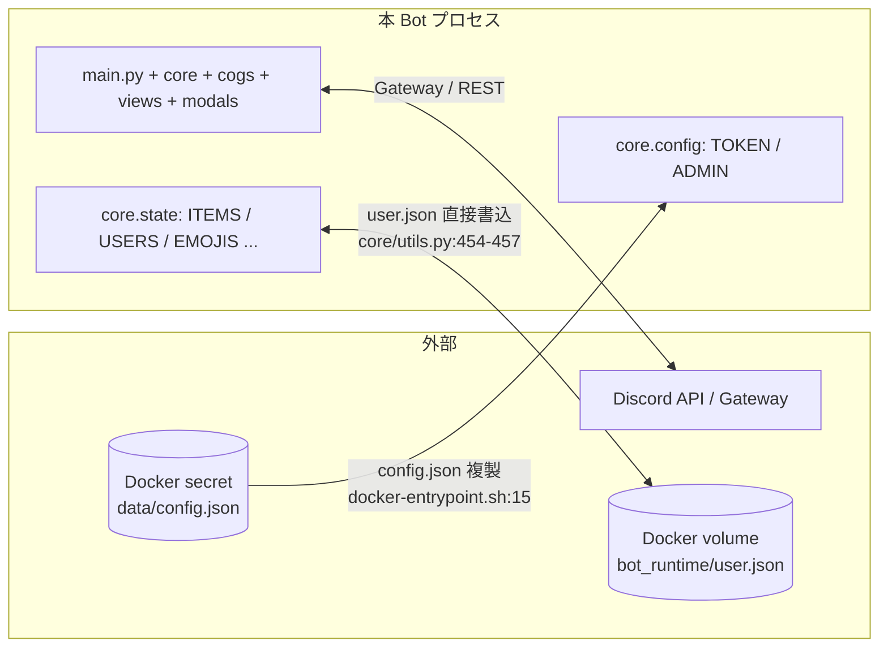

# 外部統合仕様 全体案内（08-external-integrations/README）

> **対象機能ID**: EXT-001（Discord 外部統合）、関連: LIFE-EMOJI / LIFE-TREESYNC / LIFE-ONREADY / CTX-USER-INIT / OPS-CONFIG（うち外部境界）
> **対応カタログID**: EXT-DISCORD / LIFE-EMOJI / LIFE-TREESYNC / LIFE-ONREADY / CTX-USER-INIT / OPS-CONFIG（機能カタログ §2.4 / §4.3）
> **アクター**: Discord API（Gateway / REST）、Discord ユーザー、運営（人間・Docker 運用）
> **関連文書**: `00-feature-catalog.md`（§1.3 / §4.3 / §5）、`08-external-integrations/discord.md`（EXT-001 詳細）、`07-event-processing/lifecycle.md`、`07-event-processing/scheduled-and-background-jobs.md`
> **一次根拠（現行実装）**: `core/state.py`（:84-90, :92-193, :195-201）、`core/utils.py`（:15-55 の `new_user`）、`main.py`（:6-7）、`core/config.py`（:9-20）、`compose.yaml`（:1-41）、`Dockerfile`（:28-43）、`docker-entrypoint.sh`（:1-32）

---

## 1. 外部連携の定義と境界

「外部統合」とは、本 Bot のプロセス外にある**リソース・サービスとの通信**を指す。現行実装の外部連携は**Discord API のみ**であり、それ以外の外部サービス（DB・Web API・HTTP サーバ・Web UI・他社サービス）は存在しない（機能カタログ §4.3 の結論と一致）。

### 1.1 含まれるもの

| 連携先 | 種別 | 用途 | 通信手段 | 詳細文書 |
|---|---|---|---|---|
| Discord API（Gateway） | 外部サービス | アプリコマンド受信・View/Modal インタラクション・存在感（presence） | WebSocket（常時接続） | `discord.md` EXT-001 |
| Discord API（REST） | 外部サービス | アプリ絵文字取得・コマンドツリー同期・ユーザー情報取得（`fetch_user`） | HTTPS | `discord.md` EXT-001 |
| Docker secret | 運用リソース | `data/config.json` の秘密値提供（`token` / `admin[].id`） | read-only ファイルマウント | [`10-deployment-and-operations.md`](../10-deployment-and-operations.md) |
| Docker volume（`bot_runtime`） | 運用リソース | `user.json` の永続化 | ボリュームマウント | [`10-deployment-and-operations.md`](../10-deployment-and-operations.md) |

### 1.2 含まれないもの（境界外）

- **DB・永続化基盤**: 可変状態は `data/user.json`（ファイル）のみ。RDB / KV / キャッシュ等はなし（`AGENTS.md`・カタログ §1.2）。
- **HTTP サーバ / REST API 提供**: Bot が外部へ API を公開しない。外向き通信は Discord 宛のみ。
- **Web UI**: 管理画面等はなし。
- **認証基盤**: 本人認証は Discord の本人性に依存。本 Bot 独自の認証は持たない。
- **外部のゲームデータ / アセット配信**: ゲームデータはリポジトリ内の静的 JSON 7 種のみ。外部ロードなし。
- **メッセージコンテンツによる操作**: `!` プレフィックスは設定されている（`core/state.py:90`）が、プレフィックス/メッセージベースのコマンドは登録されておらず、Discord メッセージのゲーム操作は行わない（カタログ §1.2 / §3.4）。

### 1.3 境界の分界（誰が通信を担うか）

| 層 | 責務 | 現行実装 |
|---|---|---|
| discord.py ライブラリ（2.6.4） | Gateway 接続・自動再接続・REST クライアント・HTTP レート制限・ツリー照合・イベントディスパッチ | `requirements.txt:7` / `requirements.lock:7`。本リポジトリのコードはこの上で動作 |
| 本 Bot のコード | 初期化オーケストレーション（LIF-*）、ハンドラ登録（CMD-*/VIEW-*/MODAL-*）、`fetch_application_emojis` / `tree.sync` / `change_presence` / `fetch_user` の**呼び出し** | `core/state.py` / `core/utils.py` / `cogs/` / `views/` / `modals/` |
| 運用（Docker） | 秘密値と永続データの供給 | `compose.yaml` / `Dockerfile` / `docker-entrypoint.sh` |

レート制限・再試行の内部挙動は discord.py が内蔵する（HTTP 429 の待機・グローバルレート制限等）。本 Bot 側に自前のレート制限/再試行コードは**存在しない**。コマンド実行間隔・同時実行数の制御（cooldown / `max_concurrency`）も存在しない（**C-19**、導入要否・値は U-15）。ライブラリ内部の詳細仕様は本リポジトリの一次根拠外であり、必要な場合は「未確定」として扱う（`discord.md` に詳細）。

---

## 2. 外部通信の一覧（現行実装・一次根拠つき）

| # | 通信 | 方向 | 呼び出し箇所（一次根拠） | 失敗時の現行挙動 | 詳細 |
|---|---|---|---|---|---|
| 1 | Gateway 接続・自動再接続 | Bot → Discord | `main.py:7`（`bot.run(TOKEN)`、`core/state.py:90` の Bot 生成） | ライブラリ責務（再試行詳細は未確定） | `discord.md` EXT-001-A |
| 2 | アプリコマンド受信（slash） | Discord → Bot | 各 `cogs/*.py`（`cogs/__init__.py:6-23` の EXTENSIONS） | エラーハンドラ未登録 → Interaction Failed（C-12） | `discord.md` EXT-001-B / `lifecycle.md` EVT-002 |
| 3 | View / Modal インタラクション | Discord → Bot | `views/*.py` / `modals/*.py`（`views/__init__.py` / `modals/__init__.py`） | 同上 | `discord.md` EXT-001-B / `lifecycle.md` EVT-003・EVT-004 |
| 4 | ユーザー情報取得 | Bot → Discord（REST） | `core/utils.py:18`（`bot.fetch_user` in `new_user`） | 例外がコマンドに伝播し失敗（**C-18**、例外型・UI は U-14） | `discord.md` EXT-001-C |
| 5 | アプリ絵文字取得 | Bot → Discord（REST） | `core/state.py:97-102`（`fetch_application_emojis`） | 例外が setup_hook を伝播し起動失敗 | `discord.md` EXT-001-D / `lifecycle.md` LIF-002 |
| 6 | コマンドツリー同期 | Bot → Discord（REST） | `core/state.py:192`（`tree.sync()`、guild 指定なし） | 例外が setup_hook を伝播し起動失敗 | `discord.md` EXT-001-E / `lifecycle.md` LIF-002 |
| 7 | 存在感（presence）設定 | Bot → Discord（Gateway） | `core/state.py:199`（`change_presence`） | `except: pass` で握りつぶし（ログなし） | `discord.md` EXT-001-F / `lifecycle.md` EVT-001 |

---

## 3. データの出入り（境界の具体像）

- **入力**: Discord からのイベント（コマンド・View・Modal・Gateway 接続）、Docker secret（設定）、volume（保存済みユーザー状態）。
- **出力**: Discord への応答（メッセージ・Modal・presence・コマンド定義・絵文字参照）、volume への `user.json` 保存。
- **非機能**: 秘密実値（Discord token・個人 ID）は本仕様書群に記載しない（`config.json.example` の構造のみを根拠とする）。

---

## 4. 主な懸念（外部連携に関わる C-* / U-*）

| ID | 内容 | 関連連携 | 詳細 |
|---|---|---|---|
| C-07 | 非 atomic・無 lock 永続化（外部 volume への書込） | Docker volume | `jobs` 文書 JOB-002 |
| C-08 | `user.json` 読込の裸 except（起動時の外部データ読込） | Docker volume | `lifecycle.md` LIF-001 |
| C-10 | tick 基準ショップ更新（時間整合） | — | `jobs` 文書 JOB-001 |
| C-12 | エラー/観測不足（print のみ・ハンドラ未登録） | 全連携 | [`07-event-processing/lifecycle.md`](../07-event-processing/lifecycle.md) / [`09-error-handling-and-observability.md`](../09-error-handling-and-observability.md) |
| C-18 / U-14 | `new_user` の `fetch_user` 失敗が未捕捉（例外型・UI は U-14） | Discord REST | `discord.md` EXT-001-C |
| U-01 | deepmerge 欠落によるコグロード失敗（Docker） | — | `lifecycle.md` LIF-002 |
| U-04 / U-05 | インタラクション応答の実挙動 | Discord REST | `lifecycle.md` EVT-003・EVT-004 |
| U-08 | アプリ絵文字フォールバックの見え方 | Discord REST | `discord.md` EXT-001-D |
| U-09 | 複数インスタンス同時実行 | Docker volume | `jobs` 文書 |

---

## 5. 参照関係

- **EXT-001 詳細**: `08-external-integrations/discord.md`
- **起動フェーズとの関係**: `07-event-processing/lifecycle.md`（LIF-002 の step 2 / 9、EVT-001）
- **バックグラウンド処理との関係**: `07-event-processing/scheduled-and-background-jobs.md`
- **データ構造・運用**: [`04-data-model.md`](../04-data-model.md) / [`03-runtime-and-configuration.md`](../03-runtime-and-configuration.md)
